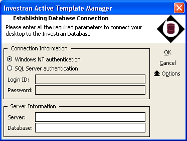
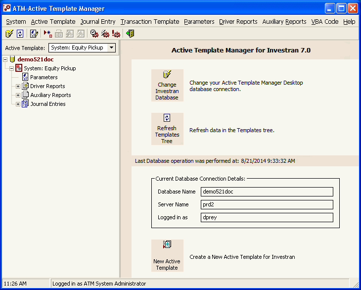
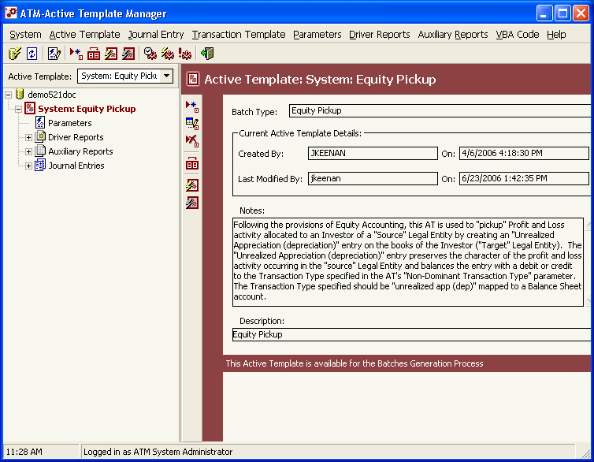
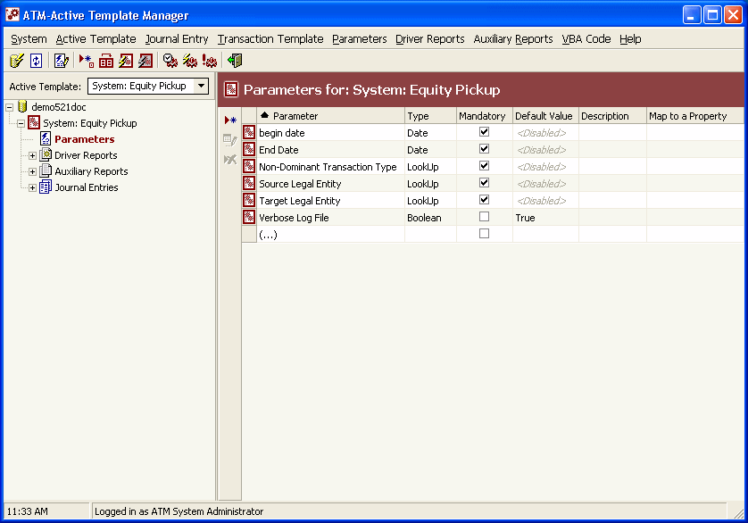
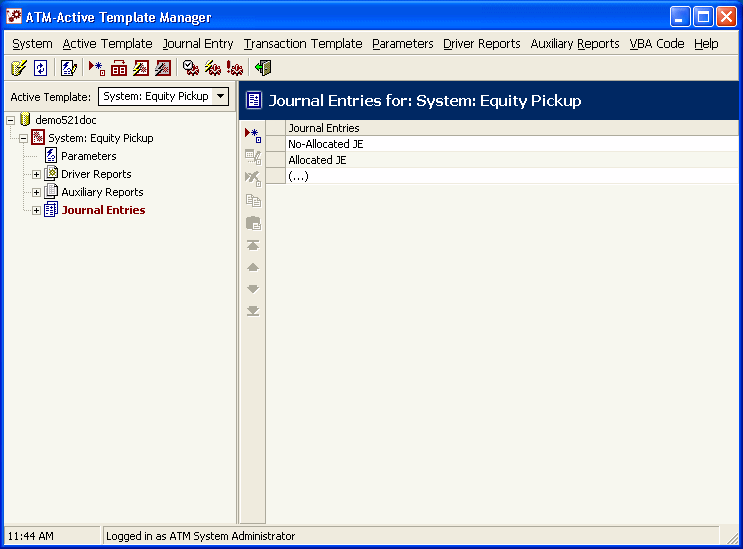
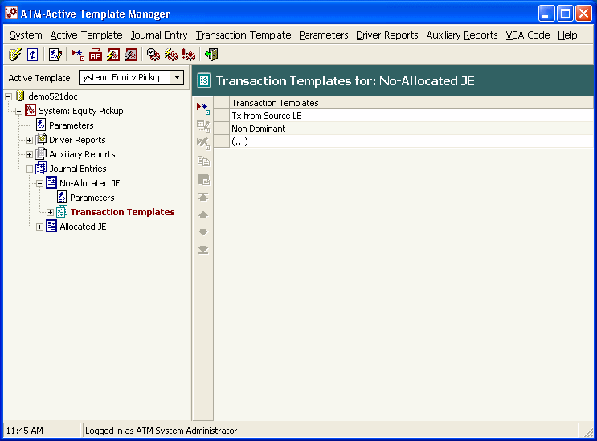
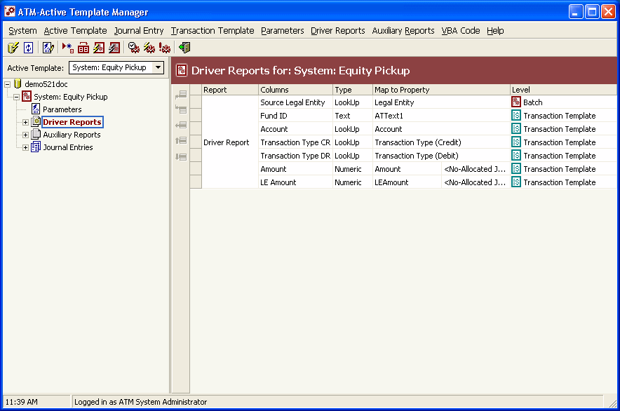
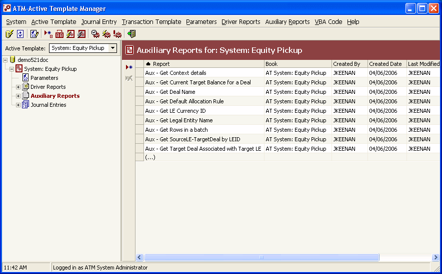
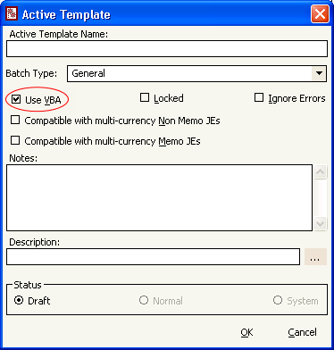

# Active Template Manager - interface, access, and navigation

## Where to find it

The standard product provides a desktop application called **Active Template Manager (ATM)**. Opening it displays a login screen similar to those in Investran and Report Wizard. Enter the database details and click `OK`.



*ATM connection screen. Confirm the server, database, and authentication method before proceeding. Source: Investran 7 Developer's Guide to Active Template Manager, p. 3.*

The manual does not specify the executable or shortcut path for each client. Record the following during KT:

- server or workstation where ATM is installed;
- shortcut/executable name and version;
- DEV, UAT, and PROD databases;
- how to visually identify each environment;
- required Team Security entitlements.

## How to locate an Active Template

After connecting, ATM loads the templates available in the database. Use the Active Templates dropdown in the main panel and select the required name.



*Main screen after connection, with the template tree on the left, actions in the center, and database information on the right. Source: ATM guide, p. 10.*

When selecting an AT, check the right panel for:

- creator and created date/time;
- last modified by and last modified date/time;
- notes;
- Batch Type;
- status: `Draft`, `Normal`, or `System`.



*Details of the selected template, including Batch Type, dates, Notes, Description, and status warning. Source: ATM guide, p. 11.*

The manual does not document searching by ID. If templates have similar names, confirm their attributes, dependencies, Batch Type, and consumer before editing.

## Template tree

```text
Active Template
├── Parameters
├── Driver Reports (up to 3)
│   ├── Columns
│   └── Parameters
├── Auxiliary Reports (unlimited)
│   ├── Columns
│   └── Parameters
└── Journal Entries
    └── Transaction Templates
```

Select a node on the left to view its details in the right panel. Expand reports to check columns and parameters.



*Parameters node selected in the tree. The grid lets you check the type, required status, default, and property mapping. Source: ATM guide, p. 12.*

## Main menus

### System

| Option | Action |
|---|---|
| `Change Database` | reopens the login screen to switch databases |
| `Refresh Tree` | reloads templates and metadata since the last login/refresh |
| `Exit` | closes ATM |

### Process Maintenance

| Option | Action |
|---|---|
| `Processes Notification` | configures generation, commit, or failure notifications |
| `Batch Generation` | monitors the generation phase in Staging |
| `Commit Transactions` | monitors the transfer phase to Investran |

### Active Template

| Option | Action | Note |
|---|---|---|
| `Add` | creates an AT | initially in `Draft` |
| `Edit` | changes attributes | unavailable while another user is running the AT |
| `Delete` | deletes an AT | unavailable while the AT is running |
| `Duplicate` | creates a copy | use as a safe baseline according to local conventions |
| `Run` | schedules execution in the Scheduler | can generate data in Staging and subsequently in Investran |
| `Simulate` | runs in memory | writes to neither Staging nor Investran |

### Journal Entry and Transaction Template

Both menus provide `Add`, `Edit`, `Delete`, `Copy`, `Paste`, `Top`, `Up`, `Down`, and `Bottom`. The order affects functionality because it determines the `JEIndex` and `TXIndex` received by VBA events.



*Journal Entries defined in the template. The list order determines `JEIndex`. Source: ATM guide, p. 14.*



*Transaction Templates within a Journal Entry. The order determines `TXIndex`. Source: ATM guide, p. 15.*

### Parameters

- `Define`: creates an Investran parameter reusable by AT, AR, and RW;
- `Add`, `Edit`, `Delete`: maintains the parameter within the template;
- sorting by level, name, type, mandatory status, and property mapping.

### Driver Reports

- `Insert Before` / `Insert After`: adds a report from a Public Read-only folder;
- `Remove`: removes an association;
- `Up` / `Down`: changes the driver order.

An AT supports a maximum of three Driver Reports. Their order can affect the hierarchy and generation.



*Driver Reports associated with the template. Expand the report to review Columns and Parameters. Source: ATM guide, p. 13.*

### Auxiliary Reports

Allows adding, removing, and reordering reports. No limit is documented. Auxiliary Reports are explicitly executed by VBA; the engine executes Driver Reports automatically.



*List of Auxiliary Reports available for use by VBA. Source: ATM guide, p. 13.*

### VBA Code

| Option | Action |
|---|---|
| `Show VBA Editor` | displays the AT's VBA module |
| `Save VBA Module` | persists code changes |

Do not confuse `Save VBA Module` with a status change, export, or promotion. These are separate operations.

## Active Template attributes

Open `Active Template > Edit` to view or change:



*Active Template Add/Edit window, with Batch Type, Use VBA, Locked, Ignore Errors, multi-currency compatibility, Notes, Description, and Status. Source: ATM guide, p. 17.*

| Attribute | Effect |
|---|---|
| `Active Template Name` | functional identity of the AT |
| `Batch Type` | type of generated batches |
| `Use VBA` | enables the VBA module |
| `Locked` | only the developer who locked it can modify it |
| `Ignore Errors` | continues after failures, writing valid transactions to Staging and errors to the log |
| multi-currency non-memo compatibility | declares support when this setting is enabled |
| multi-currency memo compatibility | declares support when this setting is enabled |
| `Notes` | technical/functional documentation |
| `Description` | text sent to `BatchComments`; accepts parameter placeholders |
| `Status` | `Draft`, `Normal`, or `System` |

### Caution with `Ignore Errors`

When selected, the process may finish with some valid transactions in Staging and errors in the Error Log. This can produce a technically “completed” but functionally incomplete result. Leave it cleared by default and use it only with an explicit requirement, reconciliation, and approval.

### Parameterized Description

The text can contain placeholders. For example, `Valuation as of <GLDate>` is converted at runtime using the parameter value. When renaming a parameter, also review Description, reports, and VBA.

## How to confirm you are in the right place

Before making any change:

- [ ] correct database;
- [ ] correct AT, rather than just a similar name;
- [ ] correct Batch Type;
- [ ] known status and lock state;
- [ ] no user running the AT;
- [ ] creator/last modified recorded;
- [ ] tree and dependencies exported/inventoried;
- [ ] ticket and expected behavior confirmed.

## Source

- *Internal_Inv7_INV_ATM_Dev_Guide_7.pdf*, Getting Started in ATM, Menu Options, Active Template Attributes, and Navigation chapters.
