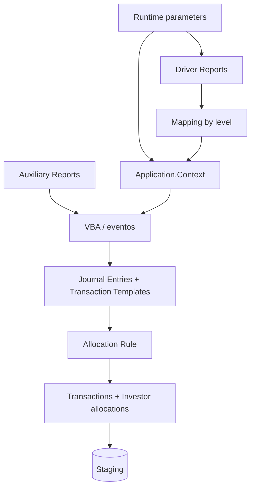
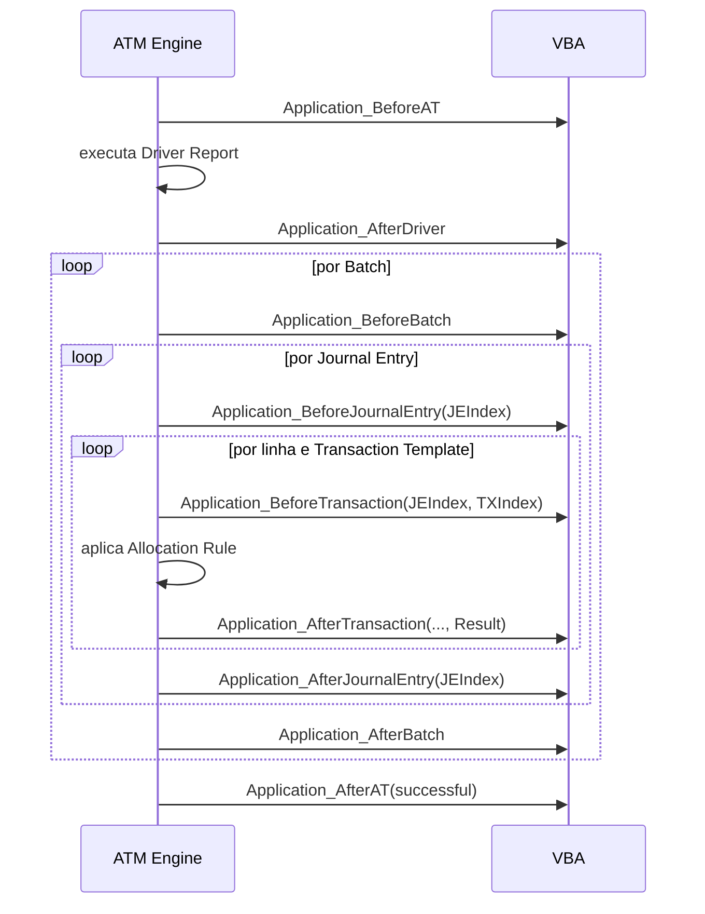

# Active Templates - structure and operation

## Execution flow



The ATM Engine combines the AT definition with the values supplied at runtime. A successful process generates temporary batches in Staging, awaiting Preview and Commit.

## Parameters

Parameters are the values requested from the user when the AT runs, such as Legal Entity, GL Date, Deal, or Transfer Date.

When adding a parameter, define:

- type and lookup, if applicable;
- level: Batch, Journal Entry, or Transaction;
- whether it is required (`Is Mandatory`);
- default value;
- `Map To a Property`, when the value should populate the `Context` directly.

All parameters are presented together at runtime, regardless of their level.

### Direct mapping

A mapped parameter overwrites the corresponding property at runtime. The level must be compatible with the property. If a value requires transformation or validation, VBA can read it with `Application.Context.Value("Nome")` and assign it explicitly.

## Driver Reports

Driver Reports control the dataset processed by the AT. The engine executes them automatically. The number of rows returned largely determines how many transactions can be created.

An AT accepts zero to three drivers.

### Mapping rules

Each visible column must be mapped to an `Application.Context` property and a level:

| Level | When to use | Effect of a change between rows |
|---|---|---|
| Batch | value that separates batches, such as Legal Entity in certain scenarios | starts a new batch |
| Journal Entry | value that separates entries within the batch | starts a new Journal Entry |
| Transaction Template | transaction-specific value | creates/populates a transaction |

Numeric columns must also indicate which Transaction Templates they apply to. This allows, for example, mapping a positive column to rebook and a negative column to reversal.

### Naming contract

AT parameters that must populate Driver Report parameters need to have the same name. The engine propagates values by matching names.

### Zero transactions

Each driver row attempts to create the transactions defined in the template. A transaction may be discarded when all relevant values are zero and `Allow zero transactions` is not selected.

## Auxiliary Reports

Auxiliary Reports provide additional data and are executed by VBA:

```vb
Dim report As RWReport
Set report = Application.Reports.Item(, "Book", "Report")
report.Parameter("LEID") = Application.Context.LegalEntity
report.Run
```

Validate cardinality explicitly:

- zero rows: missing data must be handled;
- one row: expected scenario when the lookup is singular;
- more than one row: an error or aggregation rule must be defined.

All reports used by the AT must be in Public Read-only folders. After changing them, run Refresh in ATM.

## Journal Entry Templates

These define the structure of the Journal Entries that the AT will produce. They can be added, edited, deleted, copied, pasted, and reordered.

The `Allow zero transactions` attribute determines whether transactions with both local Amount and LE Amount equal to zero remain in the output.

## Transaction Templates

These are the transaction templates for each Journal Entry. Their order defines `TXIndex` in VBA and can distinguish dominant, reversal, rebook, and non-dominant transactions.

When reviewing a transaction, identify:

- Transaction Type;
- Account;
- Deal, Position, Lot, Pool, and Income Security;
- GL Date, Effective Date, and Settlement Date;
- Amount, LEAmount, and Quantity;
- currency and scales;
- Allocation Rule;
- comments, references, and UDFs;
- dominant or non-dominant role.

## VBA and object model

### `Application`

Represents AT execution. Useful members:

- `ActiveTemplateID`;
- `Context`;
- `DriverReport`, `DriverReportCurrentRow`, and `DriverReportRecordCount`;
- `Reports` for Auxiliary Reports;
- `ProcessID` and `LogFileName`;
- `Log(message)`;
- `CancelExecution()`;
- `NewInvestorSet(...)`.

### `Application.Context`

This is the interface between VBA and the ATM Engine. Its properties form the generated records. Some important ones:

- `LegalEntity`, `GLDate`, and `EffectiveDate`;
- `Deal`, `Position`, `Account`, `Pool`, `Lot`, and Income Security;
- `Amount`, `LEAmount`, `Quantity`, and scales;
- `TransactionCurrency`;
- `AllocationRule`;
- `Value("ParameterName")` for values without a direct property.

`LegalEntity`, `GLDate`, and `EffectiveDate` are required according to the manual. Other fields depend on the Transaction Type and the process.

## Event order



### Where to place each type of logic

| Event | Recommended use |
|---|---|
| `BeforeAT` | global initialization and validation before the driver |
| `AfterDriver` | driver validation before creating batches |
| `BeforeBatch` | initialize accumulators or validate batch context |
| `BeforeJournalEntry` | populate/validate common JE fields |
| `BeforeTransaction` | set values, types, dates, and Allocation Rule before allocation |
| `AfterTransaction` | review/modify `InvestorSet`; implement User Provided |
| `AfterJournalEntry` | validate JE balancing/accumulators |
| `AfterBatch` | final batch validation |
| `AfterAT` | final logging/cleanup, including on failure |

With a Driver Report, events can fire many times. `BeforeTransaction` and `AfterTransaction` fire for each row and each applicable Transaction Template.

## Confirmed accounting rules

- a Journal Entry cannot mix allocated and unallocated transactions;
- all Investor allocations within a transaction must have the same sign;
- non-memo Journal Entries must balance to zero;
- non-dominant handling depends on the multi-currency configuration;
- use `Option Explicit`;
- use UDFs/reports for changeable values, avoiding hard-coding.

## How to understand an unfamiliar AT

1. Read attributes and Notes.
2. Draw the JE/Transaction tree with indices.
3. List parameters and mappings.
4. Run Driver Reports independently.
5. Identify Auxiliary Reports called by VBA.
6. Mark which events are implemented.
7. For each event, record which properties it reads and changes.
8. Identify Allocation Rules and the use of `Result`.
9. Calculate the expected number of batches/JEs/transactions.
10. Compare against Simulation and Preview.

## Source

- *Internal_Inv7_INV_ATM_Dev_Guide_7.pdf*, Navigation, Commonly Used VBA Classes, and Active Template Examples chapters.
