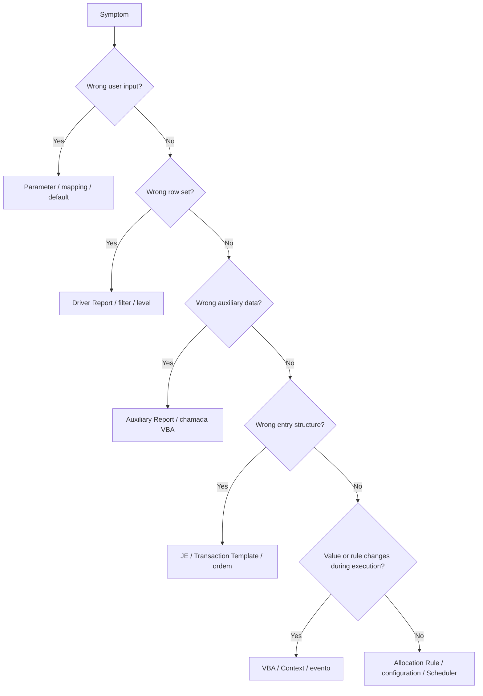
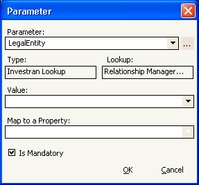
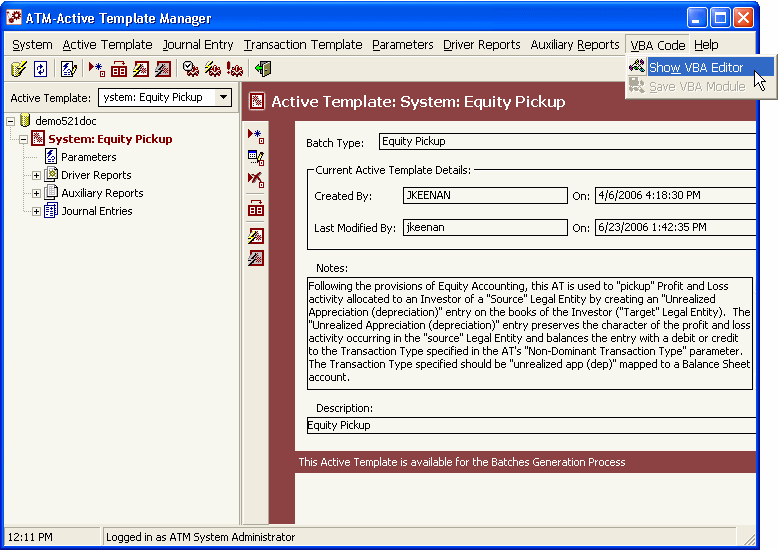

# Active Templates - editing, saving, and publishing

## Before making changes

Do not start with the code. First:

1. confirm the environment/database;
2. confirm the name, Batch Type, status, and last modified;
3. check `Locked` and whether anyone is running the AT;
4. reproduce the current behavior;
5. identify the responsible component;
6. inventory dependencies;
7. preserve the approved version by duplicating/exporting it according to the local process;
8. work in `Draft` and outside production.

## Choosing the right place to make a change

### Changing attributes

Use `Active Template > Edit`. Review the impact of:

- Batch Type;
- `Use VBA`;
- `Locked`;
- `Ignore Errors`;
- multi-currency flags;
- Notes and Description;
- status.

Saving the dialog persists the attributes but does not replace `Save VBA Module` for code changes.

### Changing Parameters

Select `Parameters` or the corresponding level and use `Add`/`Edit`/`Delete`.

*Parameter configuration window. The type, lookup, required status, and `Map to a Property` control how the value reaches the Context. Source: ATM guide, p. 42.*

When renaming or changing a parameter, look for references in:

- Description placeholders;
- Driver Report parameters;
- Auxiliary Report parameters;
- `Application.Context.Value("...")`;
- mappings;
- schedules/external processes.

### Changing a Driver Report

Prefer correcting the report in Report Wizard, validating it independently, and then running Refresh in ATM.

In ATM, check:

- driver order;
- parameters with names identical to the AT parameters;
- every visible column mapped;
- correct property and level;
- correct Transaction Template for numeric columns;
- stable cardinality and ordering.

### Changing an Auxiliary Report

After the change in RW:

1. run it with the same parameters;
2. confirm the columns and types used by VBA;
3. run Refresh in ATM;
4. validate zero, one, and multiple rows;
5. simulate the AT.

### Changing a Journal Entry/Transaction Template

Use `Edit` for properties or `Copy/Paste` to create a variation. Reorder with `Top/Up/Down/Bottom`.

After reordering, review all `JEIndex` and `TXIndex` conditions in VBA. A simple move can change which code branch executes.

### Changing VBA

1. Select `Use VBA` in the attributes, if necessary.
2. Open `VBA Code > Show VBA Editor`.
3. Ensure `Option Explicit` is on the first line.
4. Make the smallest possible change.
5. Save with `VBA Code > Save VBA Module`.
6. Start Simulation to validate syntax and logic.

Do not close, switch databases, or promote under the assumption that the editor saved automatically.

*VBA Editor open at the bottom of the ATM screen. The VBA Code menu contains actions to display and save the module. Source: ATM guide, p. 18.*

## What “saving” means in ATM

| Change | How to persist | How to validate |
|---|---|---|
| AT attributes | confirm the Add/Edit dialog | select the AT again and check the panel |
| Parameter | confirm Add/Edit | reopen the node and check mapping/default |
| Journal Entry/Transaction Template | confirm the dialog | reopen and check order and properties |
| report association/mapping | confirm in the corresponding panel | Refresh/reopen and check columns/parameters |
| VBA code | `VBA Code > Save VBA Module` | close/reopen the editor and simulate |
| status | `Active Template > Edit` and confirm | check `Draft`/`Normal` in the panel |
| version transfer between databases | ARM & ATM Export-Import Console | open in the target and run a smoke test |

## Safe change sequence

1. Capture a baseline: parameters, reports, logs, and current Preview.
2. Duplicate/export the previous version.
3. Keep the new version in `Draft`.
4. Change one component at a time.
5. Save using that component's specific mechanism.
6. Reopen/reload to confirm persistence.
7. Run reports independently.
8. Simulate the original scenario and edge cases.
9. Compare batches, JEs, transactions, and allocations.
10. Run through the Scheduler with Preview.
11. Obtain functional/accounting approval.
12. Change to `Normal`.

## Required tests

- scenario that reproduces the defect;
- known normal scenario;
- zero rows and one row in the driver;
- multiple rows and level changes;
- applicable zero and negative values;
- empty/default parameters;
- signs and balancing;
- Local Amount, LEAmount, and Quantity;
- dominant/non-dominant;
- Investor allocations;
- multi-currency where applicable;
- representative volume.

## Publishing between environments

The manual confirms the **ARM & ATM Export-Import Console** for transferring Active Templates and related reports between databases. Each organization's internal process still needs to define:

- source/target and permissions;
- objects included in the package;
- parameters, UDFs, Allocation Rules, and other items promoted separately;
- conflict and ID handling;
- import order;
- ticket, approvals, and change window;
- smoke test and rollback.

### Publishing checklist

- [ ] previous version preserved;
- [ ] AT in `Normal` only after testing;
- [ ] reports in Public Read-only and up to date;
- [ ] mappings checked in the target;
- [ ] Allocation Rule IDs validated;
- [ ] VBA references available;
- [ ] Scheduler/Staging healthy;
- [ ] parameters and UDFs present;
- [ ] Preview reconciled in the target;
- [ ] owner approved the result.

## Rollback

Technical rollback must restore a consistent set, not just VBA:

- AT and attributes;
- Driver/Auxiliary Reports;
- Parameters/mappings;
- JEs/Transaction Templates;
- Allocation Rules and dependent settings.

If incorrect batches have already been committed, restoring the template does not undo the accounting entries. Stop new executions and follow the approved reversal/rebook process.

## Source

- *Internal_Inv7_INV_ATM_Dev_Guide_7.pdf*, sections on menus, examples, development tips, and execution.
