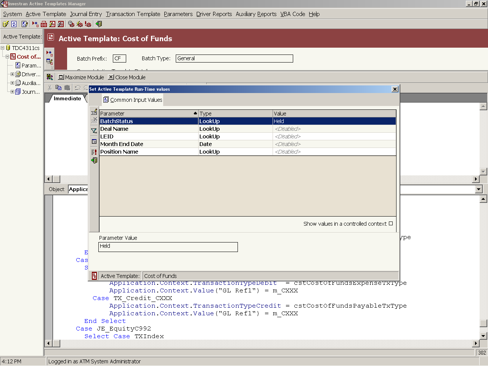
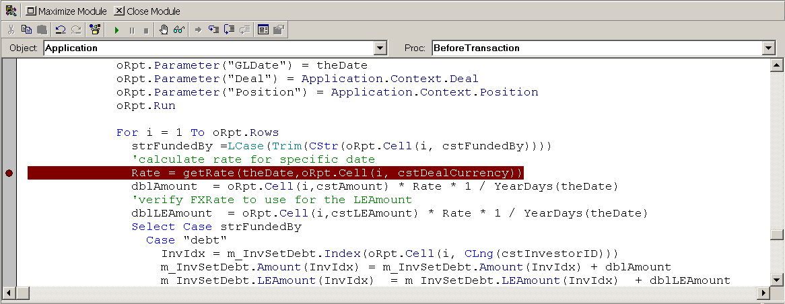
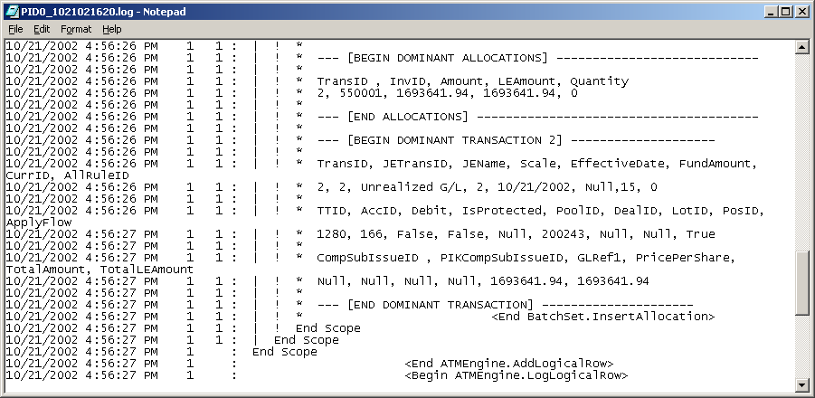
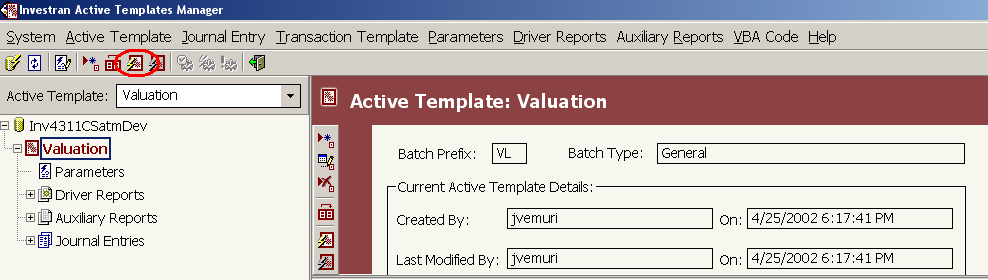
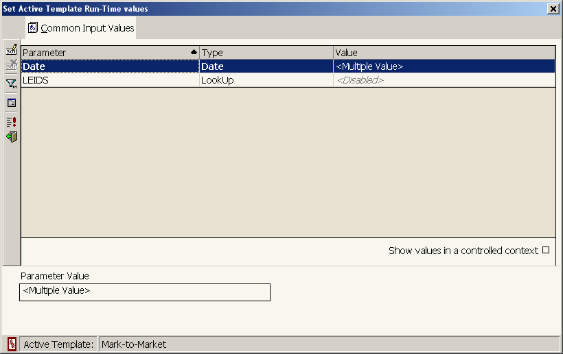
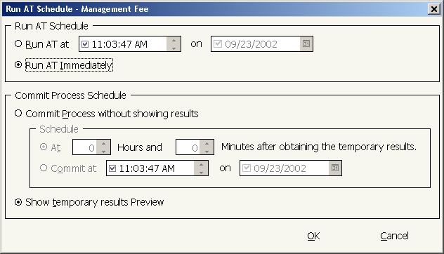
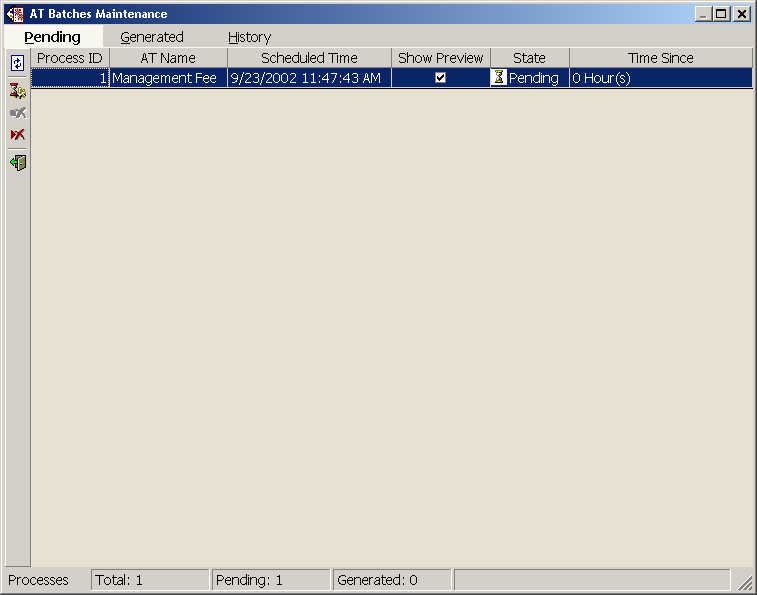
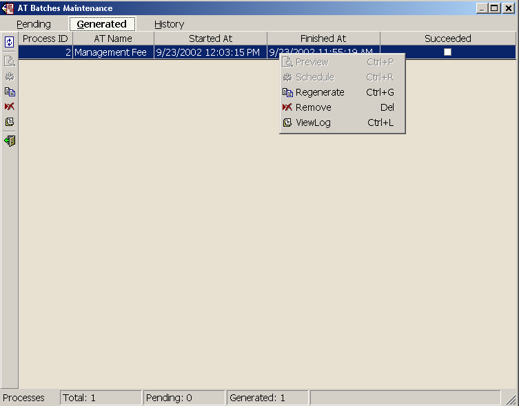
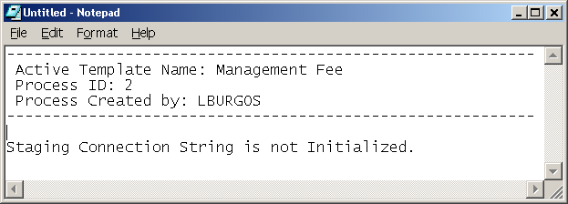
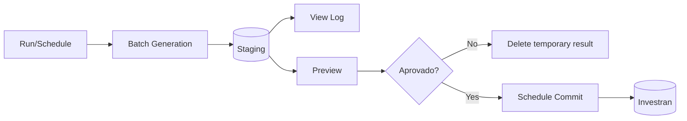

# Active Templates - debugging, execution, Preview, and Commit

## Two testing phases

### Simulation Mode

Runs everything in memory. It does not write transactions to Staging or the Investran database. This is the first mode for validating syntax, logic, and results.

### Scheduler Engine

Runs the actual asynchronous process. The Batch Generation phase writes results to Staging. The user can then review and schedule the Commit to the Investran database.

Successful Simulation does not replace testing through the Scheduler.

## Debugging in the VBA Editor

### Toolbar

| Command | Behavior |
|---|---|
| `Start/Resume` | validates/starts VBA and opens parameters when needed |
| `Pause` | temporarily pauses execution |
| `End` | ends execution; it cannot resume from the same point |
| `Toggle Break` | adds/removes a breakpoint on the line |
| `Evaluate Expression` | evaluates an expression in the Immediate Window |
| `Show Current Statement` | locates the next line |
| `Step Into` | enters Subs/Functions |
| `Step Over` | executes the call as a single line |
| `Step Out` | completes the current Sub/Function |

### Validating syntax

1. Save the module.
2. Click `Start/Resume` or use `Simulate` in ATM.
3. Fill in parameters if prompted.
4. The interpreter checks variables, types, and blocks.
5. The line with the error appears in red, with its description in the status area.
6. Use `Exit` in the parameters dialog, correct the error, and save again.

If the **Immediate** window appears behind the dialog, the manual indicates that the code passed initial syntax validation.



*Simulation running with the parameters dialog over the VBA Editor. Source: ATM guide, p. 62.*

Messages may be imprecise. `Expecting an existing scalar var`, for example, can mean an undeclared variable/constant or an incorrect type.

### Debugging logic

1. Set a breakpoint by clicking the line margin.
2. Start/resume execution.
3. The yellow line indicates the next statement.
4. Use Step Into/Over/Out.
5. Inspect variables in Immediate and Watch.
6. Use Stack to understand the call chain.
7. Compare `JEIndex`, `TXIndex`, the current driver row, and Context properties.



*Breakpoint in the gutter and current line highlighted in the VBA Editor. Source: ATM guide, p. 62.*

## Debug Log

After simulation, ATM displays a log of the steps executed and the data that would be written to the Staging tables, including transactions and Investor allocations.



*Debug Log displayed after Simulation, showing the content that would be sent to Staging. Source: ATM guide, p. 64.*

VBA can log messages:

```vb
Application.Log "Amount=" & CStr(Application.Context.Amount)
```

Log useful information without sensitive data:

- event;
- driver row;
- `JEIndex`/`TXIndex`;
- context IDs;
- values before/after calculation;
- Allocation Rule;
- number of Investors;
- Amount, LEAmount, and Quantity totals.

## Simulation procedure

1. Confirm that the version is saved and in `Draft`.
2. Select the AT.
3. Click `Simulate` or start from the VBA Editor.
4. Enter all required parameters.
5. Step through relevant breakpoints.
6. Let execution finish.
7. Review the Debug Log.
8. Validate generated counts and values.
9. Repeat with edge cases.

## Scheduler prerequisites

The manual highlights:

- Scheduler Service installed/configured;
- service identity with permissions on Master and Staging;
- Staging and Investran databases connected correctly;
- `UseATM=Yes` and `IsMaster=Yes` in Master;
- complete `StagingConnection`;
- correct `MasterServer` and `MasterDatabase` in Staging.

Do not change these settings directly without administrator/DBA authorization.

## Running through the Scheduler

1. Change to `Normal` only after Simulation is approved.
2. Select the AT in the tree.
3. Click the **Batch Generation** icon.



*Template selected and Batch Generation icon highlighted before execution. Source: ATM guide, p. 66.*
4. Fill in the runtime parameters.
5. Use `Show values in controlled context` to restrict lookups based on values already selected.



*Parameters window presented before scheduling. Source: ATM guide, p. 67.*
6. Open `Run AT Schedule` using the red exclamation icon.
7. Choose a date/time or `Run AT Immediately`.
8. During development, select **Show temporary results Preview**.



*Generation scheduling and selection of Preview or Commit. During testing, use Show temporary results Preview. Source: ATM guide, p. 68.*

Avoid **Commit process without showing results** during testing: this option automatically sends the results to Investran without review.

The Scheduler does not allow scheduling the same AT for recurring execution within the same scheduling definition described in the manual.

## Monitoring Batch Generation

In `Process Maintenance > Batch Generation`, monitor:

- `Pending`: queued;
- `Running`: processing;
- `Cancelled`: canceled;
- `Generated` tab: completed, with duration and a `Succeeded` indicator.

A blank `Succeeded` value is not always an error: the AT may legitimately generate no batch. Confirm parameters, driver rows, and the business rule.

Use Refresh to update the status.



*Process in the Pending tab of Batch Maintenance. Source: ATM guide, p. 69.*



*Process moved to Generated after generation finishes. Source: ATM guide, p. 71.*

## View Log and Preview

After generation:

- `View Log` or `Ctrl+L`: opens the log for the Process ID;
- `Preview` or `Ctrl+P`: displays the generated batches when the process allows it.



*View Log example showing a Staging connection configuration failure. Source: ATM guide, p. 71.*

In Preview, reconcile:

- number of batches;
- Batch Type, Description, and GL Date;
- Journal Entries and balancing;
- Transaction Types and Accounts;
- Deal, Position, Lot, Pool, and Income Security;
- Amount, LEAmount, Quantity, currencies, and scales;
- Allocation Rule and results by Investor;
- dominant/non-dominant;
- zeros, signs, comments, references, and UDFs.

## Commit

After Preview approval, commit can be scheduled using the red icon in the Preview window or the `Schedule`/`Ctrl+R` menu on the Process ID.

The **Commit Maintenance** screen monitors the Commit phase but does not provide Preview. Review must therefore take place before scheduling.



After Commit, deleting/reversing a batch requires an accounting procedure; it is no longer just Staging cleanup.

## Documented troubleshooting

| Error | Stated cause | Action |
|---|---|---|
| `Multiple-step operation generated errors` with a boolean | Auxiliary Report returns a boolean without the correct configuration | set `FetchBoolean=True` on the report object used by VBA |
| `ATM execution failed. Overflow` | more than 32,766 SQL command calls in commit events | reduce commands/scope, for example by supplying a more restrictive filter |
| `Check each status value` | driver returns an empty string instead of `Null` | normalize the empty property to `Null` before writing |
| GP LE receives `NULL` for all Investors | `AfterTransaction` allocates starting from the null/unallocated Investor | debug `Result` and use Investors associated with the GP Legal Entity |
| `Row index out of range` | driver returns more rows in ATM than in standalone RW | compare execution, parameters, context, and report data |

## When to stop

- results exceed the expected scope;
- Journal Entry does not balance;
- incorrect Investors receive amounts;
- Preview differs from Simulation without explanation;
- `Ignore Errors` produced partial output;
- the previous process is still `Running` or its state is unknown;
- Scheduler/Staging configuration appears incorrect;
- no previous version or rollback plan exists.

## Completion evidence

- Simulation and Scheduler logs;
- parameters used;
- Process ID;
- approved Preview;
- before/after comparison;
- reconciled totals;
- functional/accounting approval;
- Commit result or discarded Staging output;
- updated documentation and version package.

## Source

- *Internal_Inv7_INV_ATM_Dev_Guide_7.pdf*, Debugging Active Templates, Executing Active Templates, AT Execution Maintenance, and Troubleshooting chapters.
