# Active Template Manager - practical user guide

> **Document control:** Status: KT pending · Technical/functional owners: to be confirmed · Scope: Investran 7 source material; validate installed version and environment · Last validation: not validated locally · Next review: after controlled validation or any template/process change · Evidence: attach a sanitized ticket/change and test result.

This guide presents ATM as a tool: what each component does, how to navigate, how to create or change an Active Template, and how to follow a safe Simulation, Scheduler, Preview, and Commit workflow.

> The screens belong to Investran 7 as documented in the 2014 guide. Appearance, permissions, and names may vary. Always confirm the environment, database, and internal process before execution.

## What ATM does

**Active Template Manager** creates executable processes that transform parameters and Report Wizard data into accounting batches.

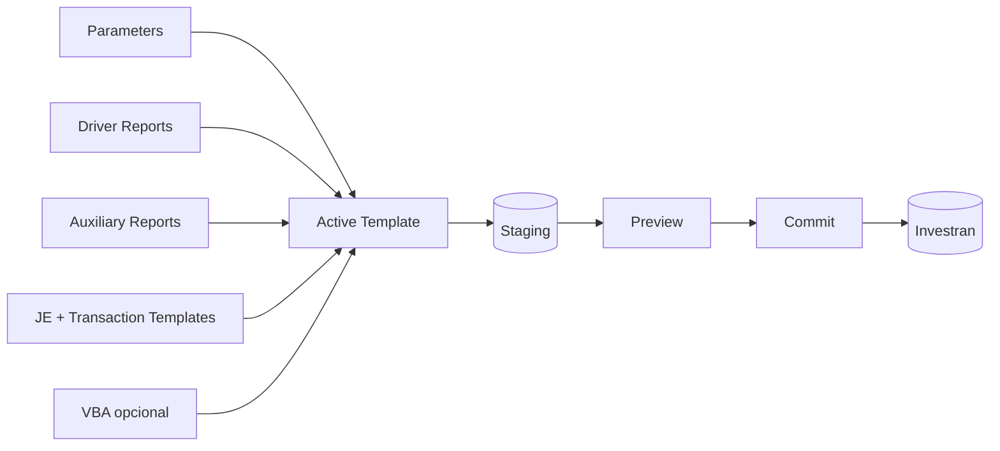

ATM creates new batches. It is not a tool for editing existing batches.

## Accessing and identifying the tool

When starting ATM, enter authentication details, server, and database.

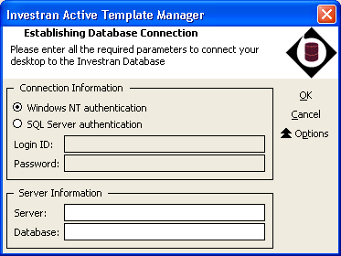

Before selecting `OK`, confirm:

- environment and database;
- account and entitlement;
- tool version;
- ticket or purpose;
- no exposed data/credentials in evidence.

After login, the main screen displays:

1. Active Template tree on the left;
2. administration and refresh actions in the center;
3. attributes, connection, and status on the right;
4. menu bar for AT, Parameters, Reports, Templates, and VBA.

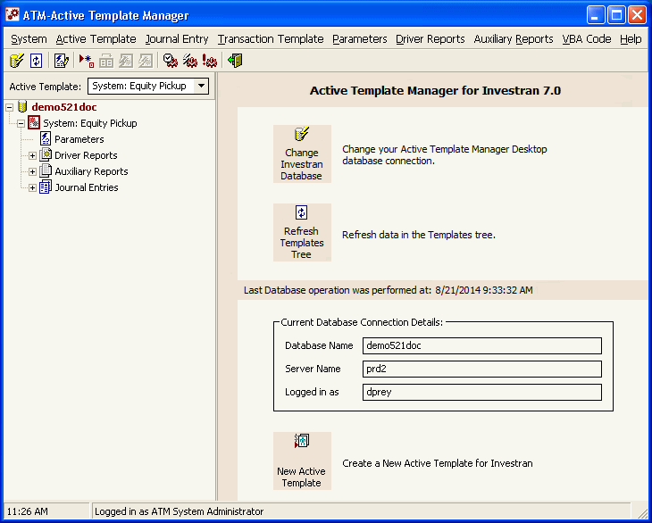

## Locating and identifying the correct template

Select the template in the list and check its name, Batch Type, creator, last modified, status, Notes, and Description.

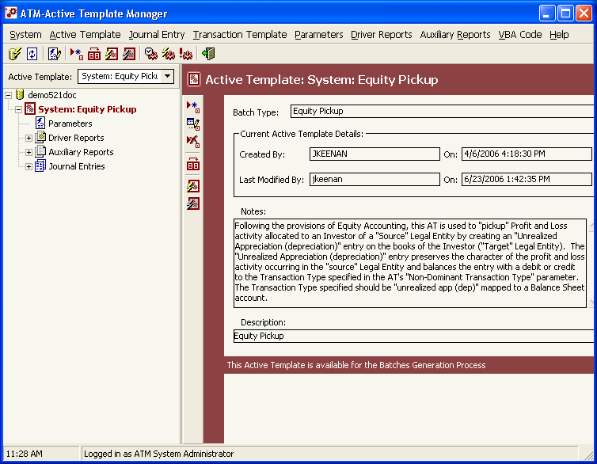

Do not edit merely because the name “looks right”. Confirm:

- database;
- Batch Type;
- parameters and reports;
- Journal Entry/Transaction tree;
- schedules and consumers;
- currently approved version.

## Understanding the Active Template tree

```text
Active Template
├── Parameters
├── Driver Reports (up to 3)
├── Auxiliary Reports
├── Journal Entries
│   └── Transaction Templates
└── VBA Module
```

Each part solves a different problem. Before changing VBA, identify whether the defect is actually in the code or in a parameter, report, mapping, template, or configuration.

## What each component is for

### Parameters

Parameters are inputs requested at runtime, such as Legal Entity, GL Date, Deal, or Transfer Date.

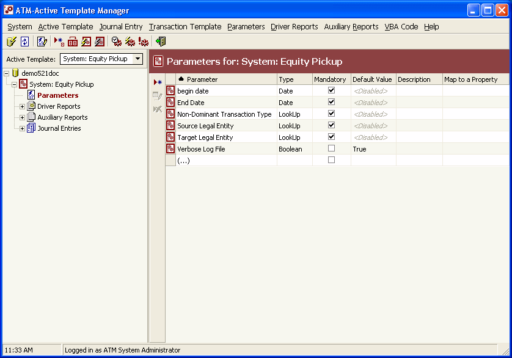

A Parameter defines:

- type and lookup;
- required status;
- default;
- Batch, Journal Entry, or Transaction level;
- `Map To a Property`, when the value populates the Context directly.

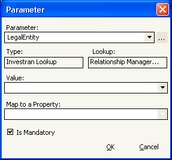

If the Parameter populates a Driver Report, the names must match. If it is renamed, also review Description, VBA, mappings, reports, and schedules.

### Driver Reports

Driver Reports determine the dataset that the template will process. The ATM Engine executes them automatically. An Active Template accepts up to three.

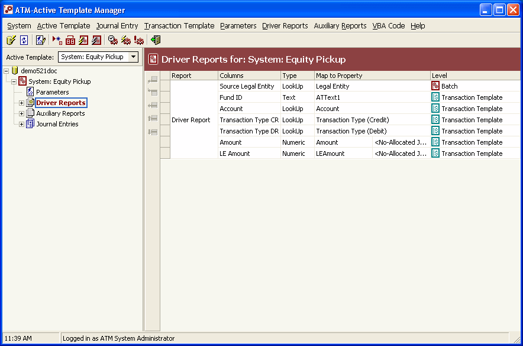

Each visible column requires mapping to a Context property and a level:

| Level | Effect when the value changes |
|---|---|
| Batch | starts another batch |
| Journal Entry | starts another Journal Entry |
| Transaction Template | creates or populates a transaction |

The number of rows, their order, and changes in level values directly influence how many batches, JEs, and transactions will be created.

### Auxiliary Reports

Auxiliary Reports provide additional data. Unlike drivers, they are explicitly executed by VBA.

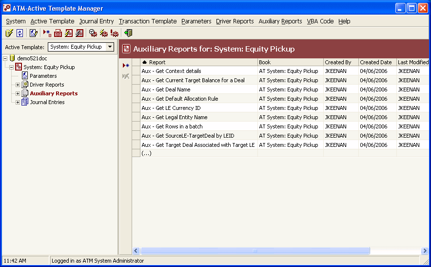

When using an Auxiliary Report, handle zero, one, and multiple rows. After changing any report in Report Wizard, validate it independently and run Refresh in ATM.

### Journal Entry Templates

Journal Entry Templates define the structure of the entries to be generated.

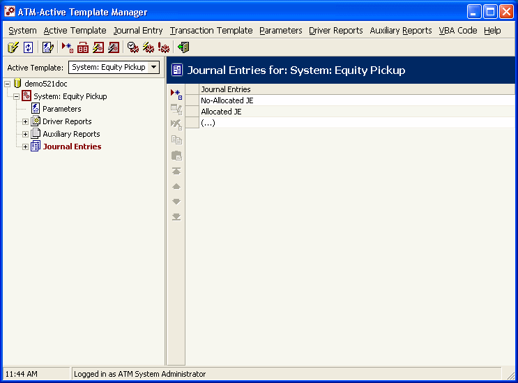

The order affects functionality: it defines the `JEIndex` received by VBA events. Reordering without reviewing the code can cause a branch to act on the wrong entry.

### Transaction Templates

Transaction Templates define the transactions within each Journal Entry.

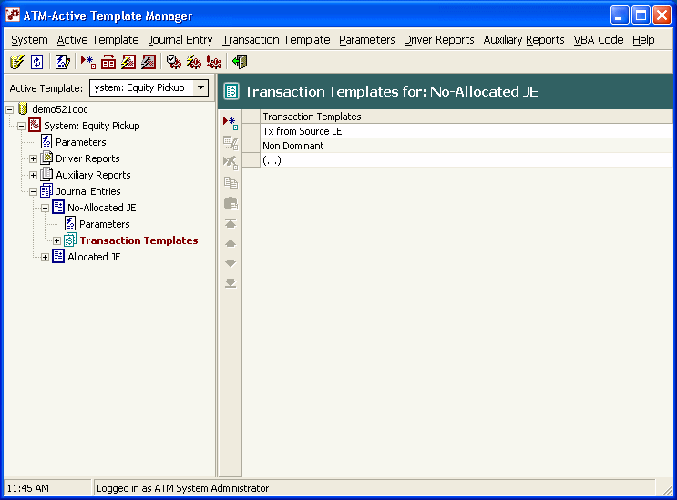

Review Transaction Type, Account, Deal, Position, dates, currencies, Amount, LEAmount, Quantity, Allocation Rule, UDFs, and the dominant/non-dominant role. The order defines `TXIndex`.

### Active Template attributes

Use `Active Template > Add/Edit` to maintain attributes.

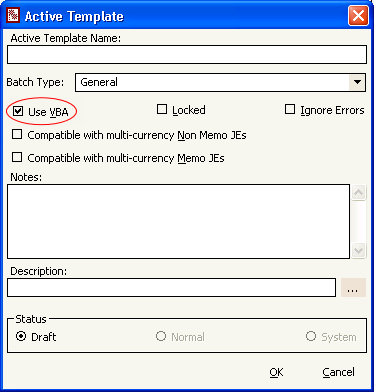

| Attribute | Practical use |
|---|---|
| Batch Type | classifies generated batches |
| Use VBA | enables the code module |
| Locked | restricts changes to the developer who locked it |
| Ignore Errors | allows partial output; requires justification and reconciliation |
| Notes | records technical and functional context |
| Description | populates batch comments and accepts parameters |
| Status | controls template availability |

Leave `Ignore Errors` cleared unless explicitly required. An execution may finish with valid transactions in Staging and others rejected.

### VBA

VBA implements validation, transformations, calls to Auxiliary Reports, and logic that depends on events.

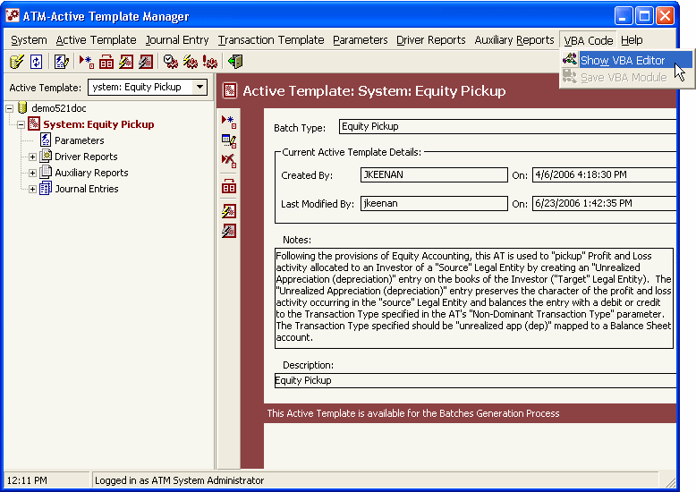

Common events:

| Event | Typical use |
|---|---|
| `BeforeAT` | initialization and global validation |
| `AfterDriver` | validate driver results |
| `BeforeBatch` | prepare batch context |
| `BeforeJournalEntry` | populate/validate the JE |
| `BeforeTransaction` | set values and Allocation Rule |
| `AfterTransaction` | review or populate Investor allocations |
| `AfterJournalEntry` | validate balancing |
| `AfterBatch` | final batch validation |
| `AfterAT` | logging and cleanup |

Save the code with `VBA Code > Save VBA Module`. Saving AT attributes does not replace this operation.

## Creating an Active Template

### 1. Plan the result

Before using the tool, define:

- functional process;
- Batch Type;
- expected number of batches/JEs/transactions;
- runtime parameters;
- data that drives the process;
- accounting structure;
- allocation rules;
- success and rollback criteria.

### 2. Create in Draft

Use `Active Template > Add`, enter the name, Batch Type, Notes, and Description, and keep the status as `Draft`.

States:

- `Draft`: development and Simulation;
- `Normal`: available for normal execution;
- `System`: reserved for the vendor.

### 3. Add Parameters

Add only the required inputs. Configure levels and mappings carefully and use defaults only when they are safe and understood by the operator.

### 4. Associate Reports

Associate Driver and Auxiliary Reports that have already been validated and stored in a Public Read-only folder. Confirm columns, parameters, mappings, and order.

### 5. Build JEs and Transactions

Create the output tree and document the indices. For each Transaction Template, define the required fields and the corresponding Allocation Rule.

### 6. Implement VBA, if needed

Enable `Use VBA`, use `Option Explicit`, implement only the required events, and record useful messages with `Application.Log`.

### 7. Save each component

“Saving” is not a single operation:

| Change | Persistence |
|---|---|
| attributes | confirm Add/Edit |
| Parameter | confirm Add/Edit |
| JE/Transaction Template | confirm the dialog |
| report/mapping | confirm the association and run Refresh |
| VBA | `Save VBA Module` |
| promotion | ARM & ATM Export-Import Console |

Reopen the component after saving to confirm persistence.

## Changing an existing template

1. confirm the environment, AT, and expected behavior;
2. capture a baseline with parameters, logs, and Preview;
3. check the lock and concurrent execution;
4. duplicate or export the approved version;
5. keep the development copy in Draft;
6. change one component at a time;
7. save and reopen;
8. run reports independently;
9. simulate the original scenario and edge cases;
10. compare before/after results;
11. test through the Scheduler with Preview;
12. obtain approval before changing to Normal.

Use the symptom to choose the first point of investigation:

| Symptom | Check first |
|---|---|
| incorrect prompt/default | Parameter |
| wrong rows or count | Driver Report and level mapping |
| incorrect supplementary lookup | Auxiliary Report |
| incorrect accounting structure | JE/Transaction Template |
| value changes during execution | Context and VBA event |
| incorrect Investor allocation | Allocation Rule and AfterTransaction |
| works in ARM/Simulation, fails when scheduled | Scheduler, Staging, permissions, and context |

## Simulation and debugging

Simulation runs in memory and writes to neither Staging nor Investran. It is the first required step.

### Validating syntax

1. save the module;
2. use Start/Resume or Simulate;
3. enter the parameters;
4. correct the indicated line;
5. save again.

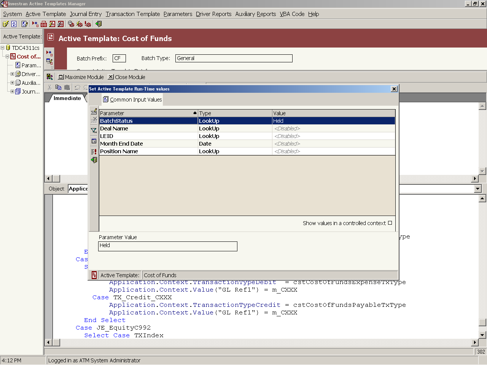

### Debugging logic

Use breakpoints, Step Into, Step Over, Step Out, Watch, Immediate, and Stack. Compare `JEIndex`, `TXIndex`, the current driver row, and Context properties.

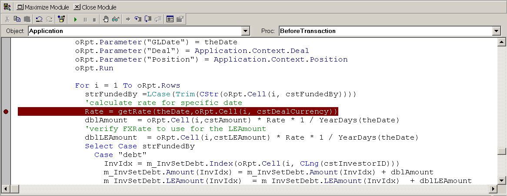

### Interpreting the Debug Log

The Simulation log shows steps and data that would be written to Staging.

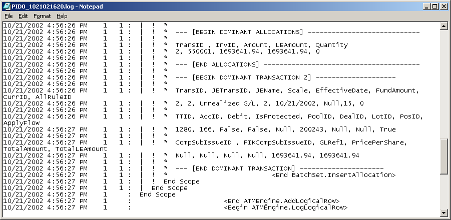

Validate counts, IDs, signs, values, currencies, Allocation Rule, and distribution by Investor. Do not conclude the test merely because there was no technical error.

## Running through the Scheduler

Approved Simulation does not replace the actual asynchronous workflow.

### 1. Start Batch Generation

Select the template and click **Batch Generation**.

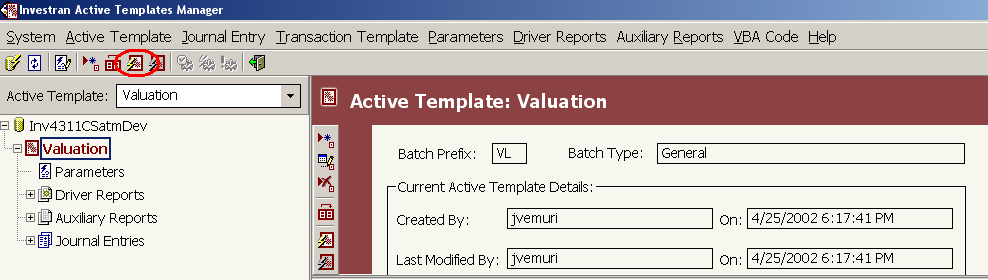

### 2. Enter parameters

Fill in the runtime parameters and use controlled context when needed.

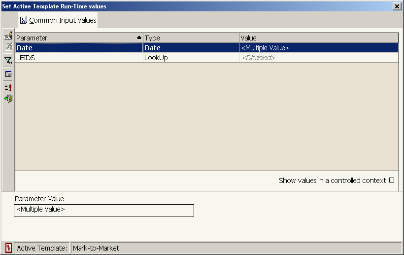

### 3. Schedule with Preview

Open `Run AT Schedule`, choose a time or immediate execution, and during testing select **Show temporary results Preview**.

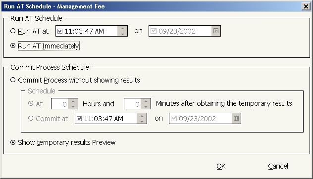

Avoid `Commit process without showing results` during development.

### 4. Monitor

Use `Process Maintenance > Batch Generation` and Refresh to monitor Pending, Running, Cancelled, and Generated.

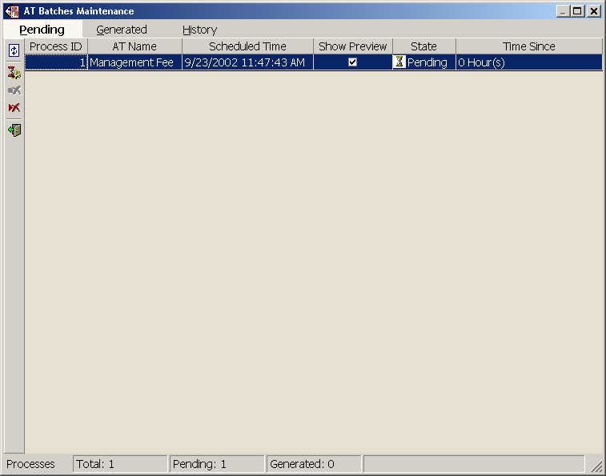

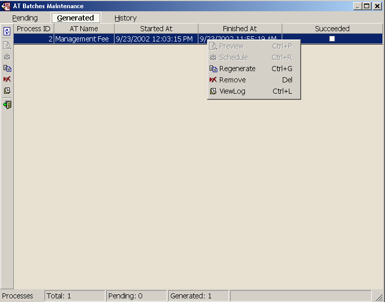

A Generated/Succeeded process may not have created a batch. Confirm parameters, driver rows, and the business rule.

### 5. Review Log and Preview

Use View Log for errors and Preview to reconcile the temporary result.

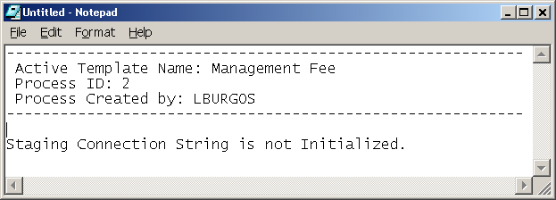

In Preview, check:

- batches and Batch Type;
- GL Date and Description;
- JEs and balancing;
- Transaction Types and Accounts;
- Deal, Position, Lot, and Pool;
- Amount, LEAmount, and Quantity;
- currencies and scales;
- Allocation Rule and Investors;
- dominant/non-dominant;
- zeros, signs, comments, and UDFs.

### 6. Commit

Schedule Commit only after Preview approval. After Commit, correcting the result is no longer Staging cleanup and requires the approved accounting reversal/rebook process.

## Publishing and rollback

The guide confirms the **ARM & ATM Export-Import Console** for transferring Active Templates and related reports.

Before promoting:

- preserve the previous version;
- include consistent reports and mappings;
- validate Allocation Rules, parameters, UDFs, and references;
- confirm IDs in the target;
- run Refresh;
- run Simulation and a smoke test through the Scheduler;
- reconcile Preview before Commit.

Rollback must restore the complete set: AT, reports, mappings, JEs, Transaction Templates, VBA, and dependencies. Restoring VBA alone is not sufficient.

## Quick usage checklist

- [ ] database, user, and entitlement confirmed;
- [ ] Active Template and Batch Type confirmed;
- [ ] baseline and previous version preserved;
- [ ] development kept in Draft;
- [ ] Parameters, reports, and mappings reviewed;
- [ ] JEIndex/TXIndex documented;
- [ ] VBA explicitly saved;
- [ ] Simulation and Debug Log reconciled;
- [ ] Scheduler test run with Preview;
- [ ] functional/accounting result approved;
- [ ] promotion and rollback documented;
- [ ] Normal only after approval.

## Source

- *Internal_Inv7_INV_ATM_Dev_Guide_7.pdf*, Getting Started in ATM, Navigation, Active Template Examples, Debugging Active Templates, Executing Active Templates, and AT Execution Maintenance chapters.
