# Allocation Rule Manager - practical usage guide

This guide presents ARM as a tool: what it solves, how to navigate it, how to build a rule, and how to validate the result before making it available to Accounting or an Active Template.

> The screens are from Investran 7 as documented in the 2014 guide. Appearance, permissions, and names may vary by version and configuration. Confirm the database and work in a non-production environment.

## What ARM does

**Allocation Rule Manager** creates and maintains rules that distribute `Amount`, `LEAmount`, and `Quantity` among Investors in a Legal Entity.

ARM maintains **Dynamic Allocation Rules**. A dynamic rule can retrieve balances, commitments, costs, or other data through Report Wizard and calculate each Investor's share at runtime.

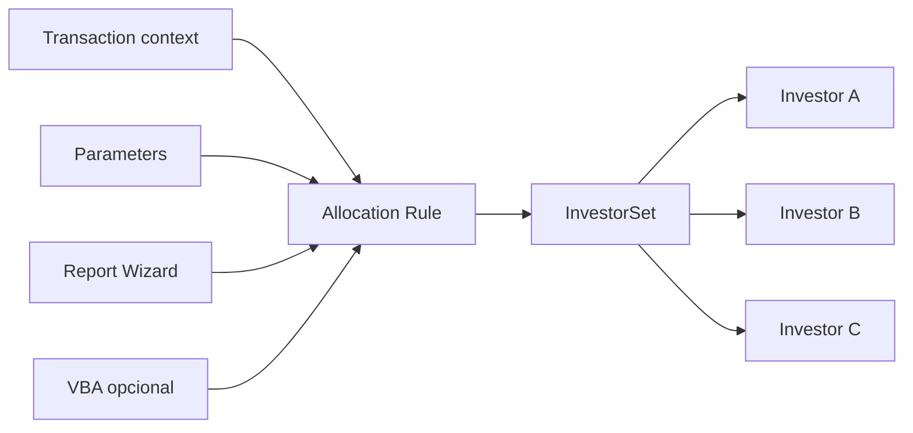

ARM does not replace the **Static Allocation Rules** tool. If percentages are entered manually and remain fixed, investigate a static rule first.

## Choosing the correct type

Before opening the tool, answer three questions.

### 1. Static or Dynamic?

| Need | Likely choice |
|---|---|
| Fixed percentages maintained manually | Static Allocation Rule |
| Calculation changes by date, balance, commitment, or investment | Dynamic Allocation Rule in ARM |

### 2. Simple or Complex?

| Need | Likely choice |
|---|---|
| One report returns all Investors and the three required bases | Simple Dynamic Rule, without VBA |
| Multiple reports, conditions, combinations, or special handling | Complex Dynamic Rule, with VBA |

Start with a simple rule. VBA increases flexibility, but also adds dependencies, testing, and maintenance risk.

### 3. Top Down or Bottom Up?

- **Top Down:** the consumer supplies Legal Entity totals and the rule distributes them proportionally.
- **Bottom Up:** the report or code supplies individual values and the engine aggregates the Investors.

In Top Down, the report's numeric columns are proportion bases. In Bottom Up, they are the final values for each Investor.

## Accessing and recognizing the tool

When starting ARM, provide authentication, server, and database details.

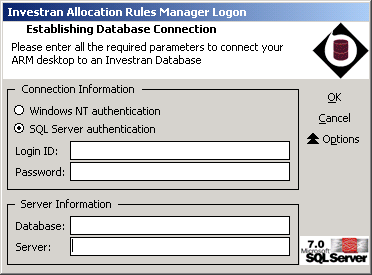

Before selecting `OK`, confirm:

- correct environment;
- correct database;
- authorized account;
- expected tool version;
- ticket or purpose of the session.

After login, the main screen has three areas:

1. Allocation Rules tree on the left;
2. creation and refresh actions in the center;
3. current connection and metadata on the right.

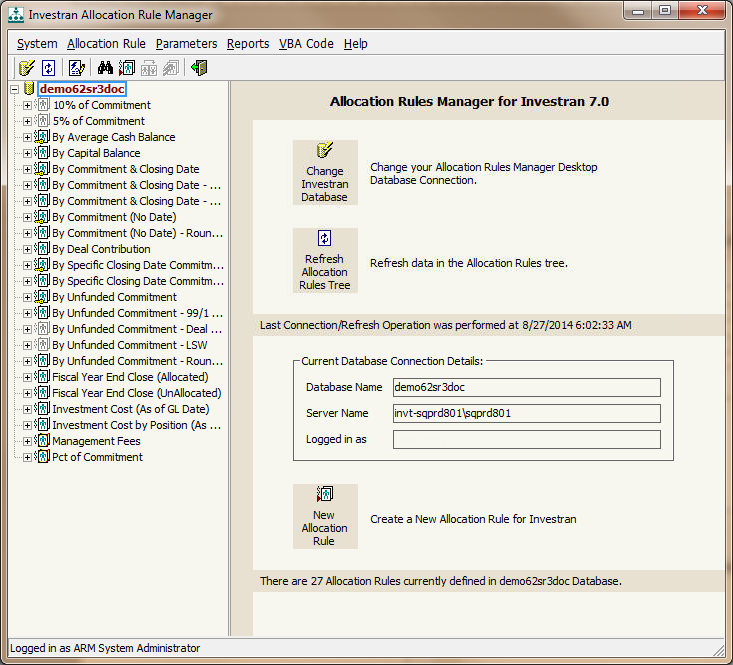

## Understanding a rule's tree

Select a rule and expand the `+` sign. The tree serves as a dependency inventory:

```text
Allocation Rule
├── Properties
├── Parameters
└── Reports
    ├── Columns
    └── Parameters
```

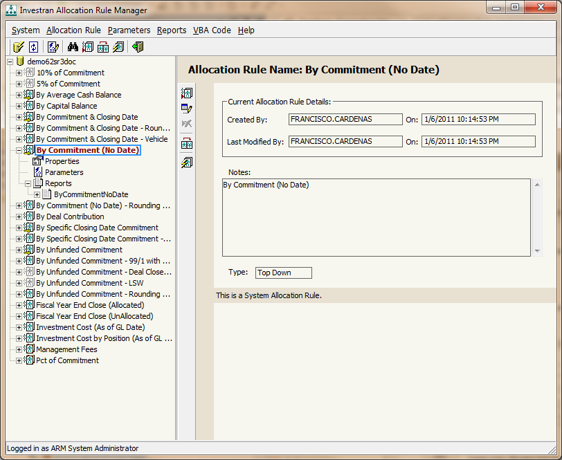

When taking over an unfamiliar rule, record:

- name, type, and status;
- creator and last modified;
- Notes;
- required Properties;
- Parameters and defaults;
- reports, books, columns, and parameters;
- presence of VBA;
- known consumers;
- result of a baseline execution.

## What each component is for

### Properties

Properties are transaction context values sent by Accounting, ATM, or another consumer. `Legal Entity` and `GL Date` are always required. Select other properties only when the rule actually needs them.

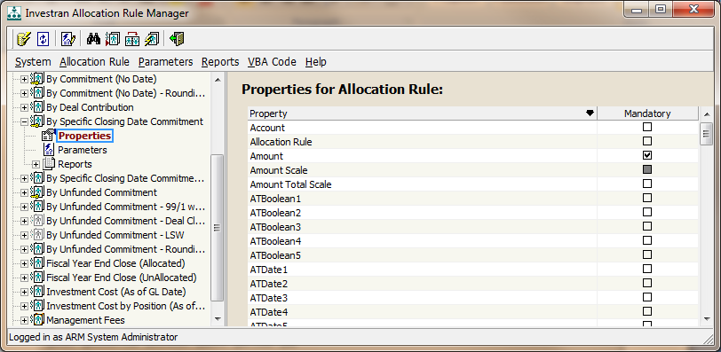

Examples:

- `Amount`, `LEAmount`, and `Quantity`: totals distributed by a Top Down Rule;
- `Account`, `Deal`, and Investment: context used for filtering or calculation;
- scales: precision used for rounding;
- dates: determine the financial position used in the calculation.

### Parameters

Parameters are additional inputs outside the standard context. They can be required, optional, or have a default.

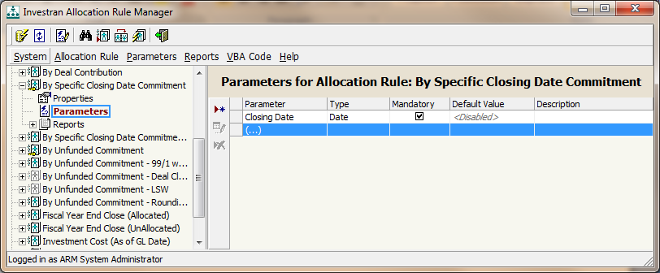

Use Parameters for values actually supplied at runtime. For durable business settings, consider UDFs or another governed source instead of hard-coding.

### Reports

Reports query the data that determines the Investor universe and calculation bases.

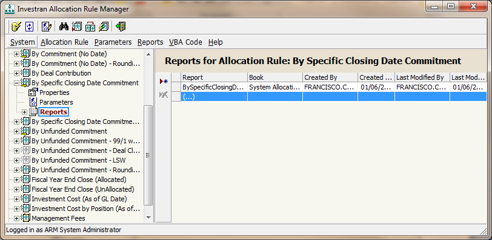

The names of the rule's Properties/Parameters must match the report parameter names for the ARM Engine to propagate values automatically.

After changing a report in Report Wizard:

1. validate the report independently;
2. return to ARM;
3. run `Refresh Allocation Rules Tree`;
4. check Columns and Parameters again;
5. run the rule with the same values.

### VBA

VBA implements complex rules that cannot fit in a single report. The module must have `Sub Main` and return the result in `AllocationRule.Results`.

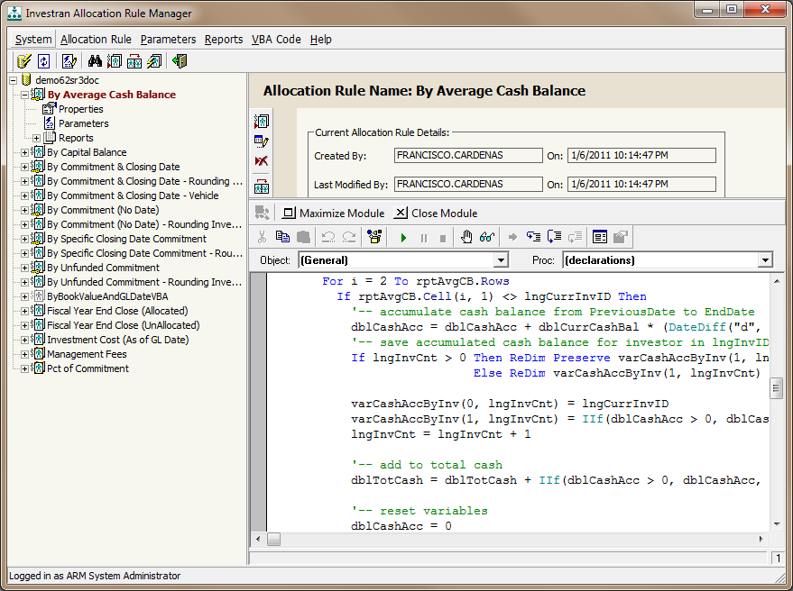

Use `VBA Code > Save VBA Module` explicitly. Saving rule attributes does not guarantee that the open module has been persisted.

## Creating a Simple Dynamic Allocation Rule

A simple rule uses exactly one report and does not need VBA.

### 1. Prepare Report Wizard

The report must be in a **Public Read-only** folder and have four visible columns in this order:

| Order | Content |
|---:|---|
| 1 | Investor Account ID |
| 2 | Amount base or value |
| 3 | LEAmount base or value |
| 4 | Quantity base or value |

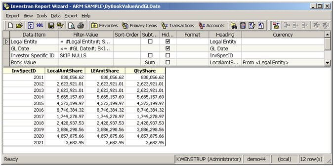

Run the report independently and confirm valid IDs, no duplicates, zero/Null handling, and expected totals.

### 2. Create the rule

Use `Allocation Rule > Add`:

1. provide a stable name and useful Notes;
2. keep Status as `Draft`;
3. choose Top Down or Bottom Up;
4. leave `Use VBA` unchecked;
5. use `Locked` only according to the team's convention;
6. do not enable optimization without testing cache behavior.

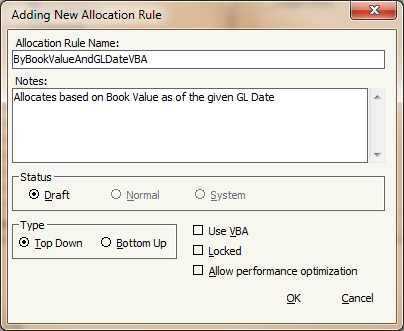

### 3. Associate the report

Select Reports and add the prepared report. Check Book, name, Columns, and Parameters.

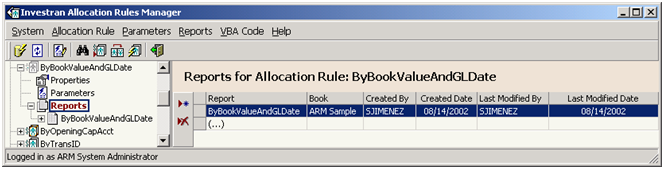

### 4. Select Properties and Parameters

Select all inputs required by the report and calculation. Do not select properties “just in case”: this expands the rule's contract and makes it harder to reuse.

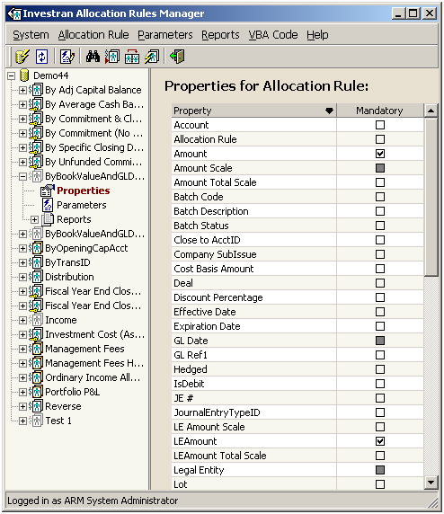

### 5. Run and reconcile

Use `Allocation Rule > Run`, enter the values, and select `Accept Values`.

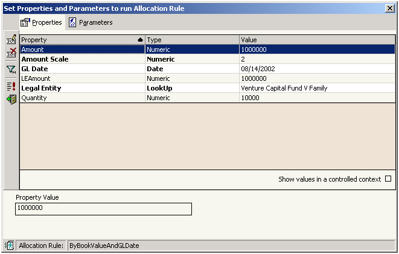

ARM displays the result by Investor:

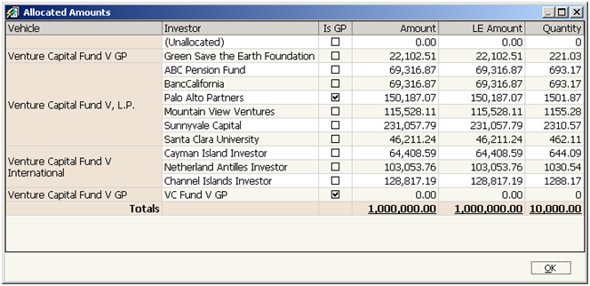

Validate:

- correct Investor in each row;
- no duplicate or ineligible Investors;
- Amount, LE Amount, and Quantity per Investor;
- totals equal to source values in Top Down;
- correct sum of individual values in Bottom Up;
- consistent sign;
- nonnegative quantity;
- explained rounding differences.

### 6. Make the rule available

Only after reconciliation and approval, use Edit and change the status to `Normal`.

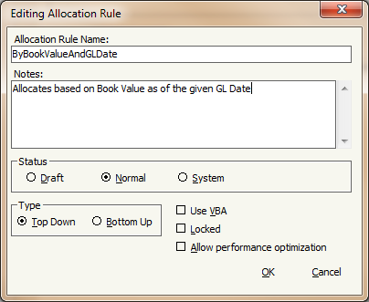

`Draft` is not available in Accounting. `System` is reserved for vendor rules.

## Creating a Complex Dynamic Allocation Rule

Use a complex rule when you need to combine reports, apply conditions, or manipulate `InvestorSet` programmatically.

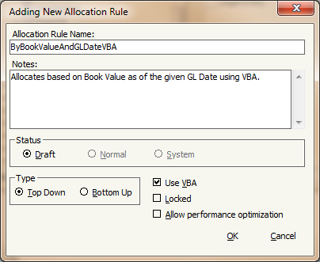

Recommended workflow:

1. create the rule in Draft and enable `Use VBA`;
2. associate all Properties, Parameters, and Reports;
3. open the VBA Editor;
4. implement `Sub Main` with `Option Explicit`;
5. read inputs through `AllocationRule.Properties` and `AllocationRule.Parameters`;
6. run reports through `AllocationRule.Reports`;
7. build auxiliary sets with `NewInvestorSet`;
8. apply calculation and rounding;
9. copy the final result to `AllocationRule.Results`;
10. save the module and run the rule;
11. also test through the actual consumer.

See [Object model and technical contracts](object-model.md) for `RWReport`, `InvestorSet`, and the `AllocationRule` object.

## Finding and changing an existing rule

1. Use `Allocation Rule > Find` to locate text in the tree.
2. Confirm the rule through attributes and dependencies, not just its name.
3. Run a baseline and save the inputs/results.
4. Check whether the rule is in use; if so, ARM blocks Edit/Delete.
5. Duplicate or export the approved version according to the internal process.
6. Make the smallest possible change to a report, input, attribute, or VBA.
7. Run Refresh when reports have changed.
8. Repeat the baseline, edge cases, and integrated test.

Do not try to bypass restrictions by editing the database directly.

## Refresh, cache, and differences between ARM and ATM

Three situations frequently complicate diagnosis:

- the report changed, but ARM still displays previous metadata: run Refresh;
- the rule works in ARM but differs in ATM: compare Properties, Parameters, and context sent by the template;
- `Allow performance optimization` is enabled: ATM may reuse values obtained by the driver, while Accounting does not use this cache in the same way.

Test ARM independently and then the consuming workflow. A correct result in `Run` alone does not prove that the integration is correct.

## Publication and rollback

The guide confirms the Import-Export Console for transferring rules and related reports between databases. Before promoting:

- preserve the previous version;
- inventory reports, parameters, UDFs, and VBA references;
- confirm IDs and conflicts at the destination;
- import in the approved order;
- run Refresh;
- run a smoke test with known values;
- test the consumer;
- maintain a consistent restoration procedure.

Restoring only the VBA may not reverse a change that also involved a report, Properties, or Parameters.

## Quick usage checklist

- [ ] database, user, and entitlement confirmed;
- [ ] Static/Dynamic type and Top Down/Bottom Up direction confirmed;
- [ ] rule kept in Draft during development;
- [ ] reports in Public Read-only and validated independently;
- [ ] Property/Parameter names compatible with reports;
- [ ] VBA explicitly saved, where applicable;
- [ ] Run executed with representative context;
- [ ] result reconciled per Investor and in total;
- [ ] integrated test executed;
- [ ] approval obtained before Normal;
- [ ] package and rollback documented.

## Source

- *Internal_INV7_ARM_Dev_Guide.pdf*, chapters Getting Started with ARM, Navigation, Simple Dynamic Allocation Rules, Complex Dynamic Allocation Rules, and Allocation Rule Development.
