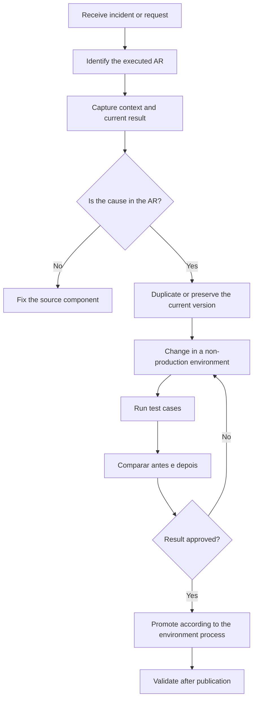

# Developing and Changing Allocation Rules

> This guide focuses on application support. It consolidates only what the supplied documents support. Where the material does not describe the exact Allocation Rule Manager interface, the procedure is marked **TODO (KT)**.

## Purpose

Provide a safe roadmap for creating or changing an Allocation Rule while preserving traceability, distinguishing upstream defects, and avoiding promotion of an unvalidated rule.

## When an AR change is actually needed

Before changing the rule, confirm that it contains the defect. In allocation incidents, the AR may simply be receiving incorrect context from another component.

Check first:

- incorrect Legal Entity;
- investors outside the expected scope;
- incorrect accounting or effective dates;
- outdated commitment, closing date, balance, cost, or unfunded commitment;
- incorrect Allocation Rule ID supplied by an Active Template or Batch;
- incorrectly configured dominant/non-dominant transaction;
- rounding or rebalancing after calculation;
- Report Wizard or automation returning unexpected data.

## Recommended workflow

## 1. Preparation

Record before the change:

- Allocation Rule name and ID;
- type: static or dynamic;
- direction: top-down or bottom-up;
- affected Legal Entity or set of entities;
- component that calls the rule;
- reference transaction or Batch;
- parameters and dates used;
- expected investors;
- current percentages, values, or quantities;
- result expected by the client;
- evidence of the error;
- version and environment where the error was reproduced.

## 2. Permissions

The documents distinguish two access levels:

- **ARM Admin**: create, edit, run, and delete Allocation Rules;
- **ARM User**: run Allocation Rules.

Confirm permissions before diagnosing an interface failure as an application defect.

## 3. Location and inventory

### Confirmed information

- dynamic rules are administered through Allocation Rule Manager;
- static rules are maintained through the **Static Allocation Rules** utility in Portfolio & Investor Manager;
- ARM allows users to find, add, edit, delete, duplicate, and simulate rules;
- rules used by at least one transaction cannot be edited or deleted;
- `Run` simulates execution with properties and parameters without changing the database;
- rules start in `Draft` and become available to Accounting only in `Normal`;
- the ATM guide states that Investran metadata can be queried through Report Wizard to find Allocation Rule IDs by name;
- Active Templates can set the rule by ID in `Application.Context.AllocationRule`.

### Environment dependencies still requiring KT

Document in the supported environment:

- exact path for opening ARM;
- available search filters;
- functional and technical owners;
- conventions for Notes, locks, and names;
- policy for duplication and preservation of the previous version;
- inventory of custom rules and consumers.

For detailed tool operation, see [ARM interface and lifecycle](arm-interface-and-lifecycle.md). For VBA classes, see [Object model and technical contracts](object-model.md).

## 4. Understand the rule before editing

Classify the rule using the questions below.

### Allocation base

Does the rule use:

- commitment;
- commitment and closing date;
- average cash balance;
- unfunded commitment;
- investment cost;
- capital account;
- management fee rate;
- user-provided values;
- another custom base.

### Investor universe

Confirm:

- who can participate;
- which dates determine eligibility;
- whether any investors are excluded;
- whether side letters or overrides exist;
- whether the rule handles GP, LP, or both;
- whether investors without a balance or commitment should receive zero;
- how new closings enter the calculation.

### Result

The output should represent:

- percentages;
- values;
- number of shares;
- an `InvestorSet` populated by the calling code;
- aggregated totals for Vehicle and Legal Entity.

### Minimum invariants

In most scenarios, validate:

- expected sum of percentages;
- sum of allocated values equals the input total;
- no `NULL` values for valid investors;
- consistent zero handling;
- rounding behavior;
- correct generation of the non-dominant or balancing portion.

> The expected sum is not always 100% at intermediate stages. Confirm the rule's functional contract before treating any difference as an error.

## 5. Change strategy

### Prefer the smallest possible change

Avoid rewriting the rule during an emergency fix. Change only the condition, source, or calculation proven to be defective.

### Do not use unknown IDs without validation

The ATM manual provides the following example:

| ID | System rule |
|---:|---|
| 0 | Non-Dominant |
| 1 | No Allocation |
| 2 | User Provided |

Validate these IDs in the installed version before use. For custom rules, prefer resolving the ID through metadata or configuration instead of scattering undocumented numbers throughout the code.

### Avoid hard-coded business values

The Active Templates development guide recommends storing mutable values in User Defined Fields and retrieving them through Report Wizard instead of embedding them in VBA. Apply the same principle when an AR or its consumer depends on configurable business percentages, dates, or limits.

### Preserve compatibility

Before removing fields, parameters, or dependencies, identify all consumers:

- Active Templates;
- Batch templates;
- Business Events;
- equalization/rebook processes;
- Report Wizard reports;
- jobs and integrations;
- manual processes.

## 6. Changes by type

### Static Allocation Rule

The documentation describes static rules as a table of fixed percentages per investor.

When making changes:

1. validate the correct Legal Entity;
2. confirm the validity period or relevant date, if available in the environment;
3. compare the investor list before and after;
4. confirm that percentages reflect the business agreement;
5. check added, removed, or inactive investors;
6. validate the sum;
7. run a test transaction.

### Dynamic Allocation Rule

Dynamic rules recalculate ratios as data changes.

When making changes:

1. identify the source of each data item;
2. confirm cutoff dates;
3. confirm investor filters;
4. validate rules for zero, null, and negative values;
5. test with historical and current data;
6. test investors with different closing dates;
7. check overrides and exceptions;
8. compare results per investor.

### Top-Down

The value originates at Legal Entity level and is distributed to investors.

Validate:

- input total;
- eligible population;
- ratio per investor;
- sum of allocations;
- rounding difference;
- balancing/non-dominant.

### Bottom-Up

The value originates or is calculated at investor level and is then aggregated.

Validate:

- individual value for each investor;
- aggregated total per Vehicle;
- aggregated total per Legal Entity;
- duplicate investors;
- precision loss during aggregation.

## 7. Interaction with Active Templates

The ATM manual shows that the Allocation Rule is set in the transaction context. Execution occurs between the `BeforeTransaction` and `AfterTransaction` events.

Two patterns are relevant:

### Rule executed by the engine

The code sets `Application.Context.AllocationRule` to the rule ID. The engine calculates the allocation.

### User Provided

The code sets the rule to User Provided and populates the `InvestorSet` in the `AfterTransaction` event.

When changing an AR consumed by an AT, also validate:

- where the ID is assigned;
- whether the assignment changes by `JEIndex` or `TXIndex`;
- whether `AfterTransaction` replaces or adjusts the result;
- whether rounding rebalancing exists;
- whether the last transaction is converted to non-dominant;
- whether the AT uses one rule for dominant and another for balancing.

## 8. Minimum tests

Create at least these scenarios:

| Scenario | Purpose |
|---|---|
| Nominal case | Validate the most common workflow |
| One investor | Confirm 100% or equivalent behavior |
| Multiple investors | Validate distribution and sum |
| Investor without commitment/balance | Confirm exclusion or zero |
| Different closing dates | Validate eligibility over time |
| Zero value | Confirm zero handling |
| Negative value | Validate reversals/adjustments |
| Rounding | Confirm balancing |
| GP Legal Entity | Avoid null or invalid allocations |
| Reprocessing | Confirm determinism |

For each test, save:

- input;
- previous result;
- new result;
- difference per investor;
- total sum;
- approval evidence.

## 9. Functional validation

Do not approve solely because execution finished without an error.

Confirm:

- correct investors;
- correct calculation base;
- correct percentages;
- correct values;
- correct dates;
- GP/LP treatment;
- reconciliation to the transaction value;
- impact on PCAP, management fees, equalization, or reporting, where applicable.

## 10. Publication and rollback

The ARM guide confirms that the **Import-Export Console** transfers Allocation Rules and related reports between databases. The materials do not provide the complete promotion procedure specific to each environment.

### TODO (KT)

Document:

- package format;
- dependency promotion order;
- required approval;
- prior backup;
- post-deployment validation;
- rollback procedure;
- ability to restore the previous version;
- cache or restart impact.

Until this is confirmed, do not treat direct production changes as the standard process.

## 11. Checklist before saving

- [ ] Defect reproduced.
- [ ] Correct AR identified.
- [ ] Input context recorded.
- [ ] Consumers identified.
- [ ] Current version preserved.
- [ ] Minimal change applied.
- [ ] Edge cases tested.
- [ ] Totals reconciled.
- [ ] Result per investor reviewed.
- [ ] Evidence attached.

## 12. Checklist before publication

- [ ] Functional approval obtained.
- [ ] Promotion process confirmed.
- [ ] Dependencies available at the destination.
- [ ] Identifiers validated at the destination.
- [ ] Rollback plan prepared.
- [ ] Maintenance window and communication confirmed.
- [ ] Post-deployment test defined.

## 13. Errors to avoid

- changing the first rule with a similar name without confirming the ID;
- assuming the problem is in the AR without validating the input;
- testing only the total and ignoring distribution per investor;
- using hard-coded IDs without documentation;
- publishing without saving the previous version;
- ignoring rounding and balancing;
- testing in ARM but not in the actual workflow that consumes the rule;
- changing static percentages without business approval;
- confusing a permission failure with a rule failure.

## Required KT follow-ups

- [ ] Demonstration of custom AR creation.
- [ ] Demonstration of safe editing.
- [ ] How to view the internal implementation.
- [ ] How to run an AR independently.
- [ ] How to supply test context and parameters.
- [ ] Debugging tool and process.
- [ ] Export/import between environments.
- [ ] Versioning and rollback.
- [ ] Execution logs and tables.
- [ ] Internal naming conventions.
