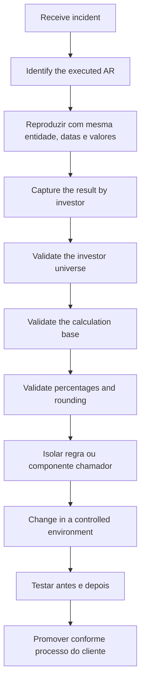

# Allocation Rules — Maintenance Guide

## 1. Operational purpose

This guide describes how to approach an Allocation Rule that behaves incorrectly without having to know all the rules in the environment beforehand.

The recommended process is:



## 2. Minimum incident information

Before investigating, record:

- Allocation Rule name or ID;
- environment;
- Legal Entity;
- Vehicle/Fund, where applicable;
- Batch, Journal Entry, and Transaction involved;
- Effective Date and GL Date;
- local currency and Legal Entity currency;
- expected total and actual total;
- expected investors and returned investors;
- expected percentages or amounts per investor;
- execution origin: user, Batch, Active Template, Business Event, or another process;
- evidence: report, screen, file, or log.

Without this information, the risk of reproducing a different scenario is high.

## 3. Identify which rule was executed

### When called by an Active Template

The ATM guide shows that the rule can be assigned through VBA using the property:

```vb
Application.Context.AllocationRule = <AllocationRuleID>
```

There are also cases where the AT uses `User Provided` and populates the `InvestorSet` in the `Application_AfterTransaction` event.

When analyzing an AT:

1. search for `AllocationRule` in the VBA module;
2. locate `cstAR_*` constants;
3. confirm whether the code changes the rule in `BeforeTransaction` or `AfterTransaction`;
4. check whether the rule varies by `JEIndex`, `TXIndex`, the last Driver Report row, or another condition;
5. confirm the ID through metadata/a report, not just the constant name.

### When called by a Batch or screen

Check the transaction details to confirm which rule was selected and whether the transaction is dominant, non-dominant, or unallocated.

### When the ID is known but the name is not

The ATM manual states that Investran metadata can be used to create reports that retrieve Allocation Rule IDs by name. Maintain a Report Wizard lookup report in the project if the client permits it.

## 4. Understand an unfamiliar AR

Use the sequence below.

### 4.1 Purpose

- Which financial item does it allocate?
- Is it used for revenue, expenses, gains, losses, management fee, investment cost, or rebook?
- Is it generic or specific to a fund/process?

### 4.2 Direction

- **Top Down:** receives a total at Legal Entity level and distributes it among investors.
- **Bottom Up:** receives/calculates investor values and aggregates them to higher levels.

### 4.3 Nature

- **Static:** predefined fixed percentages.
- **Dynamic:** percentages recalculated from data.
- **User Provided:** the calling component supplies values per investor.
- **Non-Dominant:** used for the offsetting/balancing transaction.
- **No Allocation:** retains the value without distributing it to investors.

### 4.4 Inputs

Identify all actual inputs:

- Legal Entity;
- investor population;
- commitments;
- closing dates;
- cash balances;
- unfunded commitment;
- investment cost;
- invested capital;
- management fee rates and overrides;
- Effective Date/GL Date;
- Deal, Position, Transaction Type, or GL Account;
- parameters supplied by the calling process.

### 4.5 Outputs and invariants

Validate according to the rule type:

- sum of percentages = 100%;
- sum of allocated values = total transaction value;
- ineligible investors = zero or absent;
- no unexpected `NULL` values;
- debit/credit signs preserved;
- consistent local amount and LE amount;
- differences only within rounding tolerance;
- non-dominant transaction balances the journal entry.

## 5. Diagnosis by layer

### Layer 1 — Context

Confirm that the AR received the correct Legal Entity, dates, currency, transaction type, deal, and position.

### Layer 2 — Investor universe

Confirm:

- investors active on the date;
- valid commitments;
- closing dates;
- ownership/participation;
- investor permissions and domain;
- GP versus LP investors.

### Layer 3 — Calculation base

Documented examples of dynamic bases:

- average cash balance;
- commitment with or without closing date;
- unfunded commitment;
- investment cost as of the GL Date;
- invested capital;
- commitment during the investment period.

### Layer 4 — Calculation and rounding

Record intermediate values. Compare the raw ratio, rounded ratio, and final allocated value.

### Layer 5 — Consumer

Even if the AR is correct, the AT or Batch may:

- overwrite the Allocation Rule;
- change Amount/LEAmount after calculation;
- populate the InvestorSet manually;
- use the wrong rule in just one transaction template;
- run a rebook rule that differs from the original rule.

## 6. Safe changes

The supplied PDFs do not document the ARM interface step by step. Until KT confirms the process, use these minimum controls:

1. do not change production directly;
2. record the name, ID, and current state;
3. export or document the previous version;
4. identify all known consumers;
5. create test cases with expected results;
6. make the change in the development environment;
7. run positive, negative, and boundary cases;
8. compare before/after results per investor;
9. validate totals, rounding, and the non-dominant entry;
10. promote using the approved mechanism;
11. run a smoke test in the target environment;
12. maintain a rollback plan.

## 7. Minimum test matrix

| Scenario | Validation |
|---|---|
| One investor | Receives 100% |
| Multiple equal investors | Proportional distribution and reconciled total |
| Investor with a zero base | Receives no inappropriate allocation |
| Different closing dates | Eligibility according to date |
| Effective Date at the boundary | Consistent behavior |
| Negative values | Sign and total preserved |
| Two currencies | Consistent local and LE amounts |
| Value with many decimal places | Controlled rounding and residual |
| GP Legal Entity | Correct investors, without unexpected NULL |
| Rebook | Reversal and new allocation reconcile to the total |

## 8. Integrated test with an Active Template

When an AT uses the AR:

1. run the AT in Simulation Mode;
2. place a breakpoint before the assignment to `Application.Context.AllocationRule`;
3. capture context, rule ID, and values;
4. advance to `AfterTransaction`;
5. inspect the returned `InvestorSet`;
6. confirm the dominant and non-dominant transactions;
7. run through the Scheduler Engine in a test environment;
8. use Preview before Commit;
9. compare the generated batch with the expected result.

## 9. Publication and rollback

The ATM manual mentions the **ARM & ATM Export-Import Console** utility for transferring Active Templates and related items between databases. The specific procedure for promoting Allocation Rules must be confirmed in the environment.

Until confirmed, document the following for each release:

- source and destination;
- rule, ID, and version;
- dependencies;
- previous export/backup;
- test evidence;
- person responsible for approval;
- promotion time;
- post-deployment validation;
- exact rollback procedure.

## 10. Completion criterion

A fix should be considered complete only when:

- the root cause has been identified;
- the original scenario has been reproduced;
- the test fails before and passes after the change;
- the sum across investors reconciles to the total;
- affected consumers have been tested;
- the publication process has supporting evidence;
- rollback is available;
- the rule documentation has been updated.
