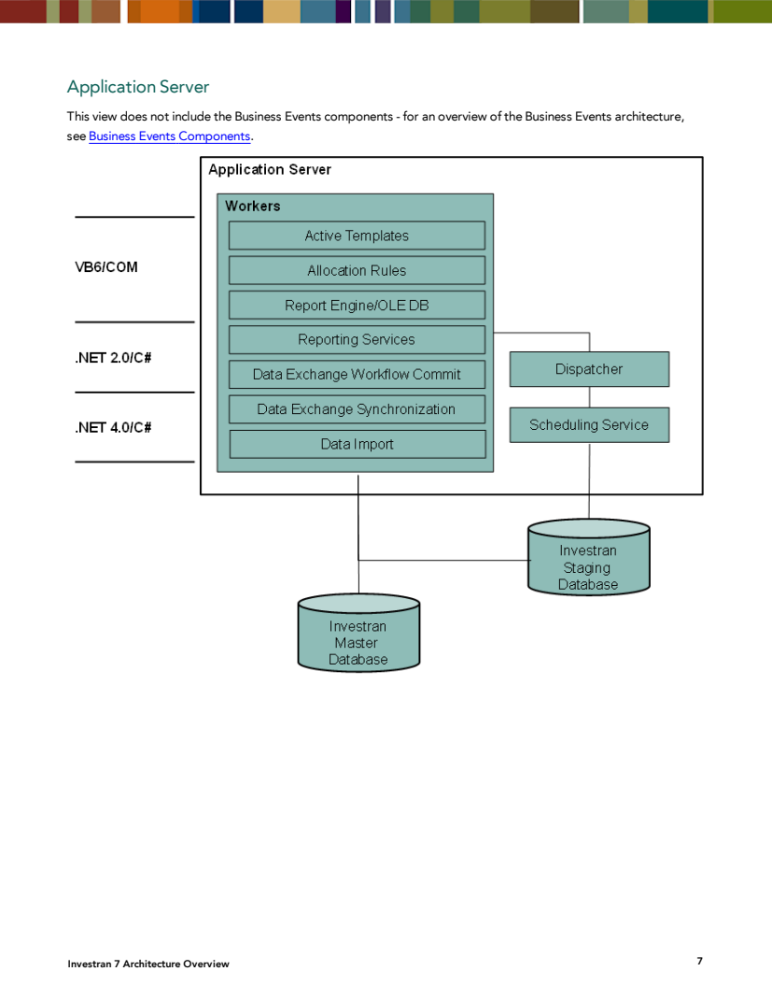
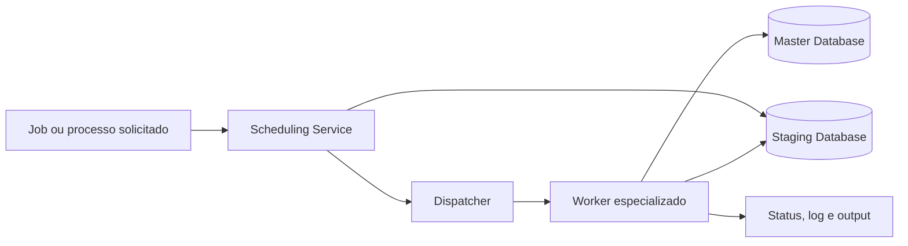
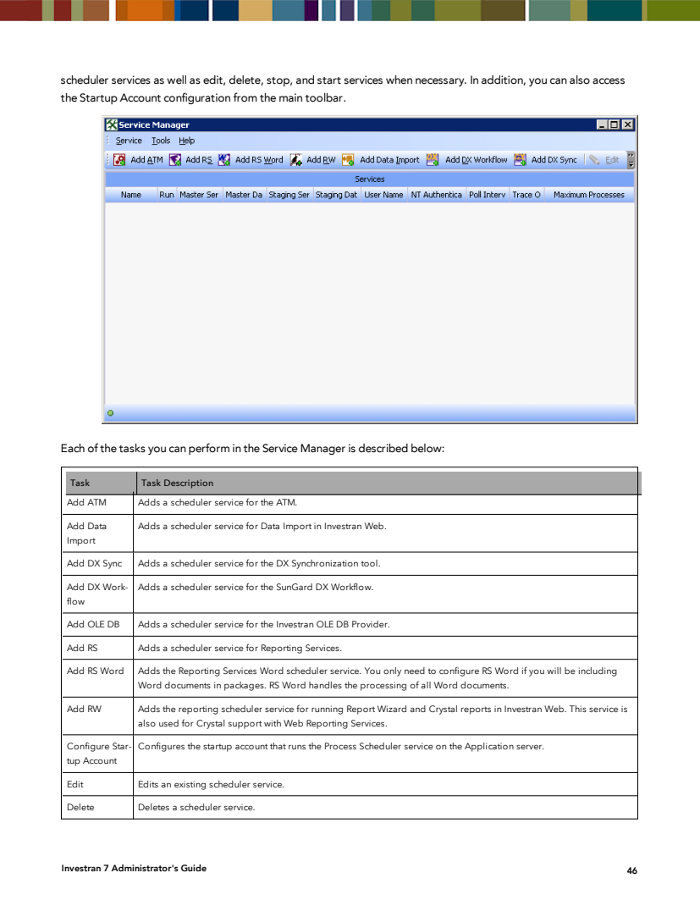
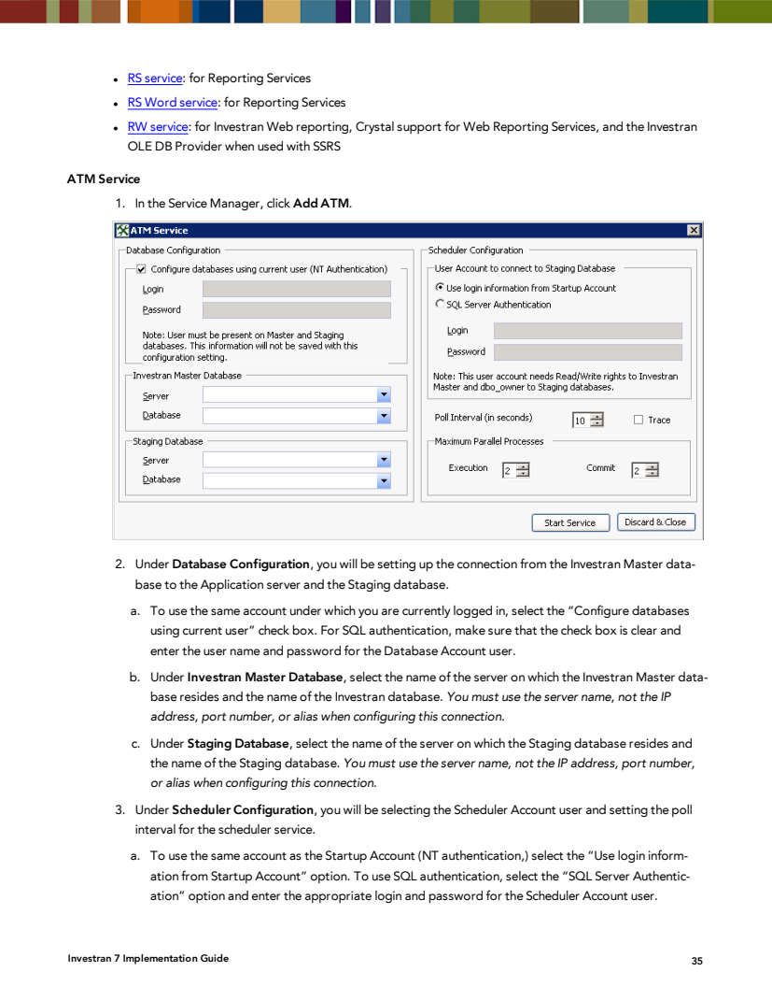
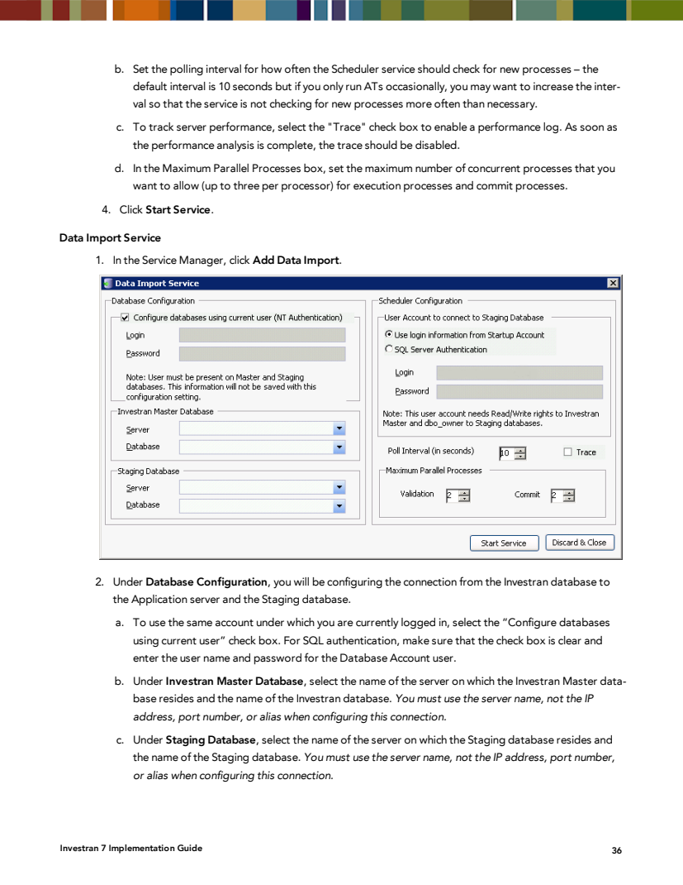
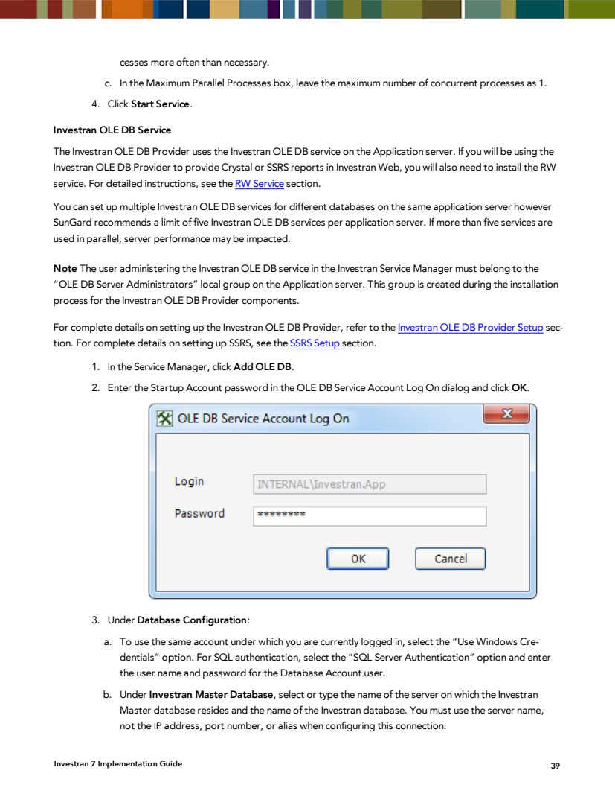
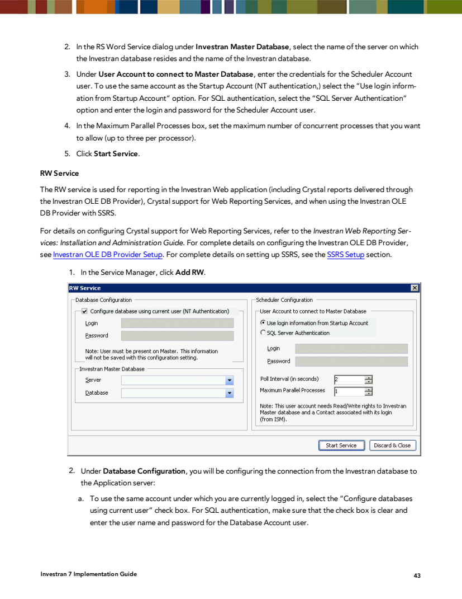

# Application Server - architecture and service catalog

## 1. Role of the Application Server

The Application Server centralizes scheduling and process execution for multiple modules. The manual states that multiple Application Servers can point to the same database, allowing a distributed architecture.



*Source: Internal_Inv7_INV_Architecture_7.pdf, Application Server, printed page 7.*

The diagram shows:

- `Scheduling Service`, connected to Staging;
- `Dispatcher`, which receives scheduled work;
- workers for Active Templates, Allocation Rules, Report Engine/OLE DB, Reporting Services, DX Workflow Commit, DX Synchronization, and Data Import;
- access to the Investran Master Database and, for applicable workflows, the Staging Database;
- different technologies depending on the component generation, such as VB6/COM and .NET.

Business Events uses a complementary architecture and is not included in this diagram.



## 2. Service Manager

The documented path is **Windows Programs > Investran > Servers > Service Manager**, on the server where the Application Server was installed.



*Source: Internal_Inv7_INV_Administrators_7.pdf, Service Manager, printed page 46.*

It allows you to:

- configure the Startup Account;
- add instances by module;
- edit configuration;
- start and stop;
- delete a scheduler service definition.

Deletion in Service Manager is a destructive configuration change and must not be confused with temporarily stopping the Windows service.

## 3. Shared components

### Process Scheduler / Scheduling Service

Periodically checks for pending work and starts the processing workflow. The manual mentions the Windows service `SunGard Investran Scheduling Service` and, in diagnostics, `FTI Process Scheduler`.

Common functions and parameters:

- Startup/Scheduler Account;
- connection to Master and, where applicable, Staging;
- polling interval;
- maximum parallel processes;
- performance tracing;
- instance mapping to an environment/database.

### FTI Process Dispatcher

Receives the request from the scheduler and starts/coordinates executors and workers. A dispatcher problem can leave jobs pending even when the scheduler instance appears to be started.

### Executor and Worker

The guides mention processes such as `FTI.SchedulingFramework.Executor.exe` and `FTI.SchedulingFramework.Worker.exe`. These are child processes used during execution, not necessarily independent services to manage manually in `services.msc`.

Do not terminate executors/workers through Task Manager without a specific procedure: they may also serve ATM, DX Workflow, and Reporting Services, and partial output may exist.

## 4. Module service catalog

### ATM Service

Purpose: run Active Templates outside local simulation, including generation and commit according to configuration.



*Source: Internal_Inv7_INV_Implementation.pdf, ATM Service, printed page 35.*

Main dependencies:

- Master Database;
- Staging Database;
- Scheduler Account;
- polling interval;
- separate limits for Execution and Commit;
- time synchronization between servers.

Associated symptoms: AT remains scheduled, generation does not start, Preview does not appear, commit does not occur, or a job gets stuck.

### Data Import Service

Purpose: validate and load Import Jobs created in Investran Web.



*Source: Internal_Inv7_INV_Implementation.pdf, Data Import Service, printed page 36.*

Main dependencies:

- Master and Staging;
- scheduler account;
- polling interval;
- Validation and Commit parallelism;
- requesting user's license and entitlements.

Associated symptoms: jobs remain Scheduled/Validating/Loading, validations are not picked up, or loads do not start.

### DX Synchronization Service

Purpose: run Data Exchange synchronization processes with Investran Web.

Service Manager uses `Add DX Sync`. The documented configuration includes Master Database, account, polling interval, and concurrency. Confirm the source, target, and behavior of the synchronization used in the environment.

### DX Workflow Service

Purpose: process Data Exchange Workflow commits.

The manual specifies `Add DX Workflow`, Windows authentication in the described version, and a maximum of 1 parallel process. This limit prevents inappropriate workflow concurrency but must be confirmed in the current release.

### Investran OLE DB Service

Purpose: serve the Investran OLE DB Provider, used by consumers such as Excel, Crystal Reports, and SSRS depending on the architecture.



*Source: Internal_Inv7_INV_Implementation.pdf, Investran OLE DB Service, printed page 39.*

Documented characteristics:

- `Add OLE DB` action;
- administrator account belonging to the local `OLEDBServerAdministrators` group;
- one instance per datasource/database;
- default initial port 19996 and subsequent ports for new instances;
- inbound firewall access;
- Windows or Kerberos authentication;
- SPN for Kerberos;
- shared folder at a UNC path;
- older recommendation of up to five OLE DB services per Application Server.

The manual warns that the authentication model can affect the user's data entitlements. This is a critical point in a security review.

### RS Service

Purpose: generate and deliver Investran Reporting Services packages.

Documented configuration:

- `Add RS` action;
- Master Database;
- Scheduler Account;
- polling interval;
- maximum generation/delivery processes;
- Processing Location and destinations configured through the module.

Do not confuse this RS with the Microsoft SQL Server Reporting Services Windows service. In this context, `RS Service` is the Investran Reporting Services scheduler.

### RS Word Service

Purpose: process Microsoft Word documents included in Investran Reporting Services packages. It is required only when those packages contain Word documents.

The manual also mentions the display name `Investran RS Word Processing Service`.

Dependencies: Master Database, service account, Microsoft Word/Office installed when required by the version, initialized profile, and parallel process limit.

### RW Service

Purpose:

- reporting in Investran Web;
- execution of Report Wizard and Crystal Reports on the web;
- Crystal support for Web Reporting Services;
- use of the Investran OLE DB Provider with SSRS.



*Source: Internal_Inv7_INV_Implementation.pdf, RS Word Service and RW Service, printed pages 42-43.*

Dependencies: Master Database, Scheduler Account, polling interval, concurrency, Report Wizard Engine, and Crystal/OLE DB depending on the report type.

### Business Events Services

Business Events uses web extensions, BE API, server services, Domain Object Model, Enterprise Service Bus, and Investran/AR/RW engines. The documentation requires a Business Event service account, which can be the same as the Scheduler Account.

Because BE does not appear among the documented Service Manager `Add` actions, inventory its Windows services, application pools, and components separately. See the [Business Events](../business-events/README.md) section.

## 5. Platform dependencies

These services are not necessarily “Investran services”, but they may be required for the workflows:

| Dependency | Role |
|---|---|
| SQL Server | Master, Staging, jobs, and persistence |
| IIS / WAS | Investran Web and web applications |
| MSMQ / RabitMQ / service bus | messaging for distributed workflows, especially BE |
| MSDTC | distributed transactions when used by the topology |
| Windows Event Log | Application/System events from the scheduler and dispatcher |
| Microsoft Office/Word | Word composition in legacy Reporting Services |
| Print Spooler | package printing, when configured |
| File server/UNC | processing locations, datasource, and outputs |

## 6. Windows names

For each instance, capture both:

```powershell
Get-CimInstance Win32_Service |
  Where-Object { $_.DisplayName -match 'Investran|FTI|SunGard' } |
  Select-Object Name, DisplayName, State, StartMode, StartName, PathName
```

This command is read-only. Do not publish `PathName` or parameters if they contain credentials or sensitive information.

## 7. Minimum inventory matrix

| Field | Example of expected content |
|---|---|
| Environment/server | PROD / APP01 |
| Module | ATM, RW, RS, Data Import, etc. |
| Service Name | internal Windows name |
| Display Name | name displayed in services.msc |
| Executable | path and version, without secrets |
| Log On As | technical account |
| Startup Type | Automatic/Manual/Disabled |
| Expected state | Running/Stopped according to usage |
| Master/Staging | environment databases |
| Polling/concurrency | approved values |
| Port/UNC | where applicable |
| Logs | paths and retention |
| Dependencies | SQL, queue, filesystem, Office, etc. |
| Owner and criticality | responsible party, SLA, and change window |
