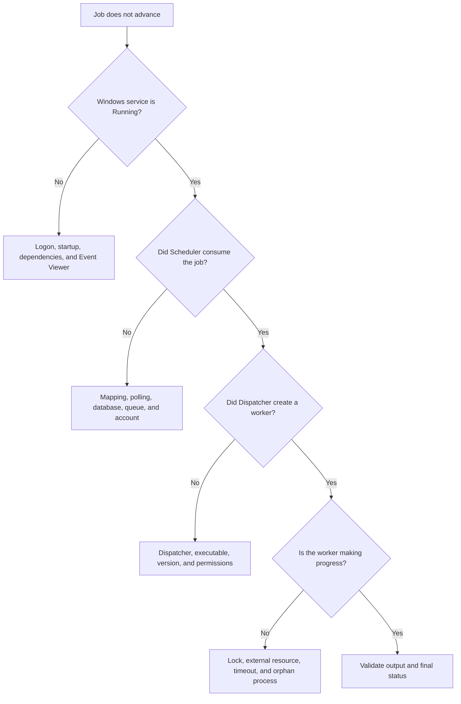

# Application Services - troubleshooting and safe restart

## Do not start with a restart

A restart can erase evidence, interrupt jobs, and create duplicates if the requester repeats the operation. First determine whether the problem is in the scheduler, dispatcher, worker, database, queue, or external resource.

## Initial evidence collection

- environment and Application Server;
- Service Name and Display Name;
- module and configured database;
- state, start mode, and logon account;
- Job/Process/Execution ID;
- status and time of the last transition;
- active Worker/Executor processes;
- concurrent jobs;
- Application/System Event Viewer logs;
- module logs;
- Master/Staging, queue, port, and share involved;
- recent password, certificate, DNS, firewall, database, or deployment change.

## Diagnostic tree



## Common symptoms

| Symptom | Initial hypotheses |
|---|---|
| Service does not start | password, Log on as a service, dependency, port, configuration, or binary |
| Starts and stops | initialization exception, inaccessible database/share, or invalid configuration |
| Running without processing work | incorrect Master/Staging, polling, mapping, queue, account, or dispatcher |
| Jobs stuck in every module | shared component, SQL, queue, or Startup Account |
| Only one module fails | service-specific configuration/worker/dependency |
| Only commit fails | Staging/Master, permission, lock, or business validation |
| OLE DB does not start | port in use, local group, account, SPN, or share |
| RS Word hangs | account profile, Word/Office, popup, file, printer, or orphaned worker |
| RW/Crystal fails | RW Service, OLE DB, Crystal runtime, report, or datasource |
| Points to the wrong target after restore | Service Manager/Config.xml still mapped to the previous environment |

## Account and password

When a `logon failure` occurs:

1. identify all instances that use the account;
2. check lockout/expiration without repeatedly testing the password;
3. update the credential through the approved process;
4. confirm `Log on as a service` and database/share permissions;
5. restart in a controlled order;
6. run smoke tests in all modules sharing the account.

A single Startup/Scheduler Account can affect several services simultaneously.

## Safe restart

### Pre-check

- [ ] Incident and hypothesis recorded.
- [ ] Exact service and server confirmed.
- [ ] Active, scheduled, and loading/commit jobs identified.
- [ ] Partial output checked.
- [ ] Dependencies and impact assessed.
- [ ] Approval/change window obtained when required.
- [ ] Logs and Event Viewer evidence preserved.
- [ ] Success and rollback criteria defined.

### Generic sequence

1. block new submissions only if the procedure permits;
2. wait for jobs that can safely finish, or document the decision to interrupt them;
3. stop the specific instance through Service Manager;
4. confirm in Windows that the process actually ended;
5. do not terminate a remaining Worker/Executor without identifying the Job ID;
6. correct the cause or configuration;
7. start dependencies before the scheduler that uses them;
8. start the instance;
9. confirm there are no errors in Event Viewer or logs;
10. observe the backlog being processed;
11. run a functional smoke test;
12. reconcile interrupted jobs.

### Post-check

- [ ] Service remains Running.
- [ ] Scheduler resumes processing work.
- [ ] Dispatcher/workers are created normally.
- [ ] Backlog decreases without duplicates.
- [ ] Functional output validated.
- [ ] Interrupted jobs reconciled.
- [ ] Cause and prevention documented.

## Orphaned or stalled process

The Administrator's Guide has a specific procedure for stalled Reporting Services and mentions shared executors/workers. Do not generalize this procedure to ATM, DX, or other modules.

Before terminating a process:

- map the PID to the Job/Process ID;
- confirm the owner and module;
- check for partial writes;
- preserve dumps/logs if applicable;
- confirm it is not serving another job;
- use the official runbook for the version;
- reconcile after recovery.

## Command-line start/stop

The documented examples are:

```powershell
net start "Scheduler Service Name"
net stop "Scheduler Service Name"
```

Prefer commands that query the target before changing its state. Never use a broad filter to stop all Investran services at once.

Read-only example:

```powershell
Get-Service -Name "NOME_EXATO" | Select-Object Name, DisplayName, Status, StartType
```

## When to escalate

- financial jobs with partial output;
- orphaned worker without reliable correlation;
- growing backlog after restart;
- service repeatedly starts and stops;
- need to edit the database/internal configuration;
- suspected binary incompatibility;
- OLE DB/Kerberos/SPN with a risk of unauthorized exposure;
- failure after restore/upgrade;
- multiple Application Servers competing for or failing to process the same jobs.

## Evidence for escalation

- instance inventory;
- timeline and IDs;
- exported Event Viewer logs;
- module logs;
- sanitized configuration;
- process/queue state;
- Master/Staging and version/MR;
- recent change;
- smoke test performed;
- outputs found and reconciliation.

## Sources

- *Internal_Inv7_INV_Architecture_7.pdf*, Application Server.
- *Internal_Inv7_INV_Implementation.pdf*, Application Server Setup and scheduler service configuration.
- *Internal_Inv7_INV_Administrators_7.pdf*, Application Server Management, Service Manager, and troubleshooting.
