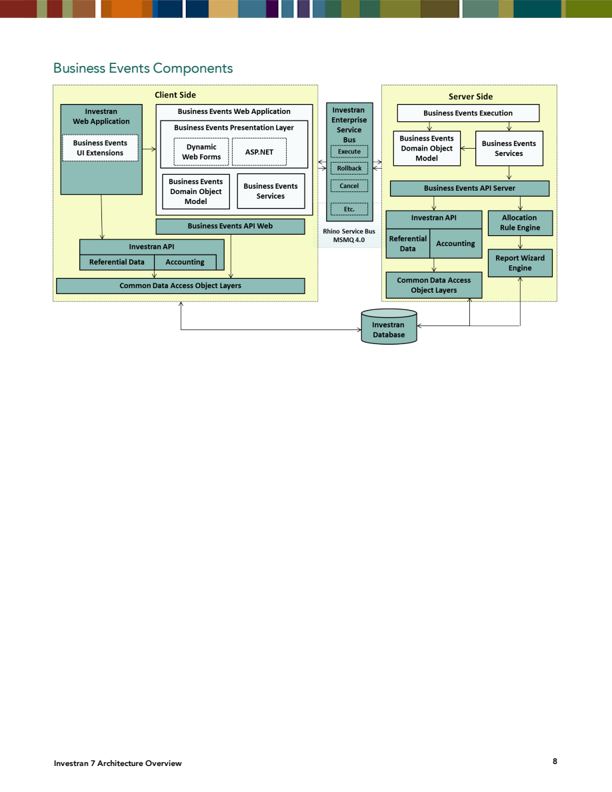
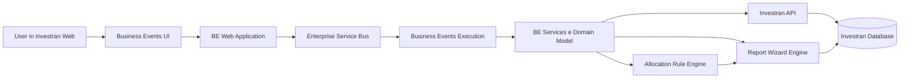
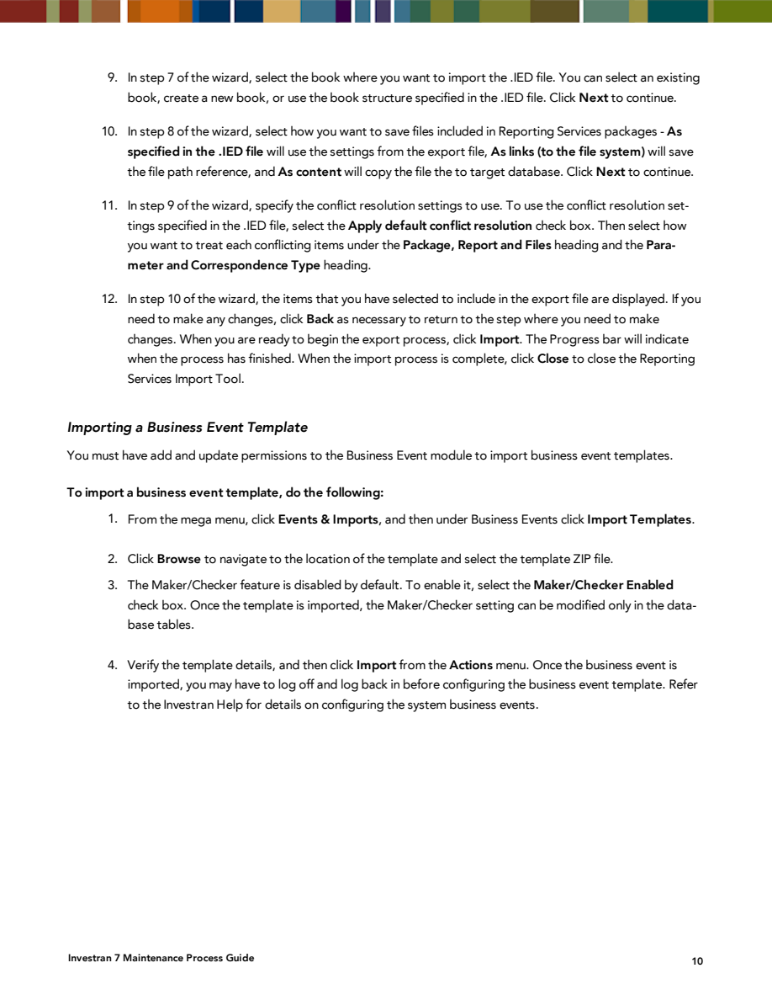
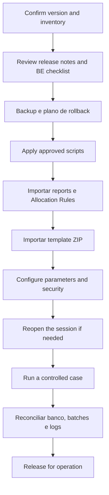

# Business Events practical guide

## 1. What a Business Event is

A Business Event (BE) encapsulates a business process that can query data, apply rules, and make changes in Investran. The interface is in Investran Web, while execution can span web components, application services, and specialized engines.

Documented examples for the version consulted:

| Business Event | Purpose indicated by the name and package | Documented deployment dependencies |
|---|---|---|
| Equity Pickup | Equity pickup processing | Transaction UDF script, `.IED` report, and `.ZIP` template |
| Fund Valuation | Fund valuation processing | `.ZIP` template |
| LP Capital Event | LP capital event processing | Bank Account UDF script and `.ZIP` template |
| Partner Transfer | Transfer of interests between investors | `.CAB` reports and `.ZIP` template |

> The table reproduces the deployment checklist from the maintenance manual. The business logic, parameters, and availability of each event must be confirmed in the installed version.

## 2. Architecture

*Source: Internal_Inv7_INV_Architecture_7.pdf, Business Events Components, printed page 8.*

The diagram separates the components into two sides:

### Client and Web

- **Investran Web Application:** hosts BE interface extensions;
- **Business Events Web Application:** contains the presentation layer, WebForms/ASP.NET, domain object model, and services;
- **Business Events API Web:** provides the access layer used by the web component;
- **Investran API:** supplies reference and accounting data;
- **Common Data Access Object Layers:** centralizes database access.

### Server

- **Business Events Execution:** coordinates execution;
- **Business Events Services:** applies service logic;
- **Business Events Domain Object Model:** represents domain objects and rules;
- **Business Events API Server:** integrates execution with other components;
- **Investran API:** accesses reference and accounting data;
- **Allocation Rule Engine:** runs allocation rules when the BE depends on them;
- **Report Wizard Engine:** supplies report data used by the process;
- **Common Data Access Object Layers:** persists and queries data in the Investran Database.

The two sides communicate through the **Investran Enterprise Service Bus**, shown in the manual with operations such as `Execute`, `Rollback`, and `Cancel`, over Rhino Service Bus/MSMQ 4.0. The exact technology must be validated in the current environment because the material is old.

## 3. Where to find it

The documented import path is:

1. access Investran Web;
2. open the mega menu;
3. select **Events & Imports**;
4. under **Business Events**, choose **Import Templates**.

Once imported, the event should appear in the Business Events area for configuration and execution, depending on permissions and version. Exact screen and action names may vary.

## 4. How a BE is delivered

The release package contains a `SystemPackages` folder. The manual indicates that `SystemPackages\BusinessEvents` contains the set of BEs for that version, distributed as `.ZIP` files.

Do not treat the `.ZIP` in isolation. Build a matrix for each event:

| Dependency | Control question |
|---|---|
| `.ZIP` template | Does it match the environment's version/MR? |
| SQL script | Has it been reviewed, approved, applied, and recorded? |
| `.CAB` report | Was it imported through the ARM & ATM Export Import Console? |
| `.IED` report | Was it imported through the Reporting Services Import Tool? |
| Allocation Rule | Does it exist, is it the correct version, and does it return the expected result? |
| Configuration | Do the parameters, hierarchies, UDFs, and transaction types exist? |
| Security | Do the user and service account have only the permissions they need? |

## 5. Importing the template

*Source: Internal_Inv7_INV_Maint_Process.pdf, Importing a Business Event Template, printed page 10.*

Consolidated procedure:

1. confirm package compatibility with the version and maintenance release;
2. validate the backup, maintenance window, and recovery plan;
3. first import scripts, reports, and rules required by the event checklist;
4. access **Events & Imports > Business Events > Import Templates**;
5. click **Browse** and select the `.ZIP`;
6. decide whether the event will use **Maker/Checker**;
7. review the details displayed;
8. run **Import** from the **Actions** menu;
9. close and reopen the session if the event does not appear for configuration;
10. configure and validate the BE with a controlled case.

### Maker/Checker considerations

The manual states that Maker/Checker is disabled by default and can be enabled during import. After that, the setting could only be changed directly in database tables in the documented version.

This makes the choice a deployment decision. Do not change tables directly based solely on the old manual. If a change is needed, use the official procedure for the version, approval, and FIS/DBA support.

## 6. Recommended deployment order

If a dependency fails, stop before importing or activating the following stages. Recording the actual order is essential for reproducing deployment and performing rollback.

## 7. How to configure and use it

Fields vary by BE type. For each event, document:

- technical name and display name;
- template version and compatible MR;
- entity, fund family, vehicle, or investor in scope;
- accounting date, effective date, and processing period;
- reports and parameters used as input;
- Allocation Rules and hierarchies queried;
- batch, journal entry, account, and transaction types used;
- options that change the processing scope;
- executing user and service account;
- expected output and reconciliation method.

### Before execution

- confirm that the template is active and correctly configured;
- confirm that reports and rules return consistent data;
- check that no concurrent execution exists for the same scope;
- record parameters and date/time;
- capture evidence of balances or objects before execution;
- identify whether the action creates batches, changes data, or only calculates results.

### During execution

- follow the status in Investran Web;
- correlate time, user, BE name, and identifier/GUID;
- monitor the services and queues used by the environment;
- do not start a second execution simply because the first seems slow.

### After execution

- check functional status, not just the success message;
- identify all batches, entries, and files created;
- reconcile totals, entities, dates, currencies, and quantities;
- validate the effect on dependent reports;
- preserve execution logs and evidence;
- obtain functional approval when accounting is affected.

## 8. Changes and versioning

The supplied manuals explain import and deployment, but do not describe a generic editor for modifying the internal logic of all BEs. Therefore:

- treat the `.ZIP` as a versioned, immutable artifact;
- do not edit its contents directly without an officially supported tool, source, and process;
- record checksum, filename, version, source, and import date;
- keep report, rule, and script versions aligned with the template;
- compare parameters and settings between environments;
- never replace it in production without prior validation and a defined rollback.

For a customization, KT must identify where the source code is located, how it is compiled/packaged, which tools are used, how to debug it, and who approves publication.

## 9. Logs and observability

Existing internal notes indicate two groups of logs:

- **Web Server:** installation log directory, typically correlated by BE and date;
- **Application Server:** profile of the account running the service, under `AppData\Local\Business Events\Logs`, identified by GUID/name/date.

Paths must be inventoried for each environment. In addition, correlate:

- IIS/Investran Web logs;
- Business Events service logs;
- queues and pending messages, if the architecture uses MSMQ;
- Report Wizard Engine and Allocation Rule Engine logs;
- batch records and application messages;
- SQL Server only for approved diagnostics, preferably read-only.

## 10. Summary operational checklist

### Before execution

- [ ] BE, version, and owner identified.
- [ ] Parameters recorded and approved.
- [ ] Reports, rules, scripts, and settings validated.
- [ ] Scope and concurrency checked.
- [ ] Prior evidence and success criteria defined.

### After execution

- [ ] Status and GUID recorded.
- [ ] Outputs and batches identified.
- [ ] Totals and entities reconciled.
- [ ] Logs preserved.
- [ ] Functional approval recorded.

## 11. What to request during Knowledge Transfer

Request a real demonstration, recorded or attended, for each critical BE:

1. where to find the event;
2. how to recognize the installed version;
3. how to configure each parameter;
4. which data or report feeds the process;
5. which services execute the event;
6. how to follow progress;
7. which artifacts are produced;
8. how to reconcile the result;
9. how to diagnose the three most common failures;
10. when to retry, cancel, roll back, or escalate.

## Sources

- *Internal_Inv7_INV_Architecture_7.pdf*, Business Events Components.
- *Internal_Inv7_INV_Maint_Process.pdf*, System Packages, Business Event Deployment Checklists, and Importing a Business Event Template.
- *Internal_Inv7_Partner.Transfer.Instructions.pdf*, legacy Partner Transfer business workflow.
- Existing summaries of *GFT Business Events Troubleshooting Guide.docx* and *PT BE Guidebook_2018.06.29.docx*. The Word files were not available in the current directory for another review.
