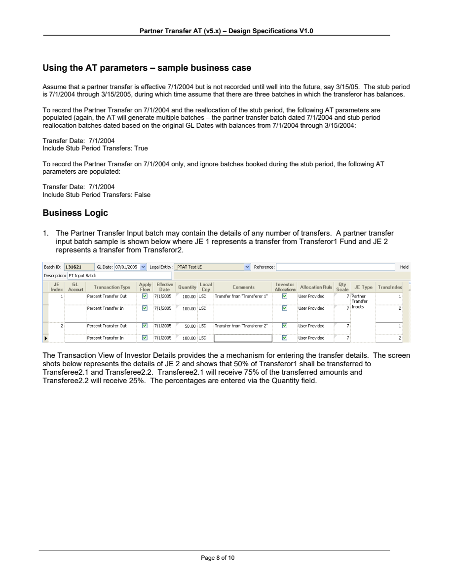
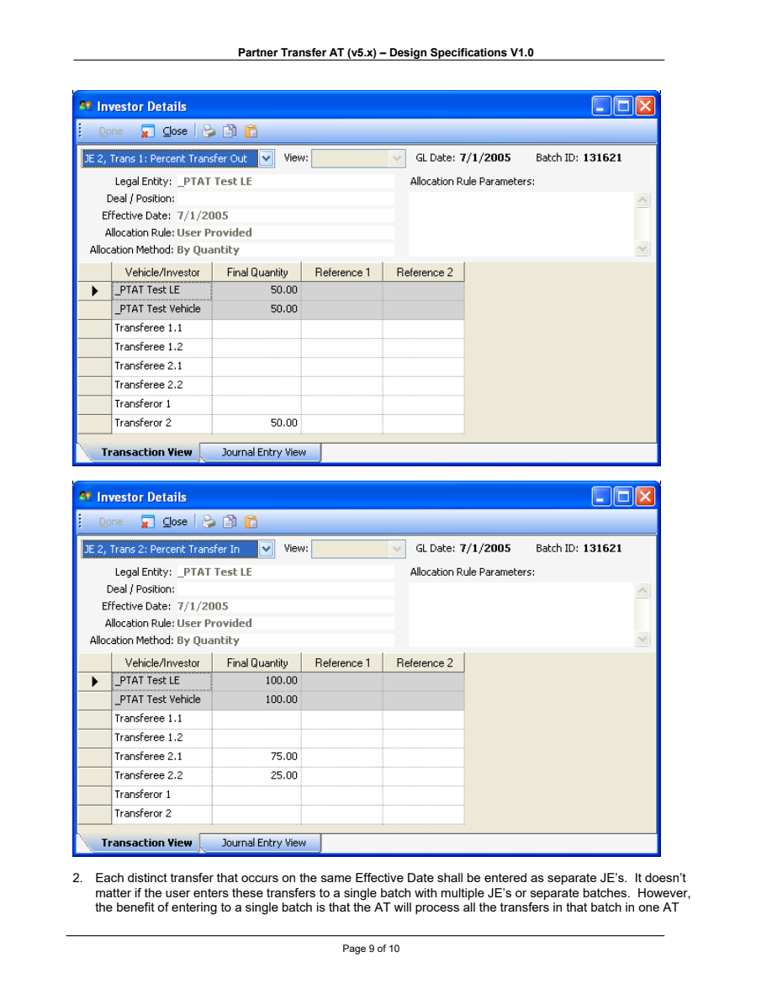
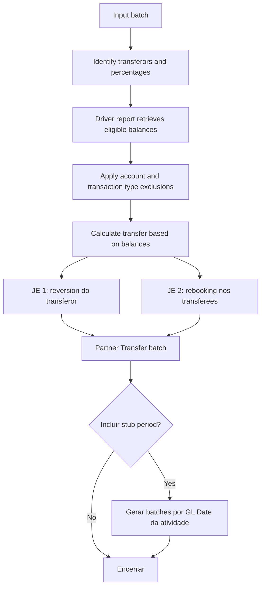

# Partner Transfer in depth

> **Document control:** Status: KT pending · Technical/functional owners: to be confirmed · Scope: validate against the installed version, configuration, and each environment · Last validation: not validated locally · Next review: after controlled reconciliation or any rule/process change · Evidence: attach a sanitized ticket/change and approved before/after reconciliation.

## Purpose

Partner Transfer automates the full or partial transfer of a **transferor**'s interest to one or more **transferees**. The process can move accounting balances, commitment, and unfunded commitment and, when configured, reallocate activity from the period between the transfer's effective date and its processing date.

The available PDF describes an older implementation called Partner Transfer Active Template (PTAT), version 5.x. The Investran 7 maintenance manual also lists Partner Transfer as a Business Event. Use the logic below to understand the domain, but confirm names, screens, and behavior in the current version.

## Terms

| Term | Operational meaning |
|---|---|
| Transferor | Investor transferring all or part of their balances and commitments |
| Transferee | Investor receiving the transferred interest |
| Transfer Date | Accounting date used to record the transfer |
| Stub Period | Interval between the effective date and the time the transfer is processed |
| Input Batch | Batch describing the transferor, transferees, and percentages |
| Partner Transfer G/L Account | Account used to isolate capital/P&L movements in the legacy workflow |

## Documented configuration

The legacy process depends on:

- Account Types correctly classified as `Capital`, `Revenue`, or `Expense`;
- Batch Type `Partner Transfer`;
- transaction types `Percent Transfer Out` and `Percent Transfer In`;
- a journal entry template with a debit to Percent Transfer Out and a credit to Percent Transfer In;
- Journal Entry Types for the transfer, stub period, and inputs;
- hierarchy node `PTAT Excluded Transaction Types`;
- hierarchy node `PTAT Excluded Accounts`;
- a driver report capable of retrieving eligible balances.

## Preparing the input

*Source: Internal_Inv7_Partner.Transfer.Instructions.pdf, example case and input batch, page 8.*

In the documented example:

- each distinct transfer is represented by a journal entry;
- the percentage transferred is entered in `Percent Transfer Out`;
- the distribution among recipients is entered in `Percent Transfer In`;
- percentages are entered in the quantity field;
- multiple transfers can be processed in the same execution when they belong to the specified input batch.

*Source: Internal_Inv7_Partner.Transfer.Instructions.pdf, Investor Details, page 9.*

Validations described in the legacy workflow:

- `Percent Transfer Out` must be negative, with an absolute value greater than zero and less than or equal to 100%;
- the total `Percent Transfer In` must be positive and equal to 100%;
- the input batch GL Date must match the Transfer Date;
- accounts and transaction types in the exclusion hierarchies are not transferred.

## Documented parameters

| Parameter | Use |
|---|---|
| Batch ID - Transfer Inputs | Identifies the input batch |
| Legal Entity Name | Defines the entity where the transfer occurs |
| Transfer Date | Defines the GL Date of the transfer batch |
| Partner Transfer Account | Account used for P&L/capital items under the legacy model |
| Non-Dominant TransType | Balancing transaction type when exclusions apply |
| Partner Transfer JE Type | Entry type for the transfer |
| Stub Period JE Type | Entry type for reallocations |
| Include Stub Period Transfers | Determines whether stub period activity is reallocated |

The actual parameters may differ in the more recent Business Event implementation.

## Output logic

According to the document, the workflow preserves attributes such as transaction type, Deal, and Position. For capital, revenue, and expense accounts, the older implementation routes movements through the Partner Transfer G/L Account. The output includes a reversal for the transferor and rebooking to the transferees.

## Stub period

When the transfer is recorded after its effective date, subsequent activity may have been attributed to the transferor. With `Include Stub Period Transfers` enabled, the process reallocates this activity.

- the period starts on the Transfer Date itself;
- the main batch receives the Transfer Date;
- reallocation batches receive the original GL Dates of the activities;
- there may be more than one stub period batch;
- the exact effective date behavior must be validated in the installed version.

## Required reconciliation

Compare before and after by:

- Legal Entity and Vehicle;
- transferor and each transferee;
- Deal and Position;
- account and transaction type;
- currency and quantity;
- original commitment and unfunded commitment;
- GL Date and effective date;
- values excluded by the hierarchies;
- main batch and stub period batches.

The net total must follow the approved logic: what leaves the transferor must be explained by what enters the transferees, taking exclusions, rounding, and the configured accounting treatment into account.

## Main risks

- inconsistent percentages;
- an input batch with an incorrect date;
- incorrectly classified account types;
- incomplete exclusion hierarchies;
- changing the driver report without assessing the BE;
- repeating execution after partial output;
- confusion between transfer date, effective date, and stub period;
- reconciling only the grand total, concealing errors by Deal/Position.

## Partner Transfer-specific KT

- which implementation is active: legacy AT, BE, or customization;
- where input is prepared and approved;
- how the transferor and transferees are selected;
- how commitment and unfunded commitment are handled;
- which UDFs and memo transaction types are involved;
- which reports and hierarchies drive/exclude balances;
- how rounding, currencies, and multiple transferees work;
- how to reconcile the stub period;
- the approved procedure when a partial batch or footprint exists.
