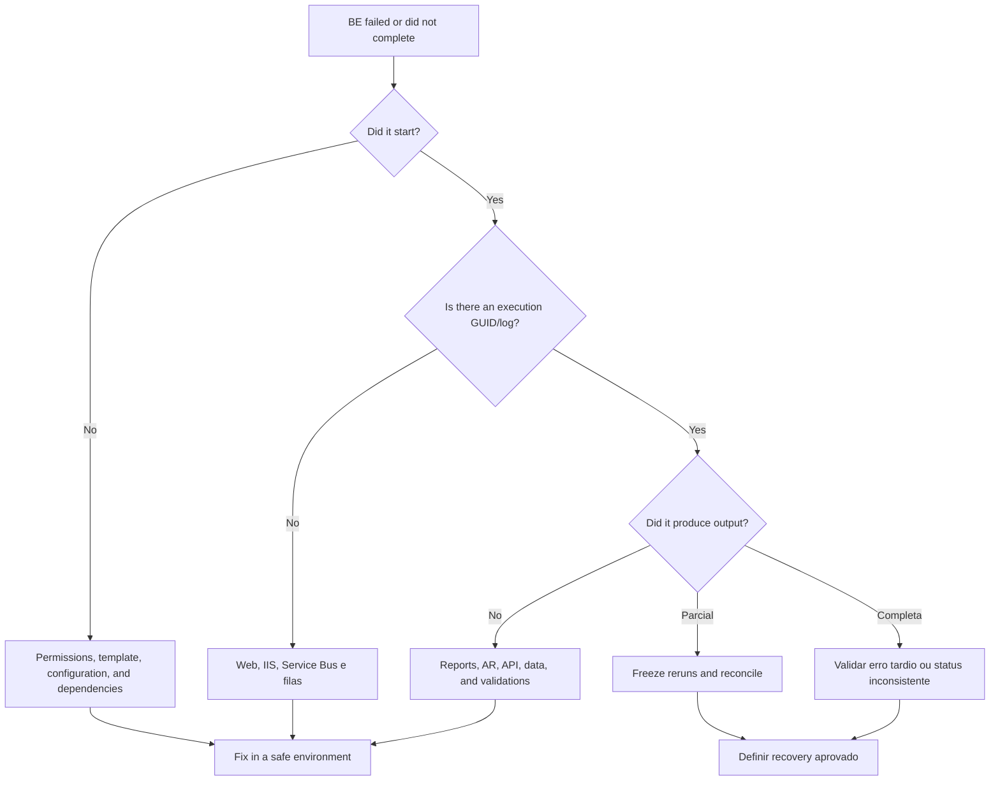

# Business Events - troubleshooting and recovery

> **Document control:** Status: KT pending · Technical/functional owners: to be confirmed · Scope: validate against the installed version and each environment · Last validation: not validated locally · Next review: after controlled validation or any event/dependency change · Evidence: attach a sanitized ticket/change and execution result.

## Principle

A BE can fail before execution, during request transport, in the event logic, in a dependent engine, or while persisting the output. First determine **which layer** execution stopped in. Do not rerun until you know whether any partial writes occurred.

## Initial evidence collection

Record:

- BE name and version;
- environment, company/entity, and user;
- date/time and timezone;
- complete parameters, without credentials;
- execution ID, GUID, or equivalent identifier;
- error message and screenshot;
- service and server that processed the execution;
- batches, entries, files, or records already created;
- last successful execution and recent change.

## Diagnostic tree

## Symptoms by layer

| Symptom | Initial checks |
|---|---|
| BE does not appear | Import, version, status, reopened session, and permissions |
| Import fails | `.ZIP`, MR compatibility, Add/Update permission, and dependencies |
| Execution does not start | Configuration, service account, IIS, BE services, bus/queues |
| Remains pending | Worker/service, stuck message, concurrency, timeout, and slow dependency |
| Data query fails | Driver report, parameters, Report Wizard Engine, security, and volume |
| Allocation fails | Allocation Rule, parameters, hierarchies, and eligible data |
| Save fails | Batch validation, locks, database, permissions, and partial output |
| Incorrect result | Scope, dates, exclusions, currency, rounding, and artifact versions |

## Log correlation

Build a single timeline:

1. request in Investran Web/IIS;
2. dispatch through the Enterprise Service Bus/queue;
3. receipt by the execution service;
4. calls to Investran API, Report Wizard, and Allocation Rule Engine;
5. validation and database persistence;
6. batch/output creation and response to the interface.

Use time, BE name, user, and GUID for correlation. If server clocks are not synchronized, record the offset before interpreting the sequence.

## Safe reprocessing

Before retrying:

- confirm whether the previous execution finished on the server despite the error on screen;
- search for outputs by GUID, time, and scope;
- identify batches that are on hold, incomplete, or already processed;
- reconcile changed data;
- confirm whether the BE is idempotent or protects against duplicates;
- obtain functional approval to remove/reverse any output;
- preserve logs from the first attempt.

Deleting a footprint directly through SQL appears in older notes, but does not constitute operational authorization. Direct database changes require a current procedure, backup, approval, and FIS/DBA involvement where applicable.

## Cancellation, rollback, and compensation

The architecture diagram shows `Cancel` and `Rollback` operations, but this does not prove that every BE or every phase can be reversed automatically. For each event, confirm:

- when the cancel button/action is safe;
- whether cancellation only stops execution or also undoes outputs;
- which objects support rollback;
- when an accounting reversal or manual compensation is required;
- how to handle messages still in the queue;
- how to prove that the environment has returned to a consistent state.

## Escalation criteria

Escalate when there is:

- partial output without an approved runbook;
- possible duplicate accounting entries;
- stuck or repeated messages in the bus/queue;
- recurring failure after configuration validation;
- suspected incompatibility between the template and MR;
- a need for direct database changes;
- a discrepancy between batches and reconciled balances;
- impact on multiple entities or period closing.

Include the timeline, GUID, parameters, versions, relevant logs, outputs found, and everything already ruled out in the escalation.

## Closure checklist

- [ ] Failure cause and layer identified.
- [ ] Partial output ruled out or reconciled.
- [ ] Fix validated with a controlled case.
- [ ] Functional result reconciled.
- [ ] Evidence attached to the incident.
- [ ] Runbook and inventory updated.
- [ ] Preventive action and owner defined.
