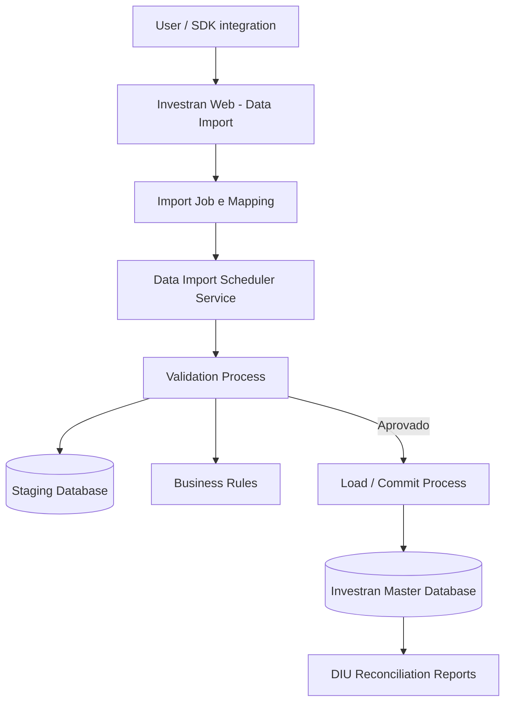
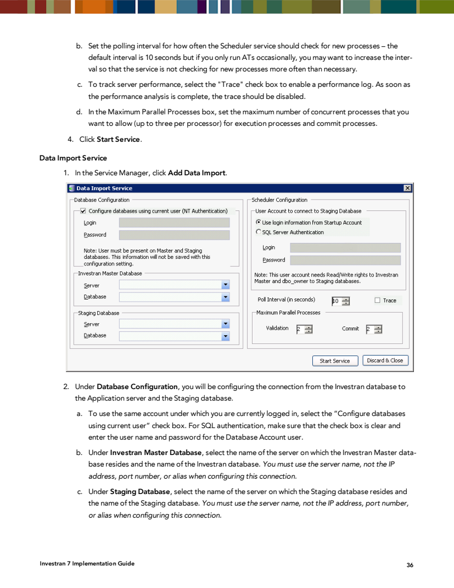
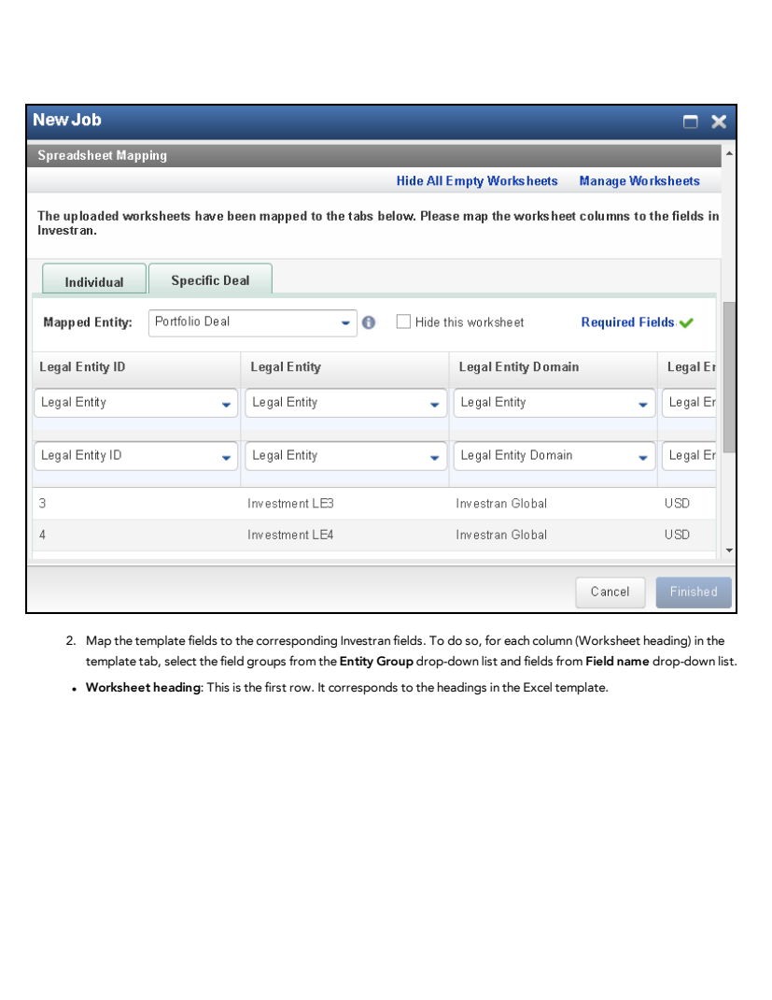
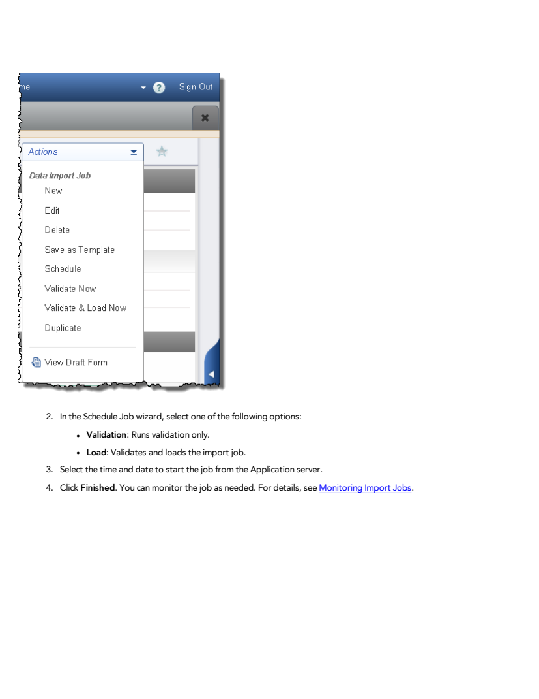
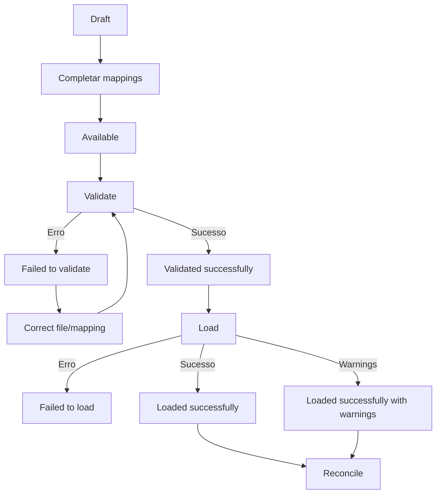
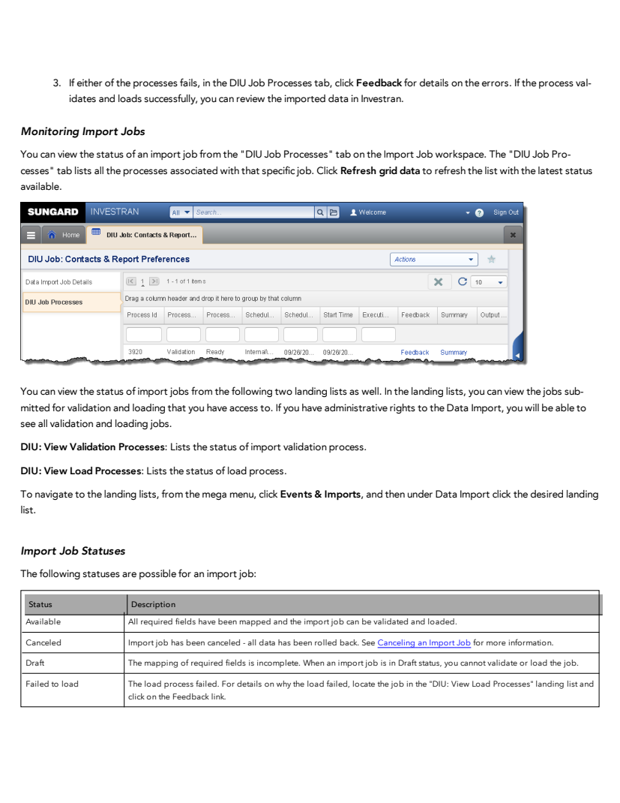
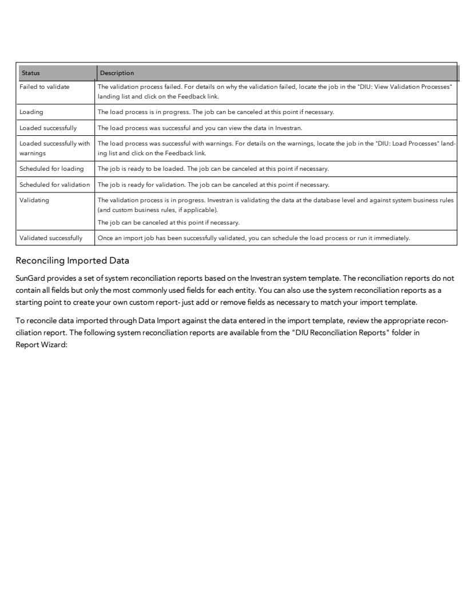

# Practical Data Import guide

## 1. What the tool does

Data Import receives data in spreadsheets, associates each worksheet with an Investran entity, maps columns to system fields, validates the content, and, if approved, loads the records. It serves three broad groups:

- Investran Web data;
- portfolio and transactional data;
- market data.

Actual access depends on licensing, entitlements, domain, and permissions on the entities involved.

## 2. Components and architecture

### Data Import Service

The service must be configured and running on the Application Server. The implementation manual shows configuration through Service Manager.

*Source: Internal_Inv7_INV_Implementation.pdf, Data Import Service, printed page 36.*

The documented screen contains:

- connection to the Investran Master Database;
- connection to the Staging Database;
- configuration authentication;
- account used by the Scheduler;
- polling interval;
- maximum parallel processes for Validation and Commit;
- trace option;
- `Start Service` action.

The old manual instructs users to use the server name in connections, not an IP address, port, or alias. Confirm whether this restriction remains in the current version.

### Account and database

The documentation assigns elevated permissions on Staging to the Data Import account. Do not replicate these permissions literally without a security review. Record the current configuration, apply the minimum supported privileges, and validate with FIS/DBA.

## 3. Where to find it

In Investran Web, the documented path is:

1. open the mega menu;
2. select **Events & Imports**;
3. under **Data Import**, choose **Add Job**.

The **View Validation Processes** and **View Load Processes** lists are in the same area. A job also has a `DIU Job Processes` tab for tracking its executions.

## 4. Prerequisites

Before preparing the file, confirm:

- Data Import Service is started and healthy;
- Master and Staging are correct for the environment;
- `DataImport` license for portfolio data, where applicable;
- `DataImportTransactions` license for transactions;
- `ImportUtilityAdmin` or `ImportUtilityUser` entitlement;
- `Read`, `Add`, `Update`, `Remove`, and/or `Post` rights for `DataImportJob and Template`, according to the role;
- import entitlement for each entity;
- user access to the entities to be created or changed;
- capacity and operational window for the expected volume.

`ImportUtilityAdmin` has administrative access to public and private jobs/templates. `ImportUtilityUser` is restricted to public objects or objects created by that user, according to the manual.

## 5. Prepare the file

Use a versioned template. The product documents the `DIU Generic Template`, available in the system's template list, and compatibility with DCT/TULT templates with minor adjustments.

Essential rules:

- `.XLSX` format;
- one or more worksheets, normally separated by entity;
- unique headers: duplicate columns can hide mappings;
- empty columns and worksheets are ignored;
- column order is not significant;
- extra spaces in text are preserved, so normalize beforehand;
- blank values are ignored;
- the word `NULL` removes a field's value during an update, according to the manual;
- dates can use Excel date values or `YYYY/MM/DD`, `YYYY-MM-DD`, and `YYYYMMDD` in Text/General cells;
- use Investran IDs for updates whenever possible.

> `NULL` is a destructive operation on an existing value. Require explicit review of cells containing this word.

## 6. Create the Import Job

In the **New Job** wizard:

1. select the file in `Select File To Import`;
2. define a traceable `Job Name`;
3. choose `Map to Template`;
4. select the `Investran Domain`;
5. set access to `Private` or `Public`;
6. review the options;
7. configure Spreadsheet Mapping;
8. finish the job.

### Documented options

| Option | Effect | Operational risk |
|---|---|---|
| Skip Top Rows | ignores rows at the top | can hide data if configured incorrectly |
| Add New Lookup Values | creates missing lookup values | expands reference data and may introduce invalid values |
| Allow Related Entries | allows loading a related entity on the main worksheet | increases dependencies and reconciliation difficulty |
| Ignore Critical Warnings | ignores critical warnings | should not be the default without justification |
| Skip Errors (Validation Only) | continues validation to collect all errors | does not mean errors are ignored during loading |

`Skip Errors` is useful for obtaining a complete list of validation problems. `Ignore Critical Warnings` and `Add New Lookup Values` require approval because they change the quality gate or reference data.

## 7. Configure mappings

Each Excel worksheet must be associated with a `Mapped Entity`. Then each header is linked to `Entity Group` and `Field Name`.

*Source: INV_Data_Import_7.pdf, Mapping Template Fields, page 10.*

The manual uses colors for worksheet status:

- **blue:** worksheet not yet associated with an entity;
- **red:** required fields are missing mappings;
- **green:** all required fields are mapped.

Green only means that required fields have mappings. You must still verify that the destination field, semantics, type, and reference are correct.

Useful features:

- `Required Fields` shows the entity's required fields;
- `Hide All Empty Worksheets` hides empty worksheets;
- `Hide this worksheet` makes Data Import ignore the worksheet;
- `Manage Worksheets` shows hidden worksheets again;
- `Save as Template` preserves options and mappings for reuse.

## 8. Validate and load

The `Actions` menu offers immediate or scheduled execution.

*Source: INV_Data_Import_7.pdf, Running an Import Job, page 14.*

### Modes

- **Validate Now:** runs validation only;
- **Validate & Load Now:** validates and, if approved, loads immediately;
- **Schedule - Validation:** schedules validation only;
- **Schedule - Load:** schedules validation and loading.

For a new or high-risk load, prefer separating validation and loading. This creates a window for reviewing feedback before data is written.

## 9. Monitor

*Source: INV_Data_Import_7.pdf, Monitoring Import Jobs, page 17.*

Record the returned `Process ID`. Check:

- the job's `DIU Job Processes` tab;
- the `DIU: View Validation Processes` landing list;
- the `DIU: View Load Processes` landing list;
- the `Feedback` link for errors and warnings;
- `Summary` and outputs available in the version.

*Source: INV_Data_Import_7.pdf, Import Job Statuses, page 18.*

Relevant statuses include `Draft`, `Available`, `Scheduled for validation`, `Validating`, `Validated successfully`, `Scheduled for loading`, `Loading`, `Loaded successfully`, `Loaded successfully with warnings`, `Failed to validate`, `Failed to load`, and `Canceled`.

## 10. Reconcile

Technical success does not complete the load. The manual provides reports in the `DIU Reconciliation Reports` folder in Report Wizard, but warns that they contain only the most common fields.

Create custom reports when the template uses additional fields. Reconciliation must compare:

- rows read, accepted, rejected, and loaded;
- inserts versus updates;
- IDs generated or updated;
- key values for each entity;
- accounting totals, currencies, and dates for transactions;
- related entities;
- UDFs;
- accepted warnings;
- the original file versus results queried in Investran.

## 11. Cancellation

The manual states that cancellation rolls back changes completed before cancellation and does not commit. It allows cancellation in the `Ready`, `Scheduled for Validation`, `Validating`, `Scheduled for Loading`, and `Loading` states in the documented version.

Even so, validate behavior in the current version and load type. After cancellation:

- confirm `Canceled` status;
- check active jobs/queues;
- perform read-only reconciliation;
- confirm that no partial records or batches remain;
- preserve Feedback and logs.

## 12. SDK automation

The guide confirms that the SDK can access Data Import for automated uploads, but the reviewed material does not provide a complete endpoint/method contract for documenting safe examples. For each automated integration, capture in the KT:

- SDK library and version;
- authentication and technical account;
- template creation and selection;
- job upload and submission;
- validation/load polling;
- Feedback download and interpretation;
- timeout, retry, and idempotency;
- secure storage of the file and evidence.

## 13. Operational checklist

### Before

- [ ] File, owner, and purpose identified.
- [ ] Template and mapping versioned.
- [ ] IDs and references validated.
- [ ] Licenses, entitlements, and domain confirmed.
- [ ] Correct Data Import Service and databases.
- [ ] Reconciliation criteria prepared.

### After

- [ ] Process ID and status recorded.
- [ ] Feedback reviewed, including warnings.
- [ ] Counts and values reconciled.
- [ ] Inserts/updates confirmed.
- [ ] File and evidence stored securely.
- [ ] Functional approval recorded.

## Sources

- *INV_Data_Import_7.pdf*, configuration, jobs, mappings, execution, monitoring, and data entry guidelines.
- *Internal_Inv7_Data Import Utility User Guide.pdf*, detailed instructions by entity in the legacy template.
- *Internal_Inv7_INV_Implementation.pdf*, Data Import Service configuration.
