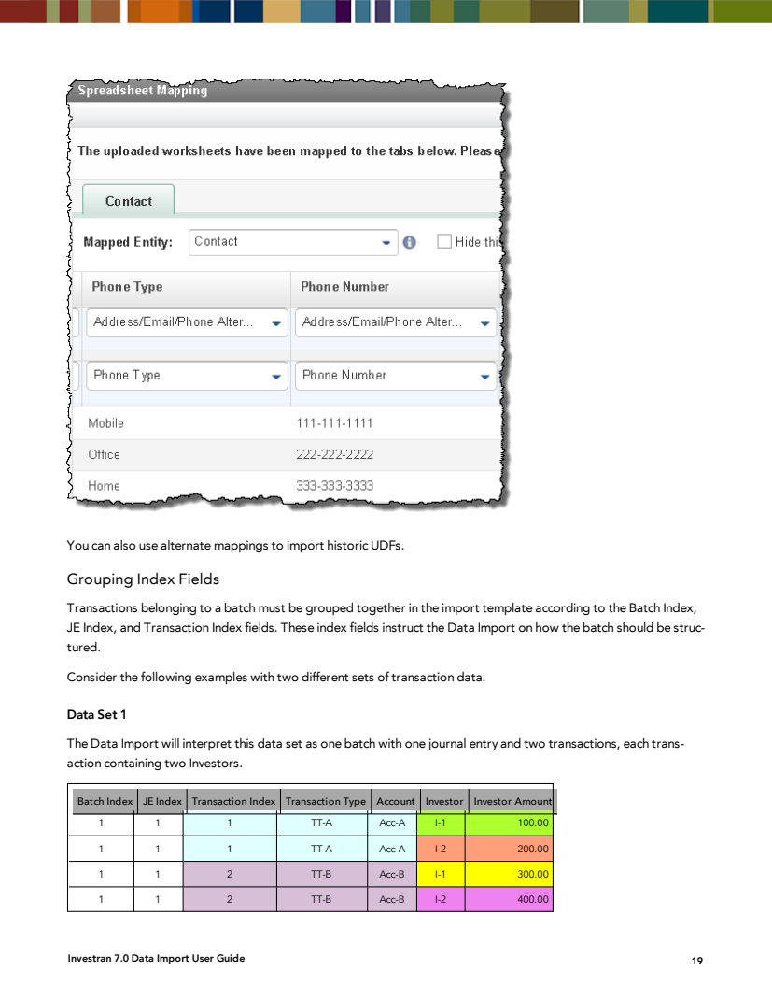

# Data Import - templates, entities, and mappings

## Documented entities

The Investran 7 guide lists the following entities as supported:

| Practical group | Entities |
|---|---|
| Master data and CRM | Contact, Individual, Organization, Opportunity |
| Investment structure | LegalEntity, Vehicle, Investor, SpecificVehicle, SpecificInvestor |
| Investments | Deal, SpecificDeal, SpecificPosition, Lot, Pool |
| Accounting | Account, GL Account, TransactionType, Transaction |
| Securities and market data | Security, IncomeSecurity, Issuer, MarketData |

Use the names displayed by `Mapped Entity` in the installed version. The catalog above does not prove that all entities are licensed or enabled in the environment.

## Insert versus update

| Operation | Recommended identification | Note |
|---|---|---|
| Insert entity | Temporary Import ID within the file | Allows references between worksheets in the same load |
| Update entity | Investran ID | Avoids ambiguity and improves performance |
| Insert transaction | Batch indexes and references | Existing transactions are not updated in the documented workflow |
| Clear field | Literal value `NULL` | Review as a destructive change |

Contacts and Opportunities can have duplicate names; the manual requires the unique ID to update these entities.

## References between entities

A primary entity can depend on reference entities. Examples from the manual:

- LegalEntity references Specific Fund Deals, Specific Direct Deals, and Specific Positions;
- Vehicle references Specific Investor;
- Contact Import ID can link new contacts to relationships or UDFs in the same load.

When loading parent and child records together:

1. assign unique Import IDs;
2. place records that create a reference before rows that consume it when the template requires this;
3. use `Allow Related Entries` only after the load design has been validated;
4. reconcile the final IDs generated.

## Mandatory versus required

- **Mandatory fields:** the minimum set needed to create a new entity;
- **Required fields:** fields or combinations used to identify the entity during an update or reference resolution.

These requirements come from Investran business rules. Do not assume a column is optional simply because Excel accepts an empty cell.

## Grouping Index for transactions

Transactions belonging to batches must be grouped by:

- `BatchIndex`;
- `JEIndex`;
- `TransactionIndex`.



*Source: INV_Data_Import_7.pdf, Grouping Index Fields, page 23.*

The combination defines the hierarchy:

```text
BatchIndex
└── JEIndex
    └── TransactionIndex
        └── Investor allocations / details
```

Rows must do more than simply “look alike”: repeated indexes or indexes outside the logical order can group investors into a single transaction differently from what was intended. Before loading, generate a grouped view and confirm how many batches, JEs, transactions, and allocations will be created.

## UDFs

The manual describes two groups:

- `UDFs`: populated dynamically with the existing UDFs for the entity;
- `UDF Alternate Mapping`: generic fields such as UDF Type, UDF Name, and UDF Value.

Alternate Mapping can also carry historical values. Data Import does not create the UDF definition: it loads values into existing UDFs.

For Contact UDF, use `ContactImportID` even when updating an existing contact: associate the Contact ID with the Import ID within the process and use the Import ID in the UDF row, following the documented logic.

## Alternate mappings

Addresses, emails, and phones can use generic pairs, for example:

| Type | Value |
|---|---|
| PhoneType | PhoneNumber |
| EmailType | EmailAddress |
| AddressType | Address fields |

This avoids a separate column for each type, but requires consistent lookup values. Do not enable `Add New Lookup Values` automatically to compensate for spelling errors.

## Template review checklist

- [ ] Template name and version.
- [ ] One clear purpose per worksheet.
- [ ] Unique headers.
- [ ] Correctly mapped entity.
- [ ] Mandatory and required fields reviewed.
- [ ] Investran IDs used for updates.
- [ ] Unique Import IDs and resolvable references.
- [ ] Normalized dates.
- [ ] Spaces, invisible characters, and formulas removed/assessed.
- [ ] `NULL` cells reviewed.
- [ ] Grouping Index reconciled for transactions.
- [ ] Existing UDFs and lookups.
- [ ] Hidden worksheet contains no required data.
- [ ] Control counts recorded.

## What to document for each interface

| Item | Expected content |
|---|---|
| Source | Supplying system, report, or department |
| File | Name, format, encoding, worksheets, and retention |
| Template | Name in Investran, version, and owner |
| Mapping | Worksheet, entity, column, group, and field |
| Key | Investran ID, Import ID, or composite key |
| Dependencies | Reference entities, UDFs, and lookups |
| Execution | Manual, scheduled, or SDK |
| Reconciliation | Reports, totals, and tolerances |
| Recovery | Cancellation, correction, and retry |
| Security | Domain, entitlement, and sensitive data |
