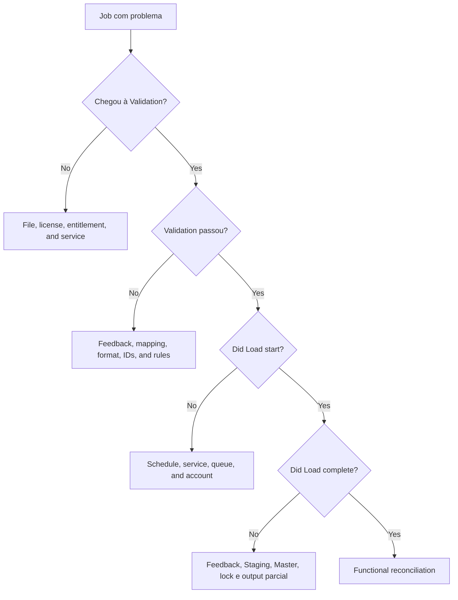

# Data Import - troubleshooting and recovery

## First: Validation or Load?

Separate the failure into two phases:

- **Validation:** mapping, type, format, references, permissions, and business rules;
- **Load:** persistence, locks, service, Staging/Master, concurrency, and rules triggered during writes.

The execution's `Feedback` link is the first piece of evidence. Preserve it before editing or duplicating the job.

## Initial collection

- Job Name and Process ID;
- user, domain, template, and file;
- `.XLSX` checksum and size;
- time, timezone, and Application Server;
- phase, status, and duration;
- Feedback, Summary, and complete message;
- job options;
- affected worksheets and mappings;
- expected and observed counts;
- recent changes to the template, entity, UDF, lookup, license, or service.

## Diagnosis by symptom

| Symptom | Checks |
|---|---|
| Job remains Draft | mandatory/required fields and worksheets without a Mapped Entity |
| Upload failure | `.XLSX`, size, file access, session, and web server |
| Failed to validate | Feedback, types, dates, IDs, references, entitlements, and business rules |
| Failed to load | service, Staging/Master, locks, permissions, space, and concurrency |
| Loaded with warnings | review all warnings and their impact before approving |
| Stuck in Validating/Loading | Data Import Service, polling, parallel processes, queue, and database |
| Duplicate entities | name-based key, missing Investran ID, and duplicate-name settings per domain |
| Reference not found | order, Import ID, Investran ID, domain, and Allow Related Entries |
| Incorrect batch/transaction | BatchIndex, JEIndex, TransactionIndex, and allocations |
| Field was not cleared | blank cells are ignored; confirm intentional use of `NULL` |
| UDF rejected | UDF does not exist, incompatible type/lookup, or incorrect Contact reference |

## Diagnostic tree

## Service and infrastructure

Confirm on the Application Server:

- Data Import Service is started;
- configuration points to the correct Master and Staging;
- Scheduler account is valid and not locked;
- polling interval is appropriate;
- Validation/Commit limit is not saturated;
- database connectivity and permissions;
- space, log growth, and blocking;
- tracing is disabled outside a controlled investigation.

Do not restart the service without checking running jobs and the impact on other loads.

## Safe retry

1. preserve the original file, Feedback, and Process ID;
2. determine whether the failure occurred before or during loading;
3. query the data using IDs and reconciliation criteria;
4. confirm whether partial inserts/updates occurred;
5. correct a versioned copy of the file or mapping;
6. validate again without loading;
7. compare validation results;
8. load only after approval;
9. reconcile again.

For transactions, retries require additional care because the documented flow includes new transactions, not updates. Repeating an execution may duplicate the accounting impact if the previous execution persisted data.

## Cancellation

The guide states that cancellation in supported states performs a rollback and does not commit database changes. Treat this as the documented version's behavior, not a substitute for reconciliation.

After cancellation:

- confirm `Canceled` on both the job and the process;
- check that no child process remains active;
- query potentially affected entities and batches;
- preserve service logs;
- document why cancellation occurred;
- only then decide whether it is safe to retry.

## Reconciliation as a diagnostic tool

Use Report Wizard reports or approved queries to determine:

- how many rows were actually created/changed;
- which IDs were involved;
- which fields differ from the file;
- whether all relationships were established;
- whether batches, JEs, transactions, and allocations match the indexes;
- whether warnings correspond to functional differences.

Standard reports do not cover every field. For critical interfaces, maintain a custom report aligned with the template.

## Escalation

Escalate with:

- a sanitized file or reproducible sample;
- exported/documented template and mapping;
- Process ID and timeline;
- complete Feedback;
- Investran and template versions;
- service status;
- affected entities/IDs;
- reconciliation evidence;
- confirmation of any possible partial load.

Do not send files containing sensitive data without an authorized channel.

## Troubleshooting KT

- where Data Import Service logs are located in each environment;
- how to correlate Process ID with logs and the database;
- how to identify a stuck message/process;
- which errors recur for each interface;
- when to cancel versus wait;
- how to prove rollback;
- which read-only queries are approved;
- when to involve DBA, infrastructure, functional teams, or FIS;
- what the runbook is for an incorrectly loaded transaction.
