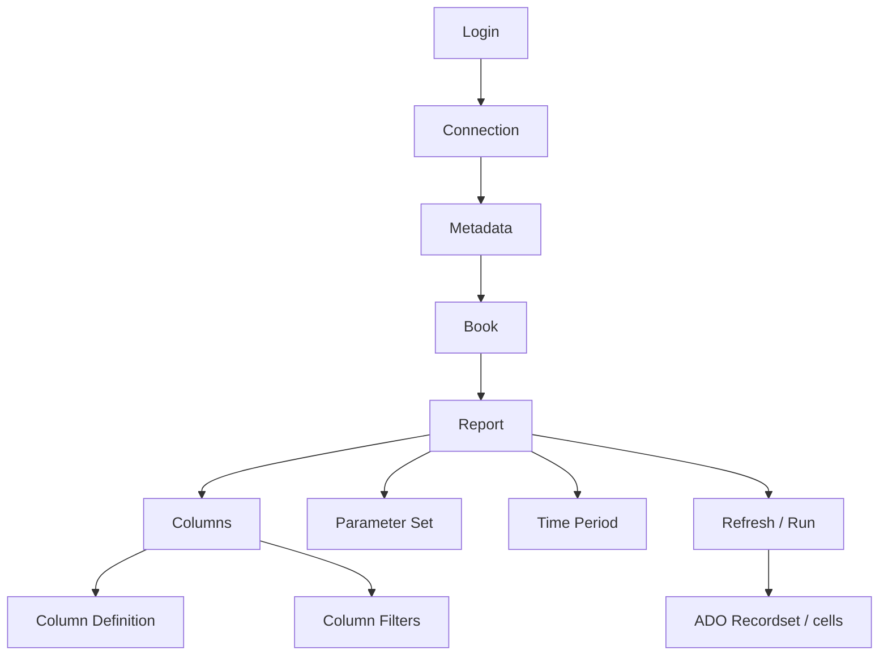
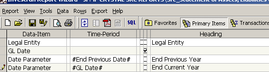
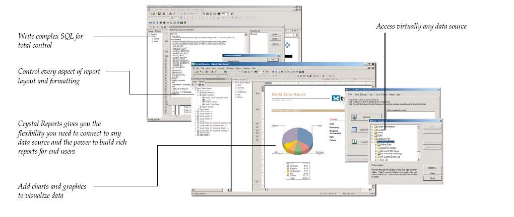

# Report Wizard - development and operations

## What Report Wizard is

Report Wizard is the Investran reporting engine. It combines metadata, report definitions, columns, filters, parameters, and periods to produce a recordset. The result can be consumed by the Investran interface, Crystal Reports, COM components, the OLE DB Provider, or Web Reporting Services.

## Conceptual model

| Component | Operational role |
|---|---|
| `Login` | tests the connection and provides the connection string |
| `Connection` | connects to the database, loads metadata and reports, and performs supporting operations |
| `Metadata` | represents the metadata available in the database |
| `Book` | logical folder that organizes reports |
| `Report` | executable definition, including columns, parameters, and properties |
| `Column` | selected field, with formatting, aggregation, and sorting |
| `ColumnDefinition` | metadata definition used by the column |
| `ColumnFilter` | operator and value used to restrict results |
| `ParameterSet` | collection of parameters and values supplied at execution time |
| `TimePeriod` | period and dates used in time-based calculations |
| `RWConnection` / `RWReport` | wrappers that simplify connections, parameters, execution, and caching |

Not every public component method is supported for customizations. The guide states that internal or undocumented APIs have no guarantee of future compatibility.

## Report development lifecycle

### 1. Define the contract

Before opening the designer, record:

- the business question the report must answer;
- the expected granularity: one row per entity, investor, deal, position, or transaction;
- the cutoff date and currency;
- required and optional filters;
- expected columns and types;
- subtotal and total rules;
- consumers and output formats;
- volume and maximum acceptable duration.

### 2. Choose the book and name

Use short, clear, stable names. For reports consumed through Crystal/OLE DB, avoid periods and special characters. The provider command references the report using the `Book.Report` pair; renaming either part can break consumers.

### 3. Select columns and define granularity

Start with the keys that determine each result row. Then add descriptions, values, and calculations. Each new relationship or hierarchy level can multiply rows; validate cardinality before adding presentation elements.

### 4. Configure filters and parameters

Parameters make a report reusable. Document the name, ID, type, description, default value, whether it is required, and format. The description must clearly guide the user. In WRS, parameters are also combined with the contact's relationships and security levels.

*Parameters defined in Report Wizard. Names and types must remain compatible with all consumers. Source: Crystal Reports Guidebook, p. 30.*

### 5. Configure aggregation, sorting, and period

Explicitly define:

- grouping fields;
- `RowAggregation` and subtotals;
- sort direction;
- currency and scale;
- period type, such as LTD, YTD, MTD, DTD, or a specific day;
- behavior for null values and missing data.

### 6. Validate independently

Run against a small, known dataset. Reconcile row counts, totals, accounting signs, currency, and dates. Associate Crystal, WRS, or another consumer only after validating the base report.

## Programmatic execution

### INVDEV Library

The basic flow is:

1. create `INVDEV70.Connection`;
2. call `RefreshMetadata(connectionString, user)`;
3. load the report with `LoadReport(bookName, reportName)`;
4. find and populate parameters in `ParameterSet`;
5. execute `Report.Refresh(connection)`;
6. process the returned `ADO Recordset`;
7. release the report, metadata, and connection.

### RW wrappers

With `ftiRW70.RWConnection` and `RWReport`:

1. initialize `RWConnection`;
2. load the report;
3. assign parameters by name;
4. execute `Run`;
5. read `Rows`, `Cols`, and `Cell(row, col)`;
6. finish with `Terminate`.

### Threading rules

Report Wizard components are COM/VB6, are not thread-safe, and must be created and used on the same STA thread.

- Classic ASP.NET: the documentation recommends `AspCompat="true"` for the page.
- ASMX: requires an STA-compatible handler.
- WCF: requires an STA thread pool/queue and explicit synchronization.
- Do not store RW instances in `Session` or `Application`, because another request may use another thread.
- Never share the same instance across concurrent executions.

Intermittent failures under load, hangs, and mixed-up results may indicate a violation of these rules, rather than necessarily a SQL problem.

## OLE DB Provider and Crystal Reports

*Report Wizard provides the dataset; Crystal applies layout, groups, formulas, and output formats. Source: Crystal Reports Guidebook, p. 4.*

There are references to the newer Investran provider and the legacy Report Wizard provider. Confirm which one is installed and supported in the environment.

For Crystal:

1. create and validate the RW report before associating it;
2. connect through the `Investran RW OLE DB Provider`;
3. use **Add Command** to reference `Book.Report`;
4. associate Crystal parameters with RW parameters;
5. validate joins, command flags, and subreports;
6. when changing the RW schema, run **Verify Database** and remap fields as needed.

The guidebook recommends not using Tree View to link RW reports; Add Command provides the necessary control over joins and parameters.

## Direct and external associations with Crystal

| Association | Executed by | Typical use |
|---|---|---|
| Direct | the RW engine, which passes the result to Crystal Viewer | an integrated report opened in the RW context |
| External | Crystal Reports through the RW OLE DB Provider | joins, parameters, and composition controlled by Crystal |

In Crystal Dynamic Reporting, distinguish between:

- **shell report:** Crystal layout published to the user;
- **driver reports:** RW reports that provide the data.

In WRS, the shell and drivers must have identical filters and security levels, but only the shell needs `Publish Report` selected.

## Performance

Measure before making changes. Capture report/book, user, parameters, time, duration, rows returned, and concurrency.

Investigate in this order:

1. missing filters or overly broad parameters;
2. granularity and row multiplication;
3. calculated columns, hierarchies, and aggregations;
4. joins across multiple reports;
5. repeated subreports;
6. concurrent calls and STA serialization;
7. SQL blocking and execution plans;
8. consumer limits/timeouts.

Do not treat a timeout increase as a permanent fix, and do not create indexes without DBA analysis and approval.

## Versioning and publishing

For each change:

- export or duplicate the previous version;
- record the ticket, author, date, and rationale;
- compare the contract before and after;
- validate in DEV and UAT with representative parameters;
- test downstream consumers;
- retain evidence of totals and duration;
- define rollback by restoring the last approved version.

## Troubleshooting checklist

1. Reproduce with the same user, book, report, and parameters.
2. Test an administrative user only to isolate security issues, without using that result as final validation.
3. Run the base RW report without Crystal/WRS.
4. Compare parameters, columns, and version with the last known good version.
5. If it fails only under load, review STA, concurrency, and the thread pool.
6. If RW works and Crystal fails, check the provider, Add Command, datasource, Verify Database, parameters, and subreports.
7. If the result is empty, distinguish an actual lack of data from an incorrect filter/security context.
8. If it is slow, capture volume, duration, and evidence of SQL blocking.

## Sources

- *Internal_Inv7_INV_RW_Dev_Guide_7.pdf*, InvDev Library Overview, components, and Report Execution Examples chapters.
- *Crystal Reports Guidebook.pdf*, integration, Add Command, joins, subreports, changes, and Reporting Services sections.
