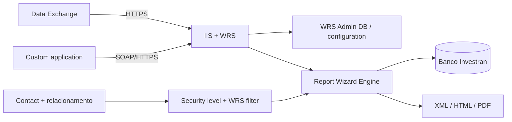
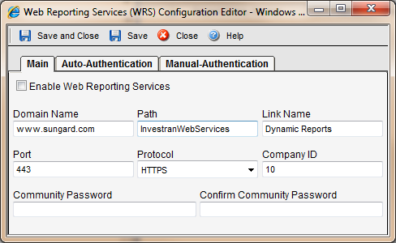
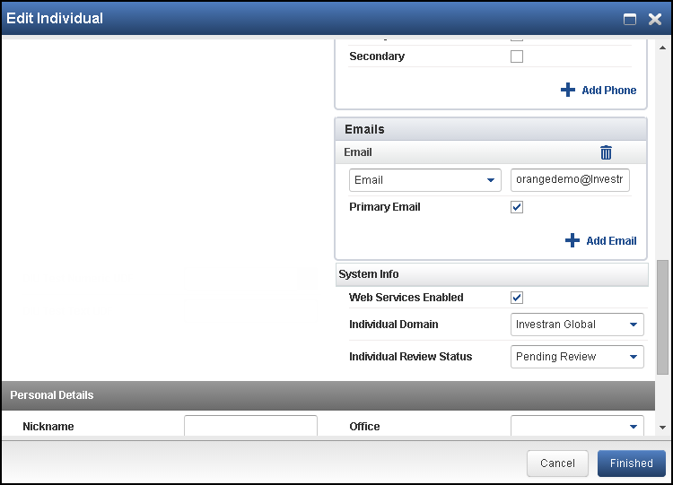
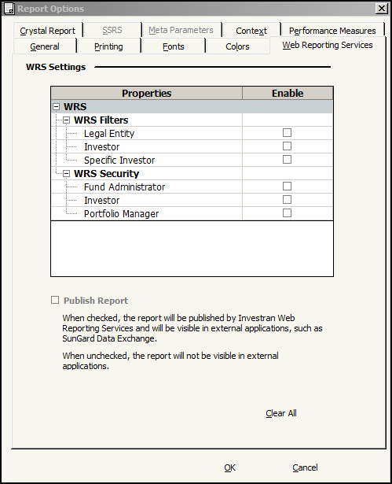
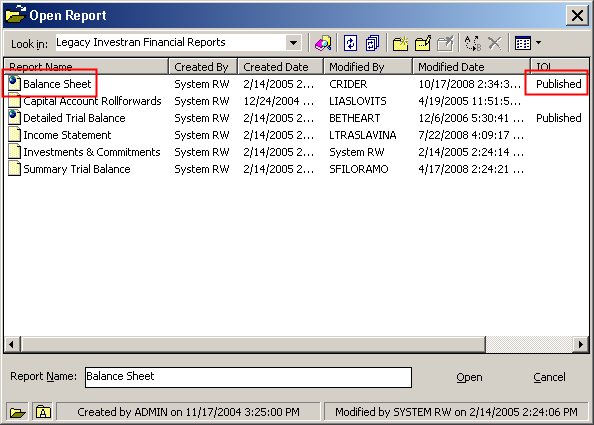
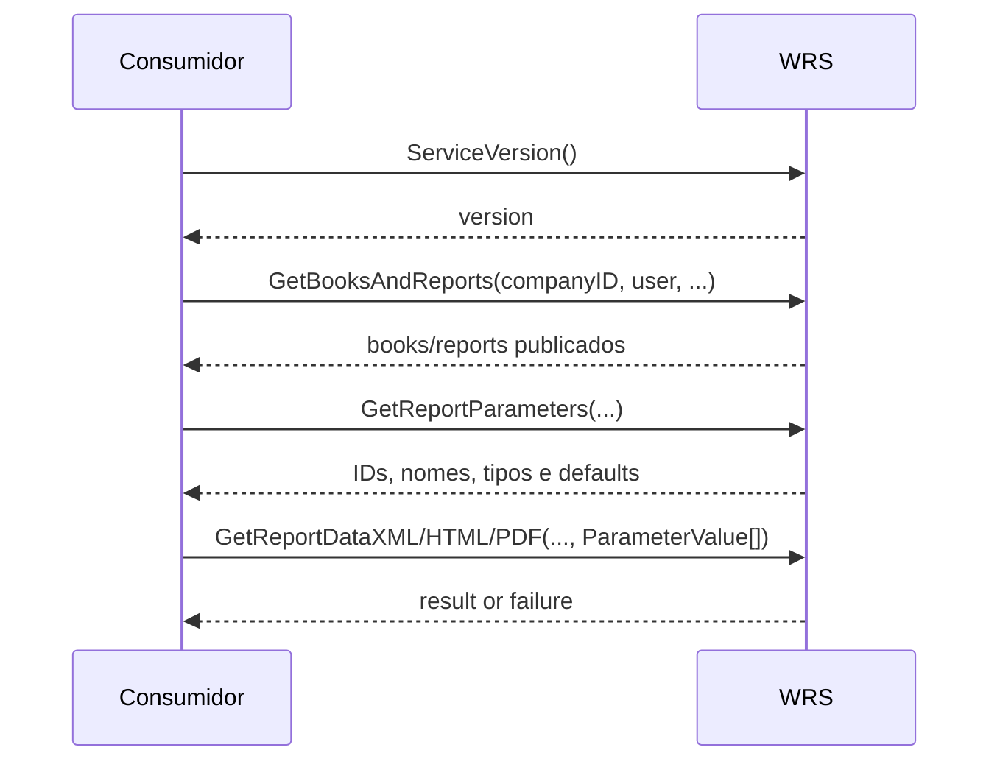

# Web Reporting Services - architecture, security, and support

## Purpose

Investran Web Reporting Services (WRS) allows Report Wizard reports to be executed in real time through Data Exchange or custom applications. The documented interface is a legacy Web Service that exposes report discovery, parameters, and execution with XML, HTML, or PDF output.

WRS is not the REST Web API built by the team. They are separate integrations with different authentication, contracts, and troubleshooting.

## Architecture



## Components and dependencies

| Component | Responsibility | Support checks |
|---|---|---|
| IIS / WRS site | host the Web Service | site, HTTPS binding, app pool, ISAPI/ASP, and logs |
| SSL certificate | encrypt traffic | validity, chain, hostname, and binding |
| WRS Admin database | store administrative settings | connection, availability, and version |
| company configuration | map `CompanyID` to the Investran database | server, database, company name, and connection test |
| WRS user | SQL access used by the service | password, lockout, permissions, and account policy |
| Report Wizard | define and execute the report | book, report, parameters, and performance |
| Contact | consumer's functional identity | primary email and `WebServicesEnabled` |
| relationship | link the Contact to a Legal Entity, Investor, or Specific Investor | entity, role, and validity period |
| security level | restrict availability, parameters, and data | match between contact and report |
| WRS filter | define the output level | Legal Entity, Investor, or Specific Investor |

## Installation and configuration

The documented procedure includes:



*Historical editor used to configure the WRS domain, path, port, protocol, and Company ID. Source: WRS Installation and Administration Guide, p. 12.*

1. install and configure IIS;
2. enable ASP and ISAPI extensions required by the version;
3. enable WRS in the Investran database using the `UseERW` parameter;
4. create/configure the WRS Admin database;
5. configure the WRS service user;
6. install WRS components and, where applicable, Crystal;
7. register the connection to the Investran database;
8. test the connection and record the assigned `CompanyID`;
9. configure hostname, path, port, and protocol in the consumer/Data Exchange;
10. validate end-to-end access over HTTPS.

The old manual mentions ASP, ISAPI, and Windows Server 2008. Do not replicate this configuration without validating the architecture and version actually deployed.

### Values required in each environment's inventory

- WRS hostname/FQDN and URL;
- IIS site, application, app pool, and identity;
- certificate and expiration date;
- virtual path, port, and protocol;
- `CompanyID`, logical company name, server, and database;
- WRS administrative database;
- service account and responsible vault;
- WRS, RW, and Crystal component versions;
- log directories and operational owners.

Do not record passwords or keys in this knowledge base.

## Security model

Effective access is the intersection of four elements:

```text
Enabled Contact
  + relationship with an entity
  + security level assigned to the relationship
  + the same security level and filter configured on the report
  = visible report and permitted data
```

### Preparing a user



*Contact with Web Services Enabled. Enablement must be combined with relationships and security levels. Source: WRS guide, p. 16.*

1. Create the required security levels.
2. Ensure the Contact has a primary email address.
3. Select `WebServicesEnabled` on the Contact.
4. Create the Contact's relationship with a Legal Entity, Investor, or Specific Investor and assign the role.
5. Assign one or more security levels to the relationship.
6. If Data Exchange is used, create/enable the user and configure the corresponding relationships.

Publishing reports and administering security levels requires the `WebRS Report Publisher` entitlement in Team Security, according to the manual.

### Filter effects

| Report WRS filter | Relationship required for output at that level |
|---|---|
| Legal Entity | direct relationship or a relationship that can be resolved to a permitted Legal Entity |
| Investor | Investor relationship; combinations without an Investor may not produce selection/output |
| Specific Investor | Specific Investor relationship; Legal Entity-only or Investor-only relationships are insufficient |

A user can have different security levels on different relationships. Therefore, “the Contact has access” is not sufficient validation; confirm the entity, relationship, and security level used during execution.

## Publishing a report in WRS



*Report Wizard WRS tab with filters, security levels, and Publish Report. Source: WRS guide, p. 23.*

Prerequisites:

- validated RW report;
- parameters applied as filters where needed;
- a clear description for each parameter;
- WRS filter appropriate for the audience;
- security level created and assigned to test relationships;
- supported output format.

Documented procedure:

1. open the report in Report Wizard;
2. go to **Tools > Report Options**;
3. open the **Web Reporting Services** tab;
4. set `WRS Filters` to Legal Entity, Investor, Specific Investor, or the applicable combination;
5. select one or more `WRS Security Levels`;
6. select `Publish Report`;
7. save the report;
8. verify that it appears as published and execute it with a representative Contact.



*Published report in Report Wizard. Source: WRS guide, p. 24.*

For Crystal Dynamic Reporting, configure identical filters and security levels on the shell and drivers. Select `Publish Report` only on the shell.

## WRS SOAP interface

The documented URL follows the legacy pattern:

```text
https://<host>:<port>/<path>/FTIRWWS.dll?Handler=Default
```

The consumer configures network credentials for the service. Use HTTPS and restrict the firewall to authorized consumers.

### Documented methods

| Method | Return value | Use |
|---|---|---|
| `ServiceVersion()` | string | get the Web Service version |
| `GetBooksAndReports(...)` | XML | list books and reports published in WRS |
| `GetReportParameters(...)` | XML | list parameters and their IDs/types |
| `GetReportDataXML(...)` | XML | execute a report and return structured data |
| `GetReportDataXMLLocalizedDate(...)` | XML | execute with a localized date format |
| `GetReportDataHTML(...)` | HTML | execute and return an HTML document |
| `GetReportDataHTMLLocalizedDate(...)` | HTML | execute HTML with the specified date format |
| `GetReportDataHTMLFirstPage(...)` | HTML + output IDs | execute and retrieve the first page |
| `GetReportDataHTMLPage(...)` | HTML | retrieve another page from the execution |
| `GetReportDataPDF(...)` | `byte[]` | execute and return the PDF |

Depending on the operation, methods receive `companyID`, user, password, `bookName`, `reportName`, and a collection of `ParameterValue` containing `id` and `value`.

### Recommended integration sequence



Do not hard-code parameter IDs assuming they will be identical across all environments. Discover them through the published contract and validate them after promotion or a report change.

## SQL identity versus Contact

The guide distinguishes two ways to specify the user:

- SQL Server user: executes with the supplied identity, but the manual warns that the report's WRS filters and security levels are not applied;
- email of an enabled Contact: allows relationships, filters, and security levels to be applied, with authentication remaining the consuming application's responsibility.

This difference is critical. Never use an execution with a SQL user as proof that the Contact's functional security is correct.

## Formats and volume

### XML

Suitable for data integration and transformation. The manual recommends filtering reports with more than 1,000 rows to avoid timeouts while building XML. Treat this number as historical guidance, not a current SLA.

### HTML

Can be returned in full or paginated. For pagination:

- `GetReportDataHTMLFirstPage` returns `reportProcessId` and `totalPages`;
- `GetReportDataHTMLPage` uses `pageNumber` and the same `reportProcessId`;
- documented date formats include `DD-MM-YYYY`, `MM-DD-YYYY`, and `YYYY-MM-DD`.

### PDF

`GetReportDataPDF` returns a `byte[]`. The consumer must set `Content-Type: application/pdf`, transmit the binary without text conversion, and control size, timeout, and storage.

## Recommended monitoring

Collect, without sensitive payloads:

- UTC timestamp and consumer correlation ID;
- hostname, `CompanyID`, book, and report;
- functional identity/Contact used;
- sanitized parameters;
- format, duration, and result size;
- HTTP status/SOAP fault;
- app pool recycling, CPU, and memory;
- database connection latency/errors;
- standalone RW report duration.

## Troubleshooting by symptom

| Symptom | Main checks |
|---|---|
| WRS unavailable | DNS, network, firewall, certificate, IIS binding, site, and app pool |
| company connection fails | `CompanyID`, WRS configuration, server, database, account, and connection test |
| report does not appear | publishing, book/report, security level, Contact, and relationship |
| empty parameters | definition/description, WRS filter, relationship, and security level |
| report returns too much data | identity type, filters, and functional security not applied |
| report returns no data | parameter, relationship, filter level, date, and actual absence of data |
| XML causes a timeout | volume, filters, RW duration, and serialization size |
| first page works and subsequent pages fail | `reportProcessId`, `pageNumber`, execution expiration/state, and affinity |
| invalid PDF | shell/Crystal, truncated binary, timeout, and `Content-Type` |
| works in RW, fails in WRS | publishing, identity, IIS, WRS configuration, and serialization/format |

## Change checklist

1. Identify consumers and the usage window.
2. Record the current configuration and version.
3. Save the report version and back up the applicable configuration.
4. Test the change outside production.
5. Validate discovery, parameters, and every format in use.
6. Test Contacts at each relevant relationship level.
7. Run negative tests to prove data isolation.
8. Compare duration and volume against the baseline.
9. Publish and monitor.
10. Roll back if there is unauthorized exposure, a broken contract, or a financial discrepancy.

## Sources

- *Internal_Inv7_INV_WRS_Install-Admin_7.pdf*, Introduction, Installation, Users, and Reports sections.
- *Internal_Inv7_InWRS_API_Guide.pdf*, Interface Specifications and Web Service Interface Methods sections.
- *Internal_Inv7_INV_RW_Dev_Guide_7.pdf*, Executing Reports from Web Applications section.
