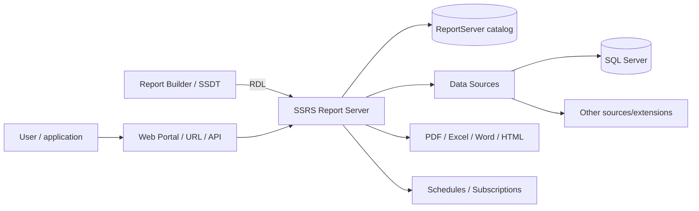
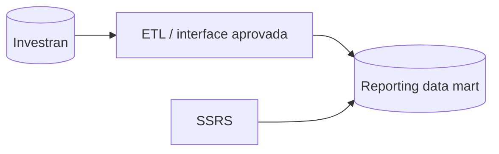
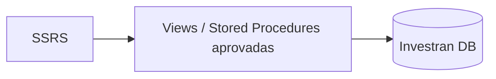
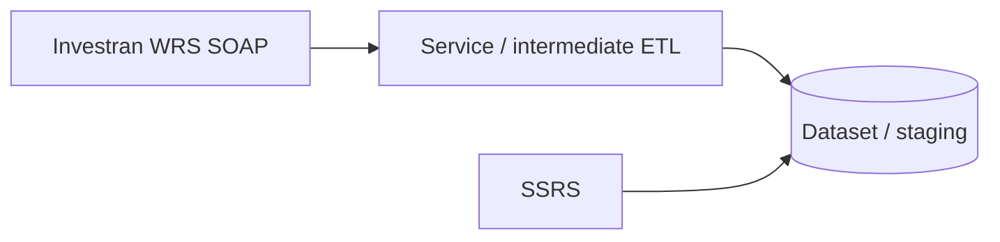

# Microsoft SQL Server Reporting Services (SSRS)

This document distinguishes **Microsoft SQL Server Reporting Services (SSRS)** from **Investran Web Reporting Services (WRS)** and describes safe ways to use it in the Investran ecosystem.

> None of the supplied Investran manuals confirms an official direct integration with SSRS. The patterns below are architectural options that must be validated with FIS, architecture, DBA, and security teams before implementation.

## What SSRS is

SSRS is Microsoft's reporting platform for creating, publishing, administering, and distributing paginated reports. An `.rdl` definition describes data sources, datasets/queries, parameters, expressions, and layout.

In Native Mode, Report Server stores reports, shared data sources, datasets, schedules, and subscriptions. Users can access content through the web portal, URL access, or integrated applications. The platform also provides SOAP Web Service and REST APIs for administration and integration.

## WRS is not SSRS

| Topic | Investran WRS | Microsoft SSRS |
|---|---|---|
| vendor | FIS/SunGard | Microsoft |
| main source | Report Wizard Engine | datasets/data sources configured in SSRS |
| report definition | RW report and possibly a Crystal `.rpt` | Report Definition Language `.rdl` |
| endpoint | WRS SOAP `FTIRWWS` | Report Server portal, URL access, SOAP, and REST |
| functional security | Contact, Relationship, Security Level, and Report Filter | Report Server roles/policies and data source credentials |
| distribution | XML, HTML, and PDF through the service/consumer | portal, export, subscriptions, email, and file share |
| typical use | exposing Investran reports with functional security | enterprise platform for paginated reports |

Do not apply one product's settings, logs, or runbooks to the other. Both may use concepts such as parameters, web services, and PDF, but they are independent stacks.

## SSRS architecture

Main components:

- **Report Server:** processes and renders reports;
- **Web Portal:** organizes content and allows it to be executed;
- **Report Builder/SSDT:** `.rdl` authoring;
- **Data Source:** connection and credentials;
- **Dataset:** query and fields;
- **ReportServer database:** catalog, configuration, and operational history;
- **Schedules/Subscriptions:** automated execution and delivery;
- **Web Service/REST/URL access:** programmatic interfaces.

## Possible patterns with Investran

### Pattern A - SSRS over a data mart or reporting layer

This is the most isolated pattern for analytics and enterprise distribution. It reduces SSRS coupling to the product's transactional schema.

Validate:

- latency and load frequency;
- reconciliation with Investran;
- lineage and ownership;
- security/masking;
- reprocessing;
- retention and history.

### Pattern B - SSRS over approved views or procedures

Use this only if FIS and the environment owners approve the objects and contract. Querying internal tables directly creates risks from schema changes, inconsistent reads, contention, and incorrect domain interpretation.

Minimum requirements:

- a dedicated read-only user;
- stable, documented objects;
- required parameters to limit scope;
- controlled timeout and volume;
- testing after upgrades/MRs;
- monitoring of blocking and duration.

### Pattern C - Intermediary application consuming WRS

An intermediary layer can execute authorized reports in WRS, transform XML, and persist a dataset that SSRS can consume. This preserves WRS publishing/security logic, but creates responsibilities for caching, identity, auditing, and refreshes.

Do not assume SSRS consumes the WRS endpoint directly without adaptation. Validate format, authentication, pagination, volume, timeout, and failure handling.

### Pattern D - SSRS for distributing an existing dataset

When another process already produces reconciled data, SSRS can handle only layout, parameters, export, and subscriptions.

This pattern is useful when calculations remain in Investran/RW and enterprise distribution needs SSRS capabilities.

## How to choose

| Need | Preferred component |
|---|---|
| execute an RW report while preserving Contact/Relationship/Report Filter | WRS |
| Crystal layout already associated with RW | RW + Crystal/WRS |
| enterprise `.rdl` portal | SSRS |
| email/file share subscriptions | SSRS |
| online integration with Investran functional security | WRS |
| enterprise report over a governed data mart | SSRS |
| Active Template or Allocation Rule consuming a report | Report Wizard |

WRS and SSRS can coexist. The choice depends on where calculations, authorization, data, and distribution reside.

## Develop an SSRS report

### 1. Define the contract

Record purpose, audience, source, granularity, parameters, SLA, format, and owner.

### 2. Create the Data Source

Prefer a shared data source when multiple reports use the same connection. Separate the connection from the `.rdl` definition to allow centralized maintenance.

Do not put passwords in the repository. Use the approved Report Server credential mechanism.

### 3. Create the Dataset

Use a parameterized query and return only required columns. Avoid `SELECT *`. Confirm types, cardinality, and duration.

### 4. Create Parameters

Define types, defaults, available values, dependencies, and handling of multiple values. Parameters must restrict data in the dataset, not merely hide rows in the layout.

### 5. Build the paginated layout

Use tablix, groups, headers/footers, expressions, and page breaks. Test PDF and Excel separately.

### 6. Publish

Publish `.rdl`, shared data sources, and datasets to the correct folder. Configure permissions and test with a non-administrative user.

### 7. Configure the subscription

Subscriptions execute and deliver reports on a schedule. Data-driven subscriptions can obtain recipients, parameter values, format, and delivery options from an external source, depending on edition/licensing.

### 8. Validate

- parameters and security;
- data and totals;
- PDF/Excel;
- timezone and schedule;
- delivery and recipients;
- volume and concurrency;
- execution logs.

## Programmatic interfaces

### URL access

Allows reports to be executed/browsed through a URL with a path and parameters. Use it for simple, controlled integration; do not put secrets in query strings.

### SOAP Web Service

Exposes Report Server functionality to applications and administrative tools. It is different from Investran WRS SOAP.

### REST API

Allows browsing the catalog and creating, updating, downloading, or deleting Report Server objects. Control permissions and avoid destructive automation without versioning.

## Security

Assess separately:

- access to the portal/folders/reports;
- credentials used by the Data Source;
- security in the query/view itself;
- parameters and filters;
- subscriptions and destinations;
- exported files;
- service accounts and encryption keys;
- TLS and Report Server URLs.

Permission to open a report does not automatically mean the source applies entity-level security like WRS. If the requirement is to restrict Legal Entity/Investor by user, explicitly implement and test that control.

## Operations and monitoring

Inventory:

- server/instance and version;
- Web Service and Web Portal URLs;
- ReportServer databases;
- service account;
- encryption key backup;
- folders, roles, and owners;
- shared data sources;
- schedules/subscriptions;
- SMTP/file shares;
- log retention;
- backup/restore and disaster recovery.

Monitor availability, execution failures, duration, queues, subscriptions, delivery, database, disk, memory, CPU, and certificates.

## Troubleshooting

| Symptom | Check |
|---|---|
| portal unavailable | service, URLs, certificate, HTTP.SYS, and logs |
| report opens but fails to execute | Data Source, credentials, query, and parameters |
| user sees an unauthorized report | folder/item permissions and inheritance |
| user sees unauthorized data | query, row-level security, and Data Source identity |
| subscription does not deliver | schedule, applicable SQL Agent, SMTP/share, and credentials |
| PDF is correct, Excel is poor | layout, merged cells, widths, and renderer |
| slow report | query, dataset, parameters, volume, expressions, and concurrency |
| works in the designer, fails on the server | version/extensions, Data Source, and Report Server permissions |
| differs from Investran | data mart/load, cutoff date, rules, and reconciliation |

## Publishing and rollback

Version `.rdl`, queries/procedures, shared datasets, and Data Source instructions without credentials.

Before deployment:

- export the published version;
- preserve the previous configuration;
- validate dependencies;
- publish to a lower environment;
- test users/roles;
- test subscriptions;
- define how to restore `.rdl` and data objects.

Reverting an `.rdl` does not automatically fix a procedure, view, Data Source, or subscription changed in the same release.

## KT questions

- Is SSRS present in the environment? Which version/edition?
- Which reports are related to Investran?
- Which integration pattern is used?
- Is the source a database, data mart, WRS, or another interface?
- Which users/service accounts and vaults are used?
- Where are `.rdl`, queries, and pipelines versioned?
- Which subscriptions are critical?
- How are Legal Entity/Investor security and reconciliation applied?
- What are the SLAs, volumes, windows, and runbooks?
- How are backup, restore, and rollback performed?

## References

- [Microsoft Learn - Reporting Services concepts](https://learn.microsoft.com/en-us/sql/reporting-services/reporting-services-concepts-ssrs?view=sql-server-ver17)
- [Microsoft Learn - Reporting Services reports](https://learn.microsoft.com/en-us/sql/reporting-services/reports/reporting-services-reports-ssrs?view=sql-server-ver17)
- [Microsoft Learn - Developer documentation](https://learn.microsoft.com/en-us/sql/reporting-services/reporting-services-developer-documentation?view=sql-server-ver17)
- [Microsoft Learn - URL access](https://learn.microsoft.com/en-us/sql/reporting-services/url-access-ssrs?view=sql-server-ver17)
- [Microsoft Learn - Supported data sources](https://learn.microsoft.com/en-us/sql/reporting-services/report-data/data-sources-supported-by-reporting-services-ssrs?view=sql-server-ver17)
- [Microsoft Learn - Data-driven subscriptions](https://learn.microsoft.com/en-us/sql/reporting-services/subscriptions/data-driven-subscriptions?view=sql-server-ver17)
