# Report Wizard - practical guide to development and use

This guide covers the lifecycle of a Report Wizard (RW) report: defining the contract, choosing data, configuring parameters, validating granularity, consuming the report in other tools, and diagnosing problems.

> The RW development guide is primarily technical and describes the INVDEV Library. Integration and layout screenshots come from the Crystal Reports Guidebook. Captions clearly identify which tool appears in each image.

## What Report Wizard does

Report Wizard queries the Investran data model using controlled metadata, organizes columns, filters, parameters, and time periods, and delivers a tabular result set.

This result can be used by users in RW, Crystal Reports, Active Templates, Allocation Rules, Web Reporting Services, and applications that use INVDEV/RWReport or OLE DB.

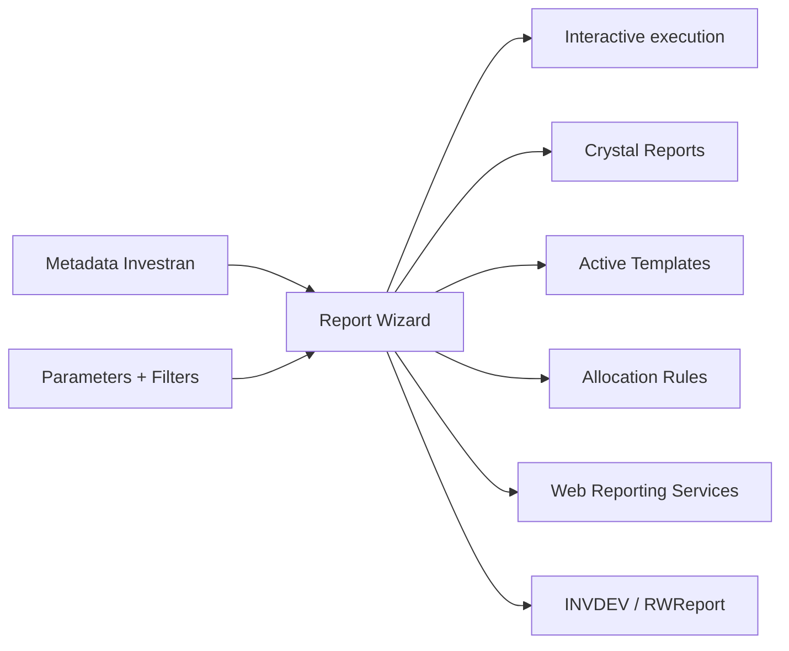

An RW report acts as a shared contract. Changing a name, column, type, order, parameter, or granularity can affect multiple consumers.

## Before creating or changing a report

Record:

- purpose, owner, and consumers;
- Book and name;
- what each row represents;
- required columns and types;
- filters and parameters;
- time periods;
- sorting, aggregation, and subtotals;
- expected volume and duration;
- output formats;
- approved baseline.

If you cannot complete the sentence “each row represents…”, you have not yet defined the granularity.

## Main elements

### Book

A Book is the folder that contains reports and participates in security and programmatic identification. A report belongs to a single Book.

Use stable names. Changing the Book/report can break references in Crystal, ATM, ARM, WRS, OLE DB, or `Reports.Item` calls.

### Columns

Each column has a name, heading, type, format, visibility, aggregation, filter, and possibly a time period.

Before adding a column, determine:

- whether it changes the granularity;
- whether it should return lookup text or an ID;
- whether it is displayed or only filters;
- whether it will be totaled;
- whether any consumer depends on its position;
- whether it needs a timeframe.

For ARM/ATM, order and type may be a mandatory part of the contract.

### Filters

Filters restrict results using fixed values or Parameters. Validate operators, `Null`, dates, lookup ID/text, and AND/OR. An incorrect filter can exclude data without producing an error.

### Parameters

Parameters are placeholders populated at runtime, with a name, type, lookup, default, and required/optional setting.

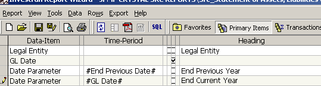

*Report Wizard screen with Parameters. The exact name is part of the contract with Crystal, ATM, ARM, and integrations. Source: Crystal Reports Guidebook, p. 30.*

Practical rules:

- meaningful, stable names;
- correct type and lookup;
- defaults that do not silently broaden the scope;
- the same name when automatic propagation is used;
- documented behavior for empty values, `Null`, and multiple selections.

### Time Periods

A Time Period defines a column's time window, such as LTD, YTD, MTD, or relative/absolute ranges. When diagnosing a discrepancy, confirm From/To, inclusive boundaries, and the date/time field used.

### Calculated Columns

Calculated Columns derive values from other columns. Test types, division by zero, `Null`, scale, and rounding. If logic is shared, avoid duplicating divergent formulas.

## Create a report step by step

### 1. Choose the Book and name

Create it in the correct Book, considering security, purpose, and consumers. Record the owner and dependencies.

### 2. Define the root entity and granularity

Start with the smallest set that can identify a row. Examples: one row per Investor, Position, Deal/Legal Entity, Transaction, or Investor/Closing Date.

### 3. Add Columns gradually

After each group of columns:

1. execute;
2. compare row counts;
3. look for duplicates;
4. validate IDs/text;
5. check totals;
6. explain any change in cardinality.

### 4. Configure Parameters and Filters

Define Parameters and associate them with filters. Test normal values, extremes, no data, defaults, empty values/`Null`, and multiple entities where supported.

### 5. Sorting, aggregation, and subtotals

Sorting must be deterministic when another process iterates through the rows. Aggregations must respect granularity and accounting meaning.

### 6. Validate independently

Before connecting to another component:

- run with real parameters;
- validate row count and duration;
- reconcile a sample;
- confirm columns, order, and types;
- export and review;
- compare against the baseline.

## Associate a Crystal layout

In Report Wizard, go to `Tools > Report Options` and associate the `.rpt` according to the environment's process.

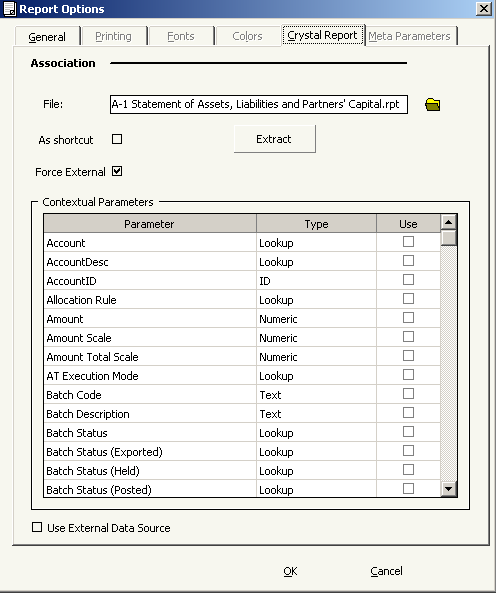

*RW Report Options with an associated Crystal file and Control Parameters. Source: Crystal Reports Guidebook, p. 34.*

Before associating it, validate RW, preserve the previous `.rpt`, and check parameters, connection, permissions, and the file path at the destination.

## How RW and Crystal work together

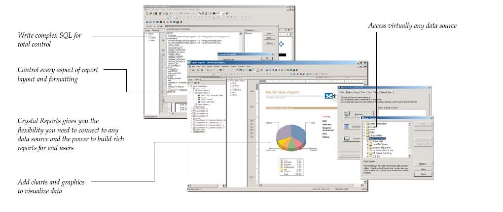

*RW supplies data; Crystal organizes layout, formulas, groups, and distribution. Source: Crystal Reports Guidebook, p. 4.*

| Responsibility | Main component |
|---|---|
| selection, filters, and granularity | Report Wizard |
| layout, sections, and pagination | Crystal Reports |
| presentation groups and formulas | Crystal Reports |
| web execution and distribution | WRS/consumer |

If the content is wrong, validate RW first. If the data is correct and the presentation is wrong, investigate Crystal.

## Connect Crystal to RW

### 1. Create the document

Open Crystal and choose the Crystal wizard or Blank Report.

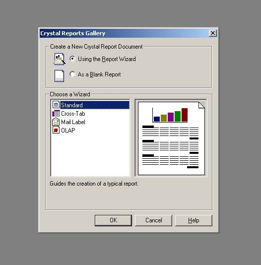

### 2. Open Database Expert

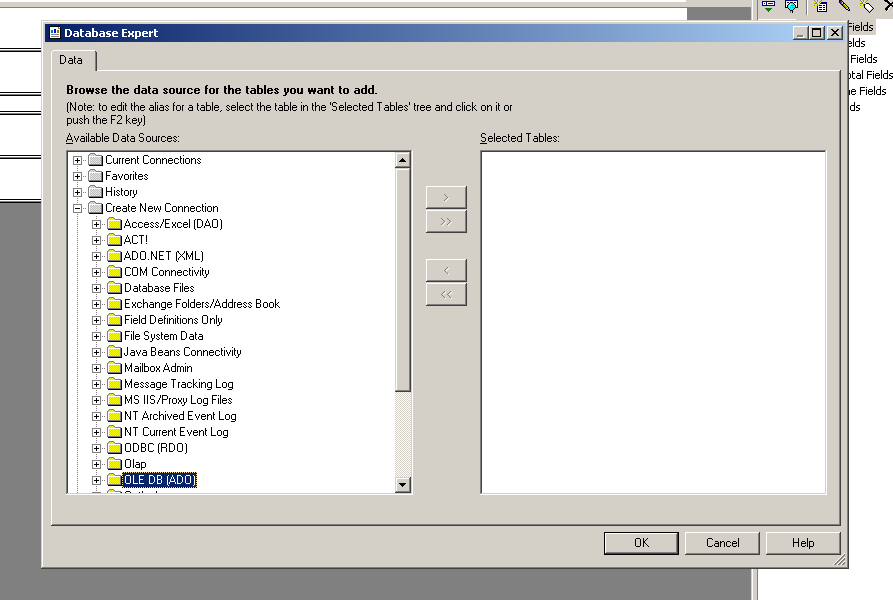

### 3. Select the provider

Choose the Investran RW OLE DB Provider compatible with the version.

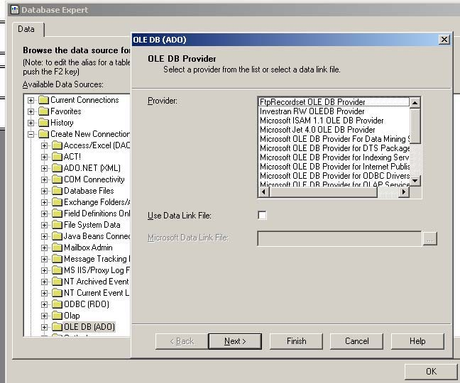

### 4. Enter connection details

Enter the Data Source, user, and database according to the environment's policy. Never save credentials in the documentation.

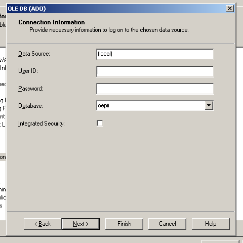

### 5. Add the Command/report

The guide uses `Add Command` to integrate RW results into Crystal. Confirm the Book, report, parameters, and control flags.

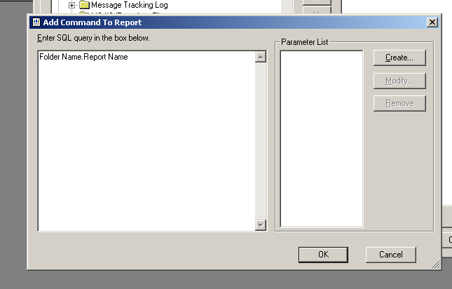

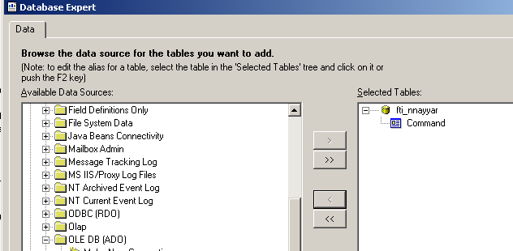

Crystal parameters must match RW parameters exactly. A different name or type can produce duplicate prompts or incorrect execution.

## Build and validate the layout

Drag fields into sections and configure groups, formulas, totals, and formatting.

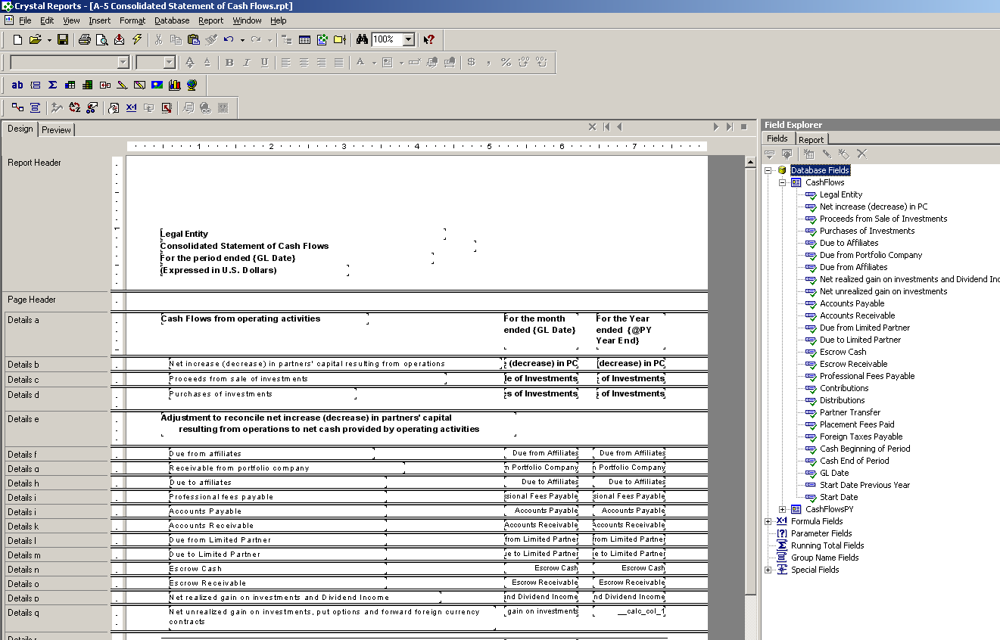

### Preview

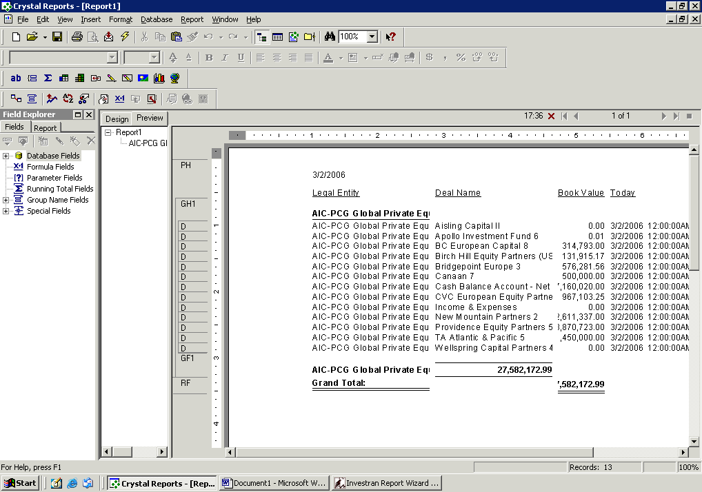

Validate headers, footers, pages, groups, subtotals, scales, dates, currencies, suppressions, headings, and representative volume.

### Formulas

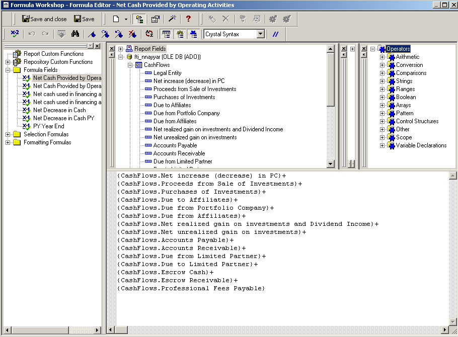

Test negative values, zero, `Null`, rounding, and types. Do not hide a correction in the layout when it should be made in RW.

### Export

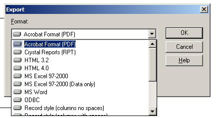

Test every required format. PDF, Excel, and CSV handle fonts, grids, dates, cells, and pagination differently.

## Multiple reports and subreports

Crystal can combine multiple RW reports.

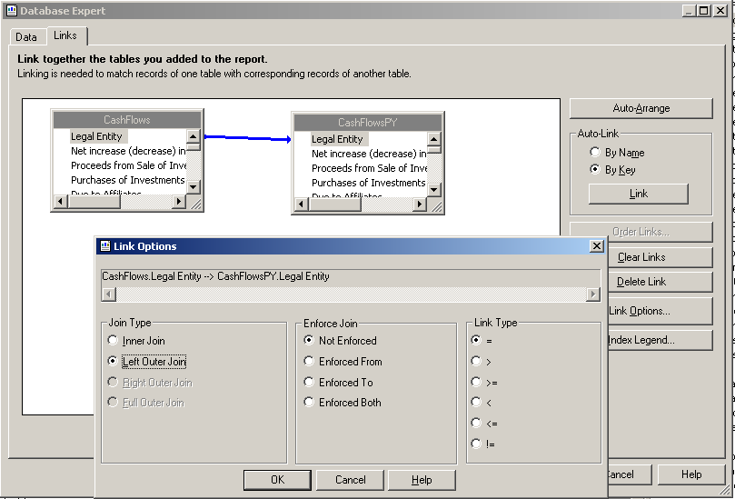

Confirm uniqueness, business key, join, row counts, and the absence of duplication/loss.

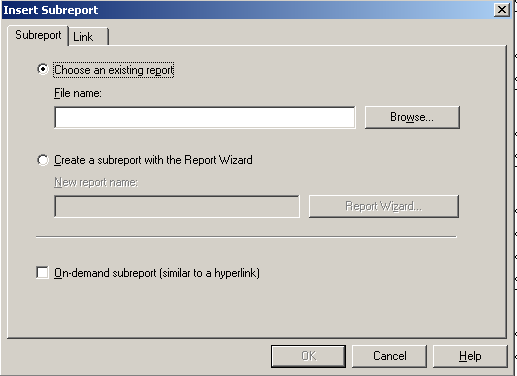

Subreports may execute a query for every row in the main report. Assess the performance impact.

## Change an RW report used by Crystal

When the RW driver changes, use `Database > Verify Database`.

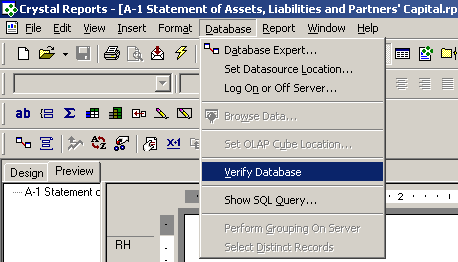

If fields have changed, Crystal may request mapping.

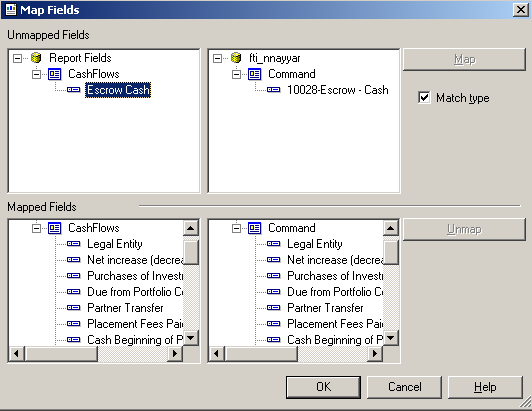

After the change:

1. run RW independently;
2. confirm columns, types, and order;
3. run Verify Database;
4. map only equivalent fields;
5. review formulas, groups, suppressions, and links;
6. run Preview and export;
7. test in the final consumer.

Do not map by name similarity; confirm semantics, type, granularity, and unit.

## Programmatic execution

### INVDEV Library

Conceptual flow:

1. `Login` tests the connection;
2. `Connection` establishes the session and metadata;
3. `Metadata` locates Books/reports;
4. `Report` loads the definition, parameters, and columns;
5. the application assigns values and executes;
6. it consumes the resultset;
7. it releases metadata and objects.

### RWReport wrapper

`RWReport` simplifies finding the Book/report, assigning `Parameter(name)`, executing `Run`, querying `Rows`/`Cols`, and reading `Cell`, `ColIndex`, `ColType`, and `ColTotal`.

Do not share Report Wizard objects across threads. Use one instance per execution/thread as specified in the manual.

## Performance

Investigate in this order:

1. scope and parameters;
2. filters applied early;
3. granularity;
4. unnecessary columns;
5. multiplication caused by joins;
6. calculated fields/time periods;
7. multiple reports/subreports;
8. formatting/export;
9. infrastructure/database.

Risks: reports without required filters, unnecessary lookup text, repetitive subreports, layouts grouping excessive volume, and cardinality that grows after adding a column.

## Publishing and rollback

A release may include the RW definition, parameters/metadata, `.rpt`, WRS, connection/provider, consumers, permissions, and baseline.

Before promoting:

- preserve previous versions;
- inventory consumers;
- validate IDs/names at the destination;
- test the connection without exposing credentials;
- run RW independently;
- test Crystal/WRS/ATM/ARM as applicable;
- validate exports;
- define rollback for the complete set.

## Troubleshooting by symptom

| Symptom | First check |
|---|---|
| no rows | parameters, filters, data, and security |
| duplicates | granularity and joins |
| incorrect total | cardinality, aggregation, and formulas |
| parameter does not reach the report | name and type in RW/consumer |
| works in RW, fails in Crystal | provider, command, parameters, and Verify Database |
| field disappeared | driver changes and Map Fields |
| works locally, fails in WRS | publishing, identity, security, and format |
| discrepancies in ATM/ARM | context, cache, ID/text, and column order |
| takes too long | scope, joins, volume, subreports, and infrastructure |
| incorrect PDF/Excel | format rules and Crystal layout |

## Quick checklist

- [ ] contract and granularity defined;
- [ ] Book, name, and security confirmed;
- [ ] columns added gradually;
- [ ] parameters, filters, and time periods tested;
- [ ] row count, totals, and sample reconciled;
- [ ] consumers inventoried;
- [ ] Verify Database run, if applicable;
- [ ] Preview and exports tested;
- [ ] performance validated with realistic volume;
- [ ] rollback preserved;
- [ ] testing in the final consumer completed.

## Sources

- *Internal_Inv7_INV_RW_Dev_Guide_7.pdf* - INVDEV, Report, Column, ParameterSet, TimePeriod, `RWReport`, and programmatic execution.
- *Crystal Reports Guidebook.pdf* - RW/Crystal integration, OLE DB, parameters, layout, links, subreports, Verify Database, and export.
