# Web Reporting Services - practical administration and integration guide

This guide introduces **Investran Web Reporting Services (WRS)**: architecture, installation, configuration, security, report publishing, and SOAP API consumption.

> In this context, Reporting Services means Investran WRS, not Microsoft SQL Server Reporting Services (SSRS). The screens belong to Investran 7 as documented in 2014; validate the version, TLS, IIS, and procedures in the current environment.

If the environment also uses the Microsoft platform, see [Microsoft SQL Server Reporting Services](04-microsoft-ssrs.md) to understand differences, coexistence, and possible integration patterns with Investran.

## What WRS does

WRS exposes Report Wizard reports to Data Exchange and custom applications. The consumer discovers published reports, obtains parameters, and requests results in XML, HTML, or PDF.

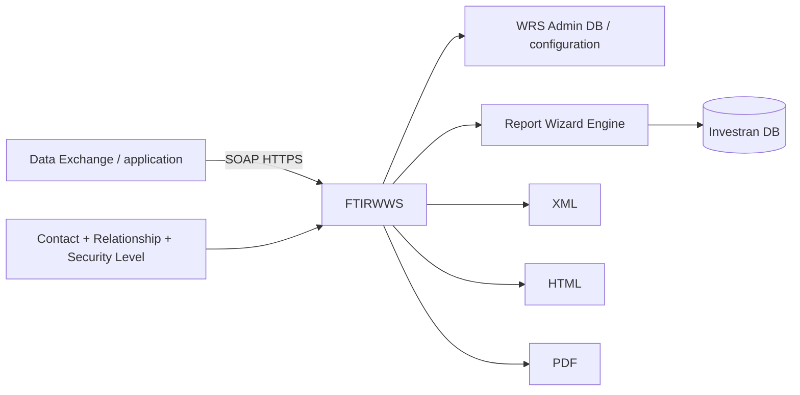

WRS does not create reports. A report is developed in Report Wizard and published to WRS with filters and security levels.

## Components

| Component | Responsibility |
|---|---|
| IIS | host the endpoint and web components |
| `FTIRWWS` | SOAP execution interface |
| WRS Configuration Tool | maintain Investran companies/connections |
| WRS Configuration Editor | configure URL, port, protocol, and Data Exchange |
| WRS Admin database | store administrative configuration |
| Investran database | data, reports, Contacts, and security |
| Report Wizard | develop and publish reports |
| Data Exchange | register users and consume reports |

## Installation flow

The manual describes this order:

1. prepare IIS;
2. configure Investran;
3. create the WRS Admin database;
4. prepare the service/database user;
5. install components;
6. configure connections;
7. configure Data Exchange;
8. register Contacts, Relationships, and security levels;
9. publish and test a report.

Do not install directly in production without a backup, approved change, and rollback plan.

## Prepare IIS

The old guide requires ASP and ISAPI extensions. These settings have security implications and must be validated against current policy.

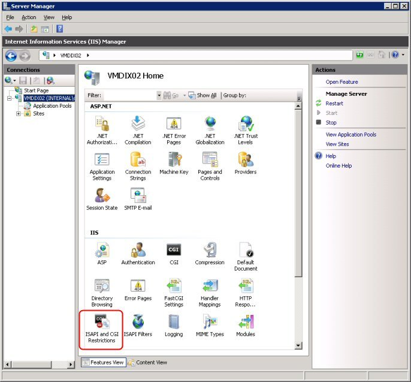

*IIS area used to enable ASP/ISAPI features. Source: WRS Installation and Administration Guide, p. 3.*

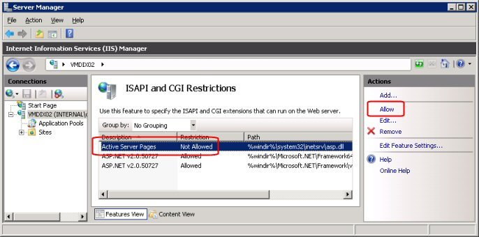

*ISAPI/CGI restrictions in IIS. Source: WRS guide, p. 4.*

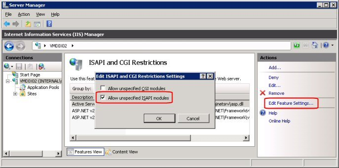

*Historical Allow unspecified ISAPI modules setting. Do not enable it without security approval. Source: WRS guide, p. 4.*

Modern checklist:

- Windows/IIS supported by the installed version;
- correct application pool and bitness;
- identity and minimum permissions;
- HTTPS and a valid certificate;
- approved protocols/ciphers;
- firewall and bindings;
- consistent authentication;
- IIS logs enabled;
- endpoint health check.

## Configure Investran and licensing

The manual mentions `UseERW=1` in `Inv_SysConfiguration` and license/feature configuration. Do not modify the table directly without an approved procedure.

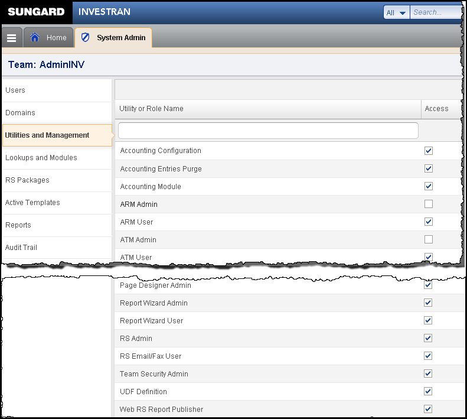

*Historical administration/licensing screen related to WRS. Source: WRS guide, p. 6.*

Also confirm:

- the database is the correct Master;
- RW reports exist;
- Contact and security features are available;
- the service account has the minimum required access;
- a backup of the WRS Admin DB and configuration exists.

## Install WRS components

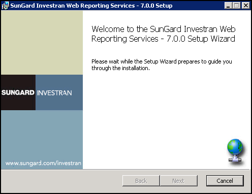

*Start of the WRS installer. Source: WRS guide, p. 7.*

The installer requests the website/virtual directory and destination folder.

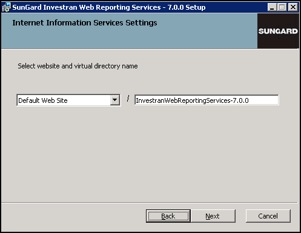

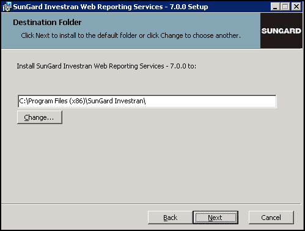

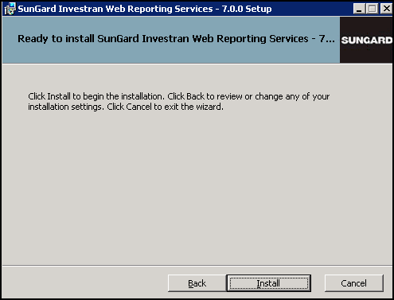

Record in the runbook:

- version and package;
- server and website;
- virtual directory/path;
- application pool;
- physical folder;
- configuration files;
- services/accounts;
- certificates;
- prerequisites;
- installer log;
- rollback.

## Configure companies and connections

The WRS Configuration Tool maintains connections to Investran databases.

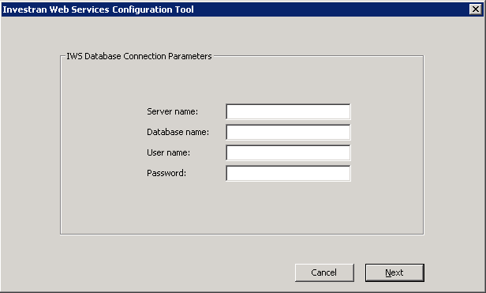

Register Company Name, server, database, and credentials according to the vault/policy. Use `Test Connection`, save, then reopen to confirm persistence.

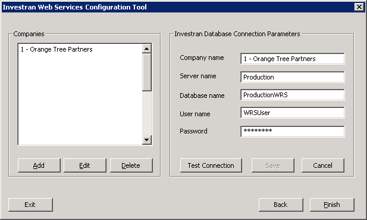

Never document passwords. Record only the credential owner, vault, rotation, permissions, and recovery procedure.

## Configure Data Exchange

In Data Exchange, the WRS Configuration area opens the configuration editor.

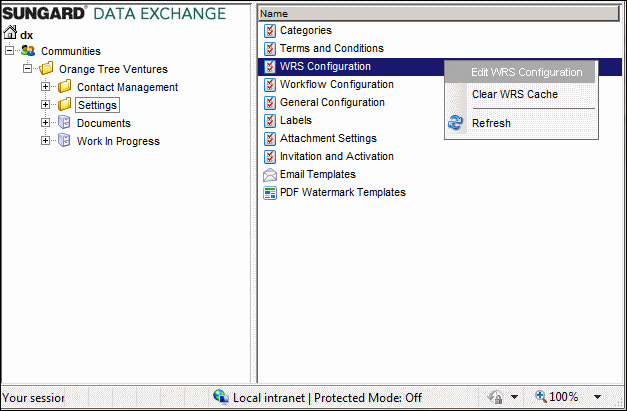

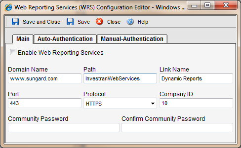

Relevant values:

- Enable Web Reporting Services;
- Domain Name;
- Path;
- Link Name;
- Port;
- Protocol HTTP/HTTPS;
- Company ID;
- configured authentication.

The manual requires a hostname matching the certificate for SSL and does not accept an IP address in Domain Name in this flow. Prefer HTTPS.

## Security model

Effective access depends on the combination:

```text
Contact enabled for Web Services
+ Relationship with Legal Entity / Investor / Specific Investor
+ Security Level assigned to the relationship
+ Security Level assigned to the report
+ Compatible Report Filter
= visible report and filtered data
```

### Create Security Levels

In Investran Web, the Investran Web Reporting Services area maintains security levels.

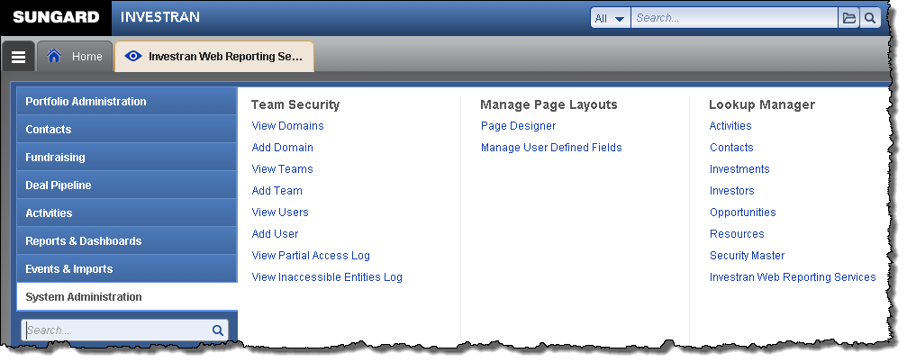

Use names that represent the audience/purpose. Document which reports each level grants access to.

### Enable the Contact

Select `Web Services Enabled` on the authorized Contact.

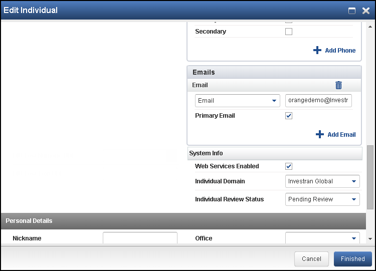

Enabling the Contact alone does not grant sufficient access: relationships and security levels are also required.

### Define Relationships and Roles

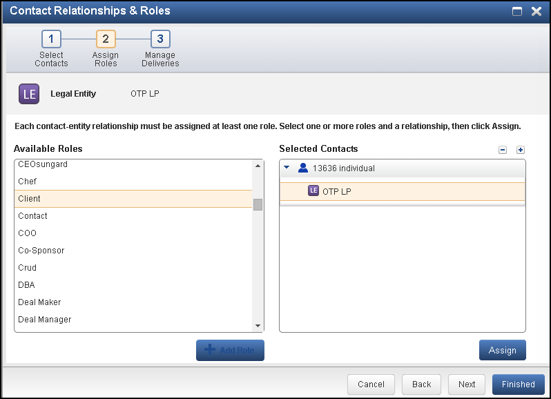

The relationship defines the entity context to which the Contact belongs. Then associate the appropriate security levels.

### Create a user in Data Exchange

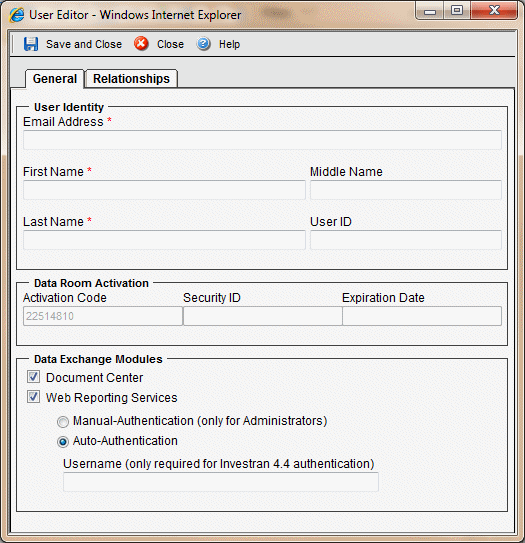

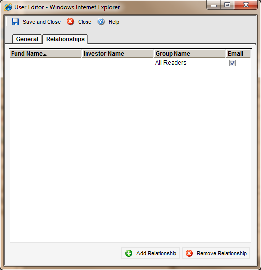

Record invitation/activation, email, roles, relationships, expiration, and the revocation process. Test with a representative user and least privilege.

## Publish a report in WRS

In Report Wizard, open the report's WRS settings.

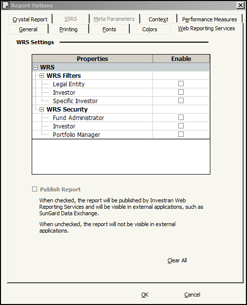

Configure:

1. Report Filter: Legal Entity, Investor, Specific Investor, or All;
2. permitted Security Levels;
3. `Publish Report`;
4. applicable formats;
5. parameters and associated Crystal report, if any.

After publishing, the report appears identified as Published.

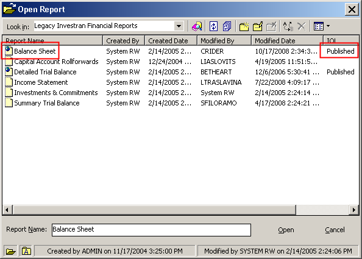

Test with Contacts with different profiles. An administrative account does not demonstrate that relationship filtering works.

## Understand Report Filter

Report Filter controls how the Contact context restricts output. The manual's matrix combines Contact Relationship, Report Filter, and Report Output Level.

Principles:

- Legal Entity: output in the context of related Legal Entities;
- Investor: output at the related Investor level;
- Specific Investor: a more specific scope;
- All: requires special attention because it can broaden visibility;
- incompatible combinations may prevent selection or execution.

Before publishing, document examples of what users “should see” and “should not see”.

## Consume the SOAP API

The historical endpoint uses `FTIRWWS.dll?Handler=Default`. Confirm the actual URL, HTTPS, authentication, and version in the environment.

Recommended sequence:

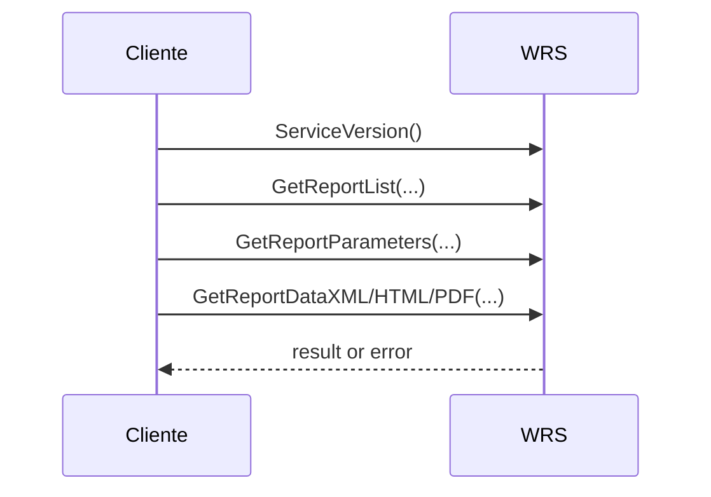

### Main methods

| Method | Purpose |
|---|---|
| `ServiceVersion` | get the service version |
| `GetReportList` | list available Books/reports and formats |
| `GetReportParameters` | get required parameters |
| `GetReportDataXML` | execute and return XML |
| `GetReportDataHTML` | execute and return HTML |
| `GetReportDataHTMLLocalizedDate` | HTML with the selected date format |
| `GetReportDataHTMLFirstPage` | start paginated HTML and obtain the Process ID |
| subsequent-page methods | retrieve other pages using the Process ID |
| `GetReportDataPDF` | execute and return PDF |

Use the name/ID returned by the service. Do not assume that the Book, report, or parameter is unchanged across environments.

## Execution identities

The guide distinguishes between:

- SQL credentials associated with technical access;
- the email of an Investran Contact enabled for WRS.

With a Contact, security levels, relationships, and filters can be applied. With a technical identity, security behavior may differ. Do not substitute one identity for the other without analyzing the authorization impact.

Never record passwords in logs, examples, tickets, or the repository.

## Output formats

### XML

Suitable for structured integration. Validate encoding, `colname`, `coltype`, `Null`, dates, lookup text/ID, and volume.

### HTML

May return the body and separate header/page header/page footer information. Test image paths, CSS, encoding, and pagination.

### PDF

Suitable for a final document. Validate fonts, images, orientation, size, pagination, and server memory.

Use `GetReportList` to confirm which formats the report actually offers.

## Logs and monitoring

Correlate:

- timestamp and timezone;
- endpoint/Company ID;
- Contact or technical identity, without secrets;
- Book/report;
- sanitized parameters;
- format;
- duration;
- size/rows/pages;
- HTTP/SOAP error;
- IIS request ID and Process ID, where available.

Monitor availability, latency, error rate, volume, queue/concurrency, memory consumption, certificates, application pool, and database connections.

## Troubleshooting

### Endpoint unavailable

1. DNS, port, and firewall;
2. certificate and HTTPS binding;
3. website/application pool;
4. virtual directory/path;
5. modules/handlers;
6. IIS logs and Event Viewer.

### `ServiceVersion` works, report fails

1. Company ID/connection;
2. database and account;
3. published Book/report;
4. parameters;
5. Contact/security/filter;
6. standalone Report Wizard;
7. associated Crystal report, if applicable.

### Report does not appear

Confirm `Publish Report`, the report's security level, enabled Contact, relationship, relationship security level, and Report Filter.

### User sees too much data

Treat this as a security incident. Suspend access/publication according to procedure and immediately review the Contact, relationships, security levels, and Report Filter.

### XML works, PDF/HTML fails

Investigate Crystal/layout, images, fonts, paths, permissions, memory, and the enabled format.

### Timeout or slow performance

Run RW independently, restrict parameters, and check volume, Crystal/subreports, concurrency, database, and application pool.

## Changes and rollback

A WRS change may involve IIS, certificates, configuration, Company connection, database, Contact/security, RW report, and Crystal.

Before deployment:

- export approved configurations;
- preserve files and databases;
- record bindings/certificates;
- test in a lower environment;
- define smoke tests;
- determine the owner and window;
- plan rollback for every layer.

Minimum smoke test:

1. `ServiceVersion`;
2. list reports;
3. obtain parameters;
4. execute a small report in XML;
5. execute HTML/PDF as applicable;
6. test an authorized Contact;
7. test an unauthorized Contact;
8. check logs and latency.

## Quick checklist

- [ ] healthy endpoint, certificate, and IIS;
- [ ] Company ID and connection validated;
- [ ] account and rotation documented without a password;
- [ ] Contact enabled;
- [ ] correct relationships/security levels;
- [ ] report published with an appropriate filter;
- [ ] parameters obtained dynamically;
- [ ] XML/HTML/PDF tested according to usage;
- [ ] positive and negative security tests validated;
- [ ] logs and correlation available;
- [ ] backup and rollback defined.

## Sources

- *Internal_Inv7_INV_WRS_Install-Admin_7.pdf* - installation, configuration, users, security, publishing, and output matrix.
- *Internal_Inv7_InWRS_API_Guide.pdf* - SOAP endpoint, methods, parameters, and formats.
